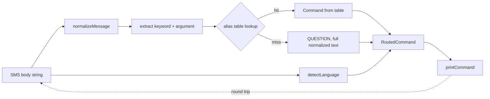

# Design Document

## Overview

The Command_Router is a small set of pure, synchronous TypeScript functions in `packages/brain`. It turns an SMS body into a `RoutedCommand` (`command`, `argument`, `language`, `argumentMissing`). It has no dependencies, no I/O, no clock and no randomness, so the Android app and the web Ouija simulator can both call it.

Public API (re-exported from `packages/brain/src/index.ts`):

- `routeCommand(input: string): RoutedCommand`
- `detectLanguage(input: string): Language`
- `printCommand(cmd: RoutedCommand): string`
- `normalizeMessage(input: string): string`
- Types `Command`, `Language`, `RoutedCommand`

Key design decisions:

1. **Normalize once, route on tokens.** Normalization is NFKC, trim, then collapse every `\s+` run to one space. The keyword is the first token, and the argument is everything after the first space. Because normalization is idempotent, routing the normalized message equals routing the original (Req 2.7).
2. **Decide on the first token only.** This makes "STOP always wins" structural. The tail is never inspected for STOP, so no tail content can override it (Req 4).
3. **One alias table.** A single frozen `ReadonlyMap<string, Command>` holds English, Roman Urdu and Urdu script aliases. Lookup is a case-folded exact match.
4. **`detectLanguage` normalizes internally.** It applies `normalizeMessage` first. Without this, NFKC could change language (for example fullwidth `ｋｙａ` becomes `kya`), and `route(normalize(s))` would differ from `route(s)`. The router calls `detectLanguage(input)`, so Req 6.8 holds by construction.
5. **No regex backtracking risk.** Splitting uses `indexOf(' ')` on the normalized string. The only regexes are linear, `/\s+/g` and a character-class strip. Inputs over 10,000 characters are handled the same way, in linear time (Req 8.6, 8.7).

Research notes: `String.prototype.normalize('NFKC')` is built into ECMAScript, does not throw on lone surrogates, and is idempotent per the Unicode spec ([MDN: String.prototype.normalize](https://developer.mozilla.org/en-US/docs/Web/JavaScript/Reference/Global_Objects/String/normalize)). JavaScript `\s` covers tab, newline, NBSP, U+FEFF and Unicode space separators, which fits Req 2.3. `fast-check` supplies `fc.string`, `fc.fullUnicodeString` and `fc.constantFrom` for the generators ([fast-check docs](https://fast-check.dev/docs/core-blocks/arbitraries/)).

## Architecture



Module layout in `packages/brain/src/`:

| File | Responsibility |
| --- | --- |
| `router.types.ts` | `Command`, `Language`, `RoutedCommand`, `COMMANDS`, `LANGUAGES` |
| `normalize.ts` | `normalizeMessage` |
| `aliases.ts` | `ALIAS_TABLE`, `ROMAN_URDU_ALIASES`, `ENGLISH_KEYWORD` map |
| `language.ts` | `detectLanguage`, `ROMAN_URDU_MARKERS`, `URDU_SCRIPT_RANGES` |
| `router.ts` | `routeCommand` |
| `printer.ts` | `printCommand` |
| `router.*.test.ts` | Vitest unit and property tests |

`index.ts` gains `export * from './router.types.js'` plus the named exports above, following the existing `.js` suffix convention in the package.

## Components and Interfaces

```ts
// router.types.ts
export const COMMANDS = [
  'HELP', 'STOP', 'START', 'SCAM', 'REMIND', 'TRANSLATE', 'QUESTION',
] as const;
export type Command = (typeof COMMANDS)[number];

export const LANGUAGES = ['en', 'ur', 'roman-ur'] as const;
export type Language = (typeof LANGUAGES)[number];

export interface RoutedCommand {
  readonly command: Command;
  readonly argument: string;
  readonly language: Language;
  readonly argumentMissing: boolean;
}
```

```ts
// normalize.ts
/** NFKC, trim, collapse every whitespace run to one space. Idempotent. */
export function normalizeMessage(input: string): string {
  return input.normalize('NFKC').replace(/\s+/g, ' ').trim();
}
```

`replace` then `trim` gives the same result as trim then replace. A final `trim` also removes the single leading or trailing space left by collapsing.

```ts
// aliases.ts
export const ALIAS_TABLE: ReadonlyMap<string, Command> = new Map([
  ['help', 'HELP'], ['stop', 'STOP'], ['start', 'START'],
  ['scam', 'SCAM'], ['remind', 'REMIND'], ['translate', 'TRANSLATE'],
  ['madad', 'HELP'], ['band', 'STOP'], ['shuru', 'START'],
  ['dhoka', 'SCAM'], ['yaad', 'REMIND'], ['tarjuma', 'TRANSLATE'],
  ['مدد', 'HELP'], ['بند', 'STOP'], ['شروع', 'START'],
  ['دھوکہ', 'SCAM'], ['یاد', 'REMIND'], ['ترجمہ', 'TRANSLATE'],
]);

export const ROMAN_URDU_ALIASES: ReadonlySet<string> =
  new Set(['madad', 'band', 'shuru', 'dhoka', 'yaad', 'tarjuma']);

/** Canonical English keyword used by the printer. */
export const ENGLISH_KEYWORD: Readonly<Record<Exclude<Command, 'QUESTION'>, string>> = {
  HELP: 'HELP', STOP: 'STOP', START: 'START',
  SCAM: 'SCAM', REMIND: 'REMIND', TRANSLATE: 'TRANSLATE',
};
```

```ts
// router.ts
const TRAILING_PUNCT = /[.,!?:;]+$/;
const ARG_REQUIRED: ReadonlySet<Command> = new Set(['SCAM', 'REMIND', 'TRANSLATE']);

export function routeCommand(input: string): RoutedCommand {
  const text = normalizeMessage(input);
  const language = detectLanguage(input);
  const space = text.indexOf(' ');
  const token = space === -1 ? text : text.slice(0, space);
  const rest = space === -1 ? '' : text.slice(space + 1);
  const keyword = token.replace(TRAILING_PUNCT, '').toLowerCase();
  const command = ALIAS_TABLE.get(keyword);
  if (command === undefined) {
    return { command: 'QUESTION', argument: text, language, argumentMissing: false };
  }
  return {
    command, argument: rest, language,
    argumentMissing: ARG_REQUIRED.has(command) && rest === '',
  };
}
```

Notes:

- `text` is already trimmed, so `rest` needs no further trim. It keeps case, digits, punctuation and Urdu script as is (Req 5.7).
- A token made only of punctuation (`"!!!"`) strips to `''`, which is not in the table, so it routes to QUESTION with the full text.
- `toLowerCase()` leaves Urdu script unchanged, so one lookup handles all three alias families.
- An empty `text` gives an empty token, a miss, and `QUESTION` with `''` (Req 1.2, 2.5, 4.7).

```ts
// language.ts
export function detectLanguage(input: string): Language {
  const text = normalizeMessage(input);
  if (URDU_RE.test(text)) return 'ur';
  const words = text.split(' ').filter(isLatinWord).map(stripEdgePunct).map(lower);
  if (words.length === 0) return 'en';
  if (ROMAN_URDU_ALIASES.has(words[0])) return 'roman-ur';
  return words.some((w) => ROMAN_URDU_MARKERS.has(w)) ? 'roman-ur' : 'en';
}
```

- `URDU_RE = /[\u0600-\u06FF\u0750-\u077F\uFB50-\uFDFF\uFE70-\uFEFF]/`.
- `isLatinWord` accepts a token made only of ASCII letters, digits and ASCII punctuation (`/^[\x21-\x7E]+$/`).
- `stripEdgePunct` removes leading and trailing ASCII punctuation, so `kya?` matches `kya`. Matching is on whole tokens, so a marker inside a longer word, or next to non-ASCII letters, does not match (Req 6.7).
- `ROMAN_URDU_MARKERS` is a frozen `ReadonlySet<string>`. Initial content: `kya, hai, hain, mein, main, kaise, kaisa, nahi, nahin, aap, meri, mera, mere, karo, kar, ka, ki, ke, ko, se, ho, hoga, chahiye, kab, kahan, kyun, kitna, bhai, shukriya, acha`. Short, ambiguous English words (`me`, `so`, `to`, `is`) are excluded to avoid false positives. The list is a constant and can be extended without changing the algorithm.

```ts
// printer.ts
export function printCommand(cmd: RoutedCommand): string {
  if (cmd.command === 'QUESTION') return cmd.argument;
  const keyword = ENGLISH_KEYWORD[cmd.command];
  return cmd.argument === '' ? keyword : `${keyword} ${cmd.argument}`;
}
```

## Data Models

| Type | Shape | Invariants |
| --- | --- | --- |
| `Command` | union of 7 string literals | exactly one per result |
| `Language` | `'en' \| 'ur' \| 'roman-ur'` | exactly one per result |
| `RoutedCommand` | `{ command, argument, language, argumentMissing }`, all `readonly` | exactly these 4 keys; `argumentMissing` is true only for SCAM, REMIND or TRANSLATE with an empty argument; `argument` is normalized (no leading, trailing or repeated whitespace) |
| `ALIAS_TABLE` | `ReadonlyMap<string, Command>` | keys lowercase; 18 entries; no QUESTION value |

## Correctness Properties

*A property is a characteristic or behavior that should hold true across all valid executions of a system-essentially, a formal statement about what the system should do. Properties serve as the bridge between human-readable specifications and machine-verifiable correctness guarantees.*

Reflection: criteria 2.1 to 2.4, 2.6, 3.1, 3.9, 5.1 to 5.3 and 5.7 all describe one alias-dispatch behavior, so they are merged into Property 3. Criteria 4.1 to 4.4 and 3.11 are merged into Property 5. Criteria 1.5 and 8.2 are merged into Property 2. Criteria 5.4 to 5.6 are one iff, Property 7. Criteria 6.2, 6.5 and 6.6 are merged into Property 9.

### Property 1: Routing is total and well-formed

*For any* string, including empty, whitespace-only, non-ASCII, astral and lone-surrogate strings and strings longer than 10,000 characters, `routeCommand` does not throw and returns an object with exactly the keys `command`, `argument`, `language` and `argumentMissing`, where `command` is one of the 7 Commands, and where whitespace-only or empty input gives `QUESTION` with an empty argument.

**Validates: Requirements 1.1, 1.2, 1.6, 2.5, 4.7, 7.1, 8.7, 9.1**

### Property 2: Routing is deterministic

*For any* string, two calls to `routeCommand` return deeply equal results.

**Validates: Requirements 1.5, 8.2**

### Property 3: Alias dispatch with tolerant formatting

*For any* alias in the Alias_Table, any letter-case variation of it, any run (zero or more) of the punctuation characters `. , ! ? : ;` after it, any non-empty whitespace separator (spaces, tabs, newlines) and any tail string, `routeCommand` returns the alias's mapped Command and an argument equal to `normalizeMessage(tail)`.

**Validates: Requirements 1.4, 2.1, 2.2, 2.3, 2.4, 2.6, 3.1, 3.9, 5.1, 5.2, 5.3, 5.7**

### Property 4: Unknown keyword routes to QUESTION

*For any* string whose first token, after stripping trailing `. , ! ? :  ;` and lowercasing, is not in the Alias_Table, `routeCommand` returns `QUESTION` with the argument equal to the normalized message.

**Validates: Requirements 1.3, 3.10**

### Property 5: STOP always wins

*For any* STOP alias (`stop`, `band`, `بند`), any letter case, any leading whitespace and any tail of up to 1,600 characters (including tails made of other command keywords), `routeCommand` returns `STOP`.

**Validates: Requirements 3.11, 4.1, 4.2, 4.3, 4.4, 9.2**

### Property 6: A non-leading `stop` does not trigger STOP

*For any* first token that is not a STOP alias and any tail containing the token `stop`, `routeCommand` does not return `STOP`.

**Validates: Requirements 4.5**

### Property 7: argumentMissing reflects empty required arguments

*For any* string, `argumentMissing` is true if and only if the Command is SCAM, REMIND or TRANSLATE and the argument is the empty string.

**Validates: Requirements 5.4, 5.5, 5.6**

### Property 8: Normalization is idempotent and routing-invariant

*For any* string `s`, `normalizeMessage(normalizeMessage(s))` equals `normalizeMessage(s)`, and `routeCommand(normalizeMessage(s))` deeply equals `routeCommand(s)`.

**Validates: Requirements 2.7**

### Property 9: Urdu script implies `ur`

*For any* string containing at least one Urdu_Script_Character, `detectLanguage` returns `ur`.

**Validates: Requirements 6.1**

### Property 10: Roman Urdu markers imply `roman-ur`

*For any* string with no Urdu_Script_Character that contains, as a whole space-delimited Latin_Word with optional edge punctuation and in any letter case, a Roman_Urdu_Marker, or whose first Latin_Word is a Roman Urdu Alias, `detectLanguage` returns `roman-ur`.

**Validates: Requirements 6.2, 6.5, 6.6**

### Property 11: No Urdu and no marker implies `en`

*For any* string with no Urdu_Script_Character whose Latin_Words are all outside the Roman_Urdu_Marker_List and the Roman Urdu Alias set, and for any whitespace-only string, `detectLanguage` returns `en`; in particular a marker embedded inside a longer word does not count.

**Validates: Requirements 6.3, 6.4, 6.7**

### Property 12: Language detection is total and deterministic

*For any* string, `detectLanguage` does not throw, returns exactly one of `en`, `ur` or `roman-ur`, and returns the same value on a second call.

**Validates: Requirements 6.9, 9.3**

### Property 13: Router language matches the detector

*For any* string, `routeCommand(s).language` equals `detectLanguage(s)`.

**Validates: Requirements 6.8**

### Property 14: Print/route round trip

*For any* string `s` whose routed result `r` has a Command other than QUESTION, `routeCommand(printCommand(r))` has the same `command` and `argument` as `r`, and `printCommand(r)` has no trailing space when `r.argument` is empty.

**Validates: Requirements 7.3, 7.4, 7.5**

### Property 15: Printing QUESTION is the identity on the argument

*For any* argument string, `printCommand({ command: 'QUESTION', argument, language, argumentMissing: false })` returns `argument` unchanged.

**Validates: Requirements 7.6**

## Error Handling

The router has no error channel. It is total, and every input maps to a valid result.

| Situation | Behavior |
| --- | --- |
| Empty or whitespace-only input | `QUESTION`, empty argument, `en` |
| Lone surrogates or astral characters | `normalize('NFKC')` does not throw; treated as ordinary characters |
| Command keyword with no argument (SCAM, REMIND, TRANSLATE) | Same command, empty argument, `argumentMissing: true`. The caller replies with a usage hint |
| Keyword with punctuation only (`"?!"`) | `QUESTION` with the text as the argument |
| Input over 10,000 characters | Processed in linear time with no truncation; the SMS layer decides how to handle long questions |
| Non-string input at runtime (JS callers) | Out of scope: the signature is `string` under strict TypeScript |

Downstream components must handle `argumentMissing` and must not treat a `REMIND` argument as a parsed time. REMIND time parsing belongs to a later feature.

## Testing Strategy

The core logic is pure, so it is tested with both example tests and property tests.

**Tooling:** Vitest and `fast-check`. No custom property-testing code. A shared `numRuns: 100` minimum is set in each `fc.assert` call (use 200 for Properties 1, 3 and 5). Vitest exits non-zero on failure, and fast-check prints the seed and shrunk counterexample on property failures (Req 9.6).

**Property tests** (one test per property, in `router.property.test.ts`, `language.property.test.ts` and `printer.property.test.ts`). Each carries a tag comment, for example `// Feature: brain-command-router, Property 5: STOP always wins`.

Generators in `router.arbitraries.ts`:

- `anyText`: `fc.oneof(fc.string({ maxLength: 1000 }), fc.fullUnicodeString({ maxLength: 1000 }), fc.stringOf(fc.constantFrom(' ', '\t', '\n', '\u00A0')))`
- `aliasArb`: `fc.constantFrom(...ALIAS_TABLE.keys())`
- `caseMutate(alias)`: per-character upper or lower casing
- `punctArb`: `fc.stringOf(fc.constantFrom('.', ',', '!', '?', ':', ';'), { maxLength: 3 })`
- `wsArb`: `fc.stringOf(fc.constantFrom(' ', '\t', '\n', '\r'), { minLength: 1, maxLength: 5 })`
- `urduCharArb`, `markerArb`, and `plainLatinWordArb` (filtered against markers and aliases)

**Unit and example tests** (`router.unit.test.ts`, `language.unit.test.ts`, `printer.unit.test.ts`):

- One example per Alias (18 entries via `it.each`), covering Req 3.2 to 3.8 and 9.4.
- Double spaces between tokens, mixed case (`StOp`, `HeLp`) and `start`/`START`.
- One example per Language (`en`, `ur`, `roman-ur`).
- Printer format: `SCAM free money`, bare `HELP`, and `STOP` with no trailing space.
- Performance: a 10,000-character input returns in under 50 ms (generous bound, one run). A 100,000-character input returns without throwing.
- Export check: `import { routeCommand, detectLanguage, printCommand } from './index.js'` resolves.

**Static checks (smoke):** `tsc --noEmit` under strict mode, a type-level test using `expectTypeOf` for the `Command` and `Language` unions (Req 7.2), and ESLint rules `@typescript-eslint/no-explicit-any` and `no-restricted-globals` for `Date`, `Math.random`, `console` and `fetch` (Req 8.1, 8.4). Input immutability (Req 8.3) holds because JavaScript strings are immutable.

Every task in the implementation plan ends with `vitest --run` passing.
