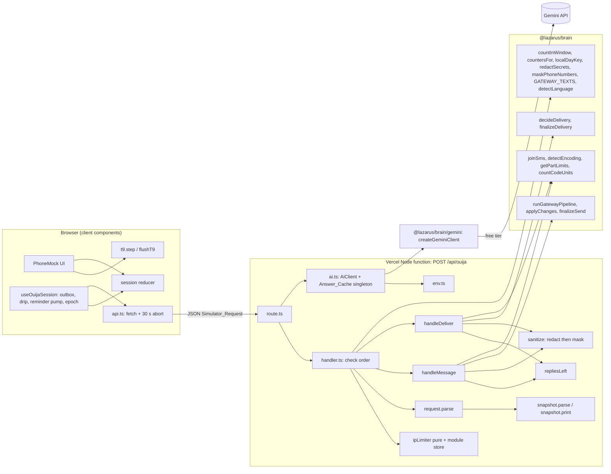
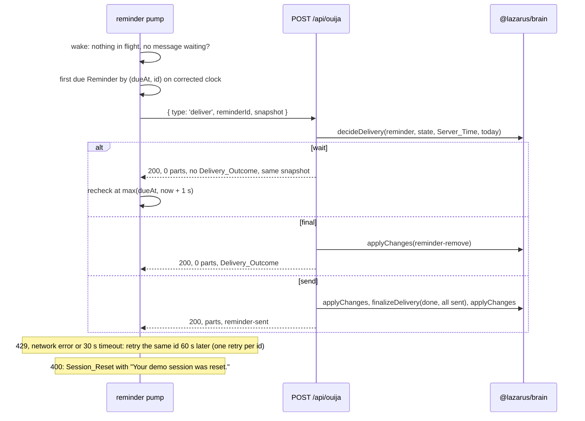

# Design Document: Crypt and Ouija Simulator

## Overview

This design adds `apps/crypt` (`@lazarus/crypt`), a Next.js App Router app with two pages and one API route:

- `/` is the Ouija_Simulator. A client component renders the Phone_Mock, holds the Simulator_Session in React state, and talks to the Simulator_Route.
- `/crypt` is the Crypt_Dashboard. It is a server component rendered from constants, with no client JavaScript of its own beyond the shared layout.
- `POST /api/ouija` is the Simulator_Route. It runs on the Node.js runtime, rebuilds a Gateway_State from the Session_Snapshot, calls the brain once, and returns the updated Session_Snapshot.

All SMS behaviour (routing, language, splitting, reminders, limits, STOP) comes from `@lazarus/brain`. The Crypt_App adds four pieces of logic of its own, each a pure TypeScript module with property tests:

1. The T9 step function, with the T9_Decoder and T9_Encoder built on it.
2. The Snapshot_Parser and Snapshot_Printer.
3. The Ip_Rate_Limiter.
4. The Replies_Left formula, written only in terms of brain exports.

### Key design decisions

| # | Decision | Requirement | Where |
|---|---|---|---|
| C1 | The T9_Decoder is a left fold of one pure `stepT9` function. The Phone_Mock calls the same `stepT9` on each key press and `flushT9` when the Multi_Tap_Timeout fires, so what the keypad shows always equals what the T9_Decoder returns for the same Key_Events. | 3.1–3.7, 4.1–4.5 | `src/t9/t9.step.ts` |
| C2 | The Simulator_Number is `+999666000000666`. Country code 999 is unassigned, so the number cannot reach a real person. It has 15 digits, so no 13-digit epoch time, counter or Due_Time in a response can contain its digit string by accident, which keeps the privacy property exact. | 17.1, 17.4 | `src/server/simulatorNumber.ts` |
| C3 | Message ids contain no digits: `m` + `letters(Server_Time)` + `-` + `letters(receiveTimes.length)`, where `letters` writes a non-negative integer in base 26 with `a` to `z`. The brain turns this into the Reminder_Id `r:<messageId>`, so Reminder_Ids are deterministic for a given Server_Time and snapshot (7.14), at most 20 characters, and never hold 7 digits in a row. | 7.14, 8.1, 17.4 | `src/server/messageId.ts` |
| C4 | Redaction and masking apply to the free-text string fields of a response: reply part texts, Reminder_Texts in the Session_Snapshot and the Slow_Down_Text of a 429. Structural strings (day key, Reminder_Ids, enum values, encoding names, error codes) are built from fixed patterns, contain no secret and no 7-digit run by construction, and are not passed through `maskPhoneNumbers`, because the brain's mask regex treats `2025-01-15` as an 8-digit run and would corrupt the day key. See the note under "Requirement notes". | 9.6, 17.2 | `src/server/sanitize.ts` |
| C5 | The browser sends at most 1 Simulator_Request at a time, `message` or `deliver`. A Message_Body sent while a `deliver` request is in flight is shown as an outgoing bubble at once and sent when that response arrives, with the newest Session_Snapshot. This prevents two responses from racing to replace the Session_Snapshot. | 6.1, 6.4, 13.3, 13.9 | `src/session/outbox.ts` |
| C6 | Every request carries the Simulator_Session epoch. A Session_Reset increments the epoch and aborts the in-flight request; a response with an old epoch is dropped before it reaches the reducer. | 6.8, 19.4 | `src/session/useOuijaSession.ts` |
| C7 | Reminder checks use one wake-up timer, not one timer per Reminder. A "pump" runs on each wake-up and after each response: when nothing is in flight it sends the first due Reminder in `(dueAt, id)` order. Timer delays are capped at 2,147,483,647 ms (the `setTimeout` maximum, about 24.8 days); the pump re-arms on wake-up, so Due_Times up to the 30-day Reminder_Horizon work. | 13.2, 13.3, 13.8 | `src/session/reminderPump.ts` |
| C8 | After a `wait` response the next check of that Reminder is at `max(Due_Time, browser now + 1,000 ms)` on the corrected clock. Without the 1-second floor, network latency can make the corrected clock pass the Due_Time while the server still answers `wait`, which would send a burst of requests against the Ip_Rate_Limiter. | 13.6 | `src/session/reminderPump.ts` |
| C9 | The build uses webpack (`next build --webpack`) with `resolve.extensionAlias` mapping `.js` to `.ts`/`.js`, because the brain is consumed as TypeScript source with `.js` import suffixes. Turbopack has no equivalent of `extensionAlias` at the time of writing ([vercel/next.js#82945](https://github.com/vercel/next.js/issues/82945)). | 1.1, 1.8 | `next.config.ts` |
| C10 | Accessibility checks with axe run in Playwright against the production build, because jsdom computes no layout or colors and axe skips the contrast rule there. | 16.8 | `e2e/a11y.spec.ts` |

### Requirement notes

These points need a decision at review. The design follows the choice in the right column.

| Requirement | Issue | Design choice |
|---|---|---|
| 17.2, 9.6 | "Every string value" through `maskPhoneNumbers` would mask the day key `YYYY-MM-DD`, which the brain's regex sees as one 8-digit run. | Mask only free-text fields (C4). Suggest rewording 17.2 to "every reply part, Reminder_Text and Slow_Down_Text". The privacy property of 17.4 still checks every JSON string value. |
| 16.7 vs 11.4, 5.5 | 16.7 sets `dir="rtl"` on any bubble that contains an Urdu character; 11.4 and 5.5 take the direction from the first strong character. A mixed bubble such as `HELP مدد` gets different answers. | `lang="ur"` whenever the text has a character in U+0600–U+06FF (16.7); `dir` from the first strong character (11.4, 5.5). Brain replies in `ur` start with Urdu script, so the two rules agree for every Simulated_Reply. Suggest rewording 16.7 to use the first-strong rule for `dir`. |
| 16.8, 17.7 | Both name the Crypt_Test_Suite (Vitest). The axe checks need a real browser (C10), and the client-bundle scan needs a build. | axe runs in the Playwright suite. The bundle scan is a Vitest file in a separate Vitest project run by `npm run test:bundle`, which builds first. `e2e` runs both. `npm test` stays fast and needs no build. |
| 1.8 | Next.js 16 no longer runs ESLint inside `next build`. | The `build` script is `npm run lint && next build --webpack`, so a lint error still fails the build script. `next build` itself fails on TypeScript errors. |

### Research summary

- **Brain as TypeScript source.** `@lazarus/brain` has `main: src/index.ts` and imports its own files with `.js` suffixes. Next.js compiles workspace packages listed in `transpilePackages`; webpack needs `resolve.extensionAlias: { '.js': ['.ts', '.js'] }` to find `./encoding.js` as `encoding.ts`. Turbopack has an open request for this ([vercel/next.js#82945](https://github.com/vercel/next.js/issues/82945)), so the design pins webpack (C9).
- **`@lazarus/brain/gemini`** resolves to `gemini.entry.ts` under the `default` condition. It imports `@google/genai` and reads `process.env` only when `options.env` is not given. The Crypt_App passes `env` explicitly from its own `server/env.ts`, so only that file reads environment variables (1.6).
- **`@lazarus/brain` main entry** contains no `process.env` read and no `GEMINI_API_KEY` text (checked with grep over the non-test sources), so client components may import it for `DEFAULT_SETTINGS`, `zeroCounters`, `localDayKey` and the shared types.
- **Vercel Functions.** With Fluid compute the default and maximum duration on Hobby is 300 seconds ([Vercel Functions limits](https://vercel.com/docs/functions/limitations)). One instance serves many requests and keeps module memory between them, which is where the AiClient, Answer_Cache and Ip_Rate_Limiter state live. The route sets `maxDuration = 30` to bound a stuck request; the brain's own answer backstop is 25 seconds.
- **Client IP.** Vercel sets `x-forwarded-for` to the client address and overwrites any value sent by the client ([Vercel request headers](https://vercel.com/docs/headers/request-headers)). The Client_Ip is its first comma-separated entry, trimmed, or `unknown`.
- **`server-only`.** Importing the `server-only` package from a module makes the build fail if a client component imports that module, which enforces 1.3 at build time ([Next.js: keeping server-only code out of the client](https://nextjs.org/docs/app/getting-started/server-and-client-components#preventing-environment-poisoning)).
- **`dir="auto"`** uses the first strong directional character, as 5.5 and 11.4 require. The Compose_Field textarea uses it directly. Bubbles get an explicit `dir` from `textDirection()` so that the value can be unit tested and `lang` can be set with it.

Content was rephrased for compliance with licensing restrictions.

### Existing brain API used

| Symbol | Signature (from `packages/brain/src`) |
|---|---|
| `runGatewayPipeline` | `(msg: InboundMessage, state: GatewayState, ctx: PipelineContext, deps: PipelineDeps) => Promise<GatewayDecision>`; never rejects; `deps.answer: AnswerDeps \| null` |
| `applyChanges` | `(state: GatewayState, changes: readonly StateChange[]) => GatewayState` |
| `finalizeSend` | `(decision, report: SendReport \| null, counters: DayCounters, today: string) => FinalOutcome` |
| `decideDelivery` | `(r: Reminder, state, now, today, split?) => DeliveryStep` (`wait`, `final` with outcome and `reminder-remove`, or `send` with parts, `reminder-handed` and counters) |
| `finalizeDelivery` | `(r, partCount, report: SendReport, counters, today) => { outcome, changes }`; changes are `[reminder-remove, counters]` |
| `joinSms` / `detectEncoding` / `getPartLimits` / `countCodeUnits` | `(parts: string[]) => string` / `(text) => 'GSM-7' \| 'UCS-2'` / `(enc) => { single, multi }` / `(text, enc) => number` |
| `detectLanguage` | `(input: string) => 'en' \| 'ur' \| 'roman-ur'` |
| `countInWindow` / `checkRate` | `(times, t, windowMs) => number`, counts `t − windowMs < τ ≤ t` / `(times, t, limit, windowMs) => { accepted }` |
| `countersFor` / `zeroCounters` / `localDayKey` | `(c, today) => DayCounters` / `(dayKey) => DayCounters` / `(ms, tzOffsetMinutes) => 'YYYY-MM-DD'` |
| `redactSecrets` / `maskPhoneNumbers` | `(text, secrets) => string` (replaces with `[redacted]`) / `(text) => string` (runs of 7+ digits with optional `+`, spaces, hyphens; keeps last 3 digits; `*` for the rest) |
| `maskNumber` | `(n: CanonicalNumber) => string` (`+` then `•` for all but the last 3 digits) |
| `createMemoryCache` | `(maxEntries = 500) => AnswerCache` |
| `createGeminiClient` (`@lazarus/brain/gemini`) | `(options?: { env?, model?, genai?, log? }) => AiClient`; model from `resolveModel(option, env.GEMINI_MODEL)`, default `DEFAULT_GEMINI_MODEL` |
| `DEFAULT_SETTINGS` | `{ allowlistMode: false, perNumberLimit: 5, rateWindowMinutes: 60, dailySendCap: 200, defaultCountryCode: '92', ownNumber: null }` |
| `GATEWAY_TEXTS[lang].slowDown`, `FIXED_TEXTS` | Fixed texts per Language |
| `Reminder` | `{ id, number, slot, dueAt, text, language, createdAt, handedAt }` |

## Architecture

### Component view



`/crypt` is a server component and has no arrow to the API (15.7).

### Directory layout

```
apps/crypt/
  package.json            @lazarus/crypt; scripts below
  next.config.ts          transpilePackages, webpack extensionAlias, no env exposure
  tsconfig.json           strict, noImplicitAny, paths none
  eslint.config.mjs       typescript-eslint strict, no-explicit-any, import restrictions
  vitest.config.ts        unit + property + component tests (jsdom for *.test.tsx)
  vitest.bundle.config.ts client-bundle scan only
  playwright.config.ts    two web servers: no key (3100) and test key (3101)
  e2e/                    smoke.spec.ts, a11y.spec.ts, privacy.spec.ts
  src/
    app/
      layout.tsx          html lang="en", fonts, Header slot
      globals.css         Theme_Tokens as CSS variables, reduced-motion rules
      page.tsx            server component that renders <OuijaSimulator/>
      crypt/page.tsx      Crypt_Dashboard (server component)
      api/ouija/route.ts  runtime 'nodejs', POST + 405 for other methods
    protocol/             shared by client and server, pure, no server import
      snapshot.types.ts   SessionSnapshot, SnapshotReminder
      wire.types.ts       SimulatorRequest, SimulatorResponse, ErrorCode
      response.check.ts   isSimulatorResponse(value): value is SimulatorResponse
      emptySnapshot.ts    emptySnapshot(nowMs)
      limits.ts           MAX_BODY_UNITS = 480, MAX_REQUEST_BYTES = 16_384
    t9/
      keymap.ts           KEY_MAP, T9Key, isT9Text
      t9.step.ts          stepT9, flushT9, T9State
      t9.decode.ts        decodeT9
      t9.encode.ts        encodeT9
    server/               every file imports 'server-only'
      simulatorNumber.ts  SIMULATOR_NUMBER
      env.ts              readGeminiEnv()
      ai.ts               getAnswerDeps() singleton
      messageId.ts        letters(), messageIdFor()
      snapshot.parse.ts   parseSnapshot()
      snapshot.print.ts   printSnapshot()
      ipLimiter.ts        checkIp() pure; IP_LIMIT, IP_WINDOW_MS, IP_MAX_CLIENTS
      ipLimiter.store.ts  module-level state cell
      clientIp.ts         clientIpFrom(headers)
      body.ts             readCappedBody()
      request.parse.ts    parseRequest()
      repliesLeft.ts      repliesLeft()
      sanitize.ts         sanitizeText(), sanitizeSnapshot()
      response.build.ts   buildParts(), json(), errorResponse()
      handle.message.ts   handleMessage()
      handle.deliver.ts   handleDeliver()
      handler.ts          createOuijaHandler(deps)
    session/              client only
      session.types.ts    SessionState, Bubble, DripItem, Action
      session.reducer.ts  sessionReducer()
      outcomeNotes.ts     noteForOutcome(), noteForDelivery()
      outbox.ts           nextRequest()
      reminderPump.ts     dueReminders(), nextWakeDelay()
      api.ts              postOuija() with AbortController and 30 s timeout
      useOuijaSession.ts  effects: fetch, drip timer, pump timer, epoch
    ui/
      OuijaSimulator.tsx  'use client' root
      PhoneMock.tsx, PhoneScreen.tsx, Bubble.tsx, Keypad.tsx, ComposeField.tsx,
      Heartbeat.tsx, RepliesLeft.tsx, StopBanner.tsx, Examples.tsx,
      Header.tsx, Announcer.tsx
      compose.ts          truncateCompose(), clearLast(), switchInputMode(), composeUnits()
      texts.ts            UI strings (Status_Notes, labels)
      direction.ts        textDirection(), hasUrdu()
      examples.ts         EXAMPLE_MESSAGES (10)
    dashboard/
      dashboard.data.ts   'server-only': DEMO_COUNTERS, SAMPLE_CONVERSATION, explanation, commands
      Dashboard.tsx       server component sections
```

### Message request flow

```mermaid
sequenceDiagram
  participant V as Visitor
  participant UI as Ouija_Simulator
  participant R as POST /api/ouija
  participant L as Ip_Rate_Limiter
  participant B as @lazarus/brain
  V->>UI: Send (Message_Body)
  UI->>UI: commit Pending_Character, outgoing bubble, SENDING
  UI->>R: { type: 'message', body, snapshot } (epoch e)
  R->>R: method POST? body ≤ 16,384 bytes?
  R->>L: checkIp(state, ip, now)
  alt rejected
    R-->>UI: 429 { error, slowDown? } + Retry-After
  else accepted (recorded)
    R->>R: parseRequest, parseSnapshot(snapshot, Server_Time, SIMULATOR_NUMBER)
    R->>B: runGatewayPipeline(inbound, state, { paused: false, today }, { answer })
    B-->>R: GatewayDecision
    R->>B: applyChanges, finalizeSend(done, all sent), applyChanges
    R->>R: printSnapshot, sanitize, buildParts, repliesLeft
    R-->>UI: 200 SimulatorResponse
  end
  UI->>UI: drop if epoch ≠ e; replace snapshot, Replies_Left, clock offset
  UI->>UI: drip parts 700 ms apart, pulse, announce
```

### Reminder delivery flow



### Simulator_Route check order

`handler.ts` applies the checks of 7.12 in a fixed order and stops at the first failure:

| Step | Check | Failure | Limiter records? |
|---|---|---|---|
| 1 | Method is POST | 405 `method-not-allowed` (body not read) | no |
| 2 | `content-length` ≤ 16,384 if present, then stream read capped at 16,385 bytes | 413 `body-too-large` (body not parsed) | no |
| 3 | `checkIp(state, clientIp, now)` | 429 `rate-limited` + `Retry-After` | no |
| 4 | `JSON.parse`, then `parseRequest` | 400 `invalid-json`, `invalid-type`, `invalid-body`, `invalid-reminder-id` | yes (from step 3) |
| 5 | `parseSnapshot` | 400 `invalid-snapshot` | yes |
| 6 | Brain call, sanitize, build | 500 `internal` on any throw | yes |

The Server_Time is read once, before step 3, and used for the limiter, the snapshot checks, the pipeline, the response and Replies_Left.

## Components and Interfaces

### 1. Protocol types (`src/protocol`)

Shared by the client and the server. No import from `src/server`.

```ts
import type { Command, DeliveryOutcome, Language, Outcome, SmsEncoding } from '@lazarus/brain';

export interface SnapshotReminder {
  readonly id: string;          // Reminder_Id, 1..64 chars
  readonly slot: 1 | 2 | 3 | 4 | 5;
  readonly dueAt: number;
  readonly text: string;        // 1..140 UTF-16 code units
  readonly language: Language;
  readonly createdAt: number;
}

export interface SnapshotCounters {
  readonly dayKey: string;      // localDayKey(…, 300)
  readonly received: number;
  readonly repliesSent: number;
  readonly replied: number;
  readonly partsSent: number;
  readonly ignored: number;
  readonly handed: number;
}

export interface SessionSnapshot {
  readonly stopped: boolean;
  readonly receiveTimes: readonly number[];   // 0..120, non-decreasing
  readonly slowDownAt: number | null;
  readonly counters: SnapshotCounters;
  readonly reminders: readonly SnapshotReminder[]; // 0..5
}

export type SimulatorRequest =
  | { readonly type: 'message'; readonly body: string; readonly snapshot: SessionSnapshot }
  | { readonly type: 'deliver'; readonly reminderId: string; readonly snapshot: SessionSnapshot };

export interface ResponsePart {
  readonly text: string;   // after redaction and masking
  readonly units: number;  // countCodeUnits(text, encoding)
  readonly limit: number;  // 160/70 when 1 part, 153/67 when 2..4
}

export interface SimulatorResponse {
  readonly kind: 'message' | 'deliver';
  readonly parts: readonly ResponsePart[];          // 0..4
  readonly encoding: SmsEncoding;                   // detectEncoding(joinSms(texts))
  readonly command: Command | null;                 // null for deliver
  readonly language: Language;
  readonly outcome: Outcome | null;                 // message only
  readonly deliveryOutcome: DeliveryOutcome | null; // deliver only; null for not-found and wait
  readonly snapshot: SessionSnapshot;
  readonly repliesLeft: number;                     // 0..DEFAULT_SETTINGS.perNumberLimit
  readonly serverTime: number;
}

export type ErrorCode =
  | 'method-not-allowed' | 'body-too-large' | 'rate-limited'
  | 'invalid-json' | 'invalid-type' | 'invalid-body' | 'invalid-reminder-id'
  | 'invalid-snapshot' | 'internal';

export type ErrorBody =
  | { readonly error: Exclude<ErrorCode, 'rate-limited'> }
  | { readonly error: 'rate-limited'; readonly slowDown?: string };
```

`isSimulatorResponse(value: unknown)` checks the shape the client relies on (field types, 0 to 4 parts, `repliesLeft` an integer in range) and is used for 6.7. It does not re-validate the snapshot; the server does that on the next request.

`emptySnapshot(nowMs)` returns `{ stopped: false, receiveTimes: [], slowDownAt: null, counters: zeroCounters(localDayKey(nowMs, 300)), reminders: [] }` (8.5, 19.2a).

### 2. T9 (`src/t9`)

```ts
export type T9Key = '0'|'1'|'2'|'3'|'4'|'5'|'6'|'7'|'8'|'9'|'*'|'#';
export interface KeyEvent { readonly key: T9Key; readonly at: number }
export type LetterCase = 'lower' | 'upper';
export interface T9Mode { readonly entry: 'letter' | 'number'; readonly letterCase: LetterCase }

export interface T9Group { readonly key: DigitKey; readonly presses: number; readonly lastAt: number }
export interface T9State {
  readonly committed: string;
  readonly mode: T9Mode;
  readonly group: T9Group | null;  // open Letter_Mode group = Pending_Character source
  readonly lastAt: number | null;  // time of the previous Key_Event
  readonly lastKey: T9Key | null;
}

export const MULTI_TAP_TIMEOUT_MS = 1_000;
export const KEY_MAP: Readonly<Record<DigitKey, readonly string[]>>; // lower-case form, Glossary Key_Map

export function stepT9(s: T9State, e: KeyEvent): T9State;   // assumes e.at ≥ s.lastAt
export function flushT9(s: T9State): T9State;               // commit the open group
export function pendingOf(s: T9State): string | null;
export function charOf(g: T9Group, c: LetterCase): string;  // KEY_MAP[key][(presses − 1) mod len], case applied to letters

export type DecodeResult =
  | { readonly ok: true; readonly text: string; readonly mode: T9Mode; readonly pending: string | null }
  | { readonly ok: false; readonly error: 'bad-time' };
export function decodeT9(events: readonly KeyEvent[], start: T9Mode): DecodeResult;

export type EncodeResult =
  | { readonly ok: true; readonly events: readonly KeyEvent[] }
  | { readonly ok: false; readonly error: 'not-t9-text' | 'too-long' };
export function encodeT9(text: string): EncodeResult;
```

`stepT9` rules, in this order:

1. `*`: commit the open group, flip `letterCase`. Mode entry unchanged.
2. `#`: commit the open group, flip `entry`. Case unchanged.
3. Digit key in Number_Mode: append the digit to `committed`.
4. Digit key in Letter_Mode with an open group of the same key and `e.at − group.lastAt < 1,000`: `presses + 1`, `lastAt = e.at`.
5. Digit key in Letter_Mode otherwise: commit the open group, open `{ key, presses: 1, lastAt: e.at }`.

"Commit" appends `charOf(group, mode.letterCase)` to `committed` and sets `group = null`. The case used is the case at commit time; since `*` commits before flipping, a group's case never changes while it is open.

`decodeT9` checks that every `at` is a safe non-negative integer and the times are non-decreasing, returning `bad-time` otherwise (4.6), then folds `stepT9` from `{ committed: '', mode: start, group: null, lastAt: null, lastKey: null }` and returns `committed`, `mode` and `pendingOf` of the final state, without flushing (4.5). Sequences longer than 300 events are outside the contract; `decodeT9` accepts them, and the property tests stay inside 0..300.

`encodeT9` returns `too-long` above 200 characters and `not-t9-text` for any character outside the Key_Map (4.8). Otherwise it walks the text with a clock `t` starting at 0, a current case `lower`, and the previous key:

- For a letter whose case differs from the current case: emit `*` at `t`, flip the case, `t += 100`.
- Find the key and index `i` of the lower-case form. If the key equals the previous digit key and no `*` was emitted in between, `t += 1,000` first (new group, 4.7).
- Emit `i + 1` presses of the key at `t, t + 100, …`, then `t += 100`.

The first press is at 0 (a leading `*` takes time 0). In-group spacing is 100 ms and same-key characters are separated by at least 1,000 ms, so `decodeT9(encodeT9(x).events, lowerLetter)` yields `x` as `text + pending` (4.9).

The UI holds a `T9State` per Compose_Field session. On each key press it calls `stepT9` with `performance.timeOrigin + performance.now()` rounded down (the physical key event's `timeStamp` for 3.9), and starts or restarts a 1,000 ms timer that calls `flushT9` (3.3). Before a commit or Number_Mode digit is applied, the UI checks the 480-unit limit (3.12): if `committed.length + newChar.length > 480`, it drops the character and shows the length message.

### 3. Server-only modules (`src/server`)

Every module here starts with `import 'server-only';`.

#### `simulatorNumber.ts`

```ts
export const SIMULATOR_NUMBER: CanonicalNumber; // '+999666000000666', checked by isCanonicalNumber at load
```

#### `env.ts`

```ts
export interface GeminiEnv { readonly apiKey: string | null; readonly model: string | undefined }
export function readGeminiEnv(source?: NodeJS.ProcessEnv): GeminiEnv;
```

Reads only `GEMINI_API_KEY` and `GEMINI_MODEL`. `apiKey` is the raw value when it has a non-whitespace character, else `null` (9.3). `model` is the trimmed value when non-empty, else `undefined` (1.7, 9.2). This is the only file in the Crypt_App that reads `process.env`.

#### `ai.ts`

```ts
export interface AiSetup { readonly answer: AnswerDeps | null; readonly secrets: readonly string[] }
export function getAiSetup(): AiSetup; // lazy module-level singleton
```

On first call with a key: `createGeminiClient({ env: { GEMINI_API_KEY: apiKey, GEMINI_MODEL: model } })` and `createMemoryCache()`, both created once per instance (9.1). `answer = { client, cache, clock: Date.now, secrets: [apiKey] }`. Without a key: `answer = null`, `secrets = []`, no client (9.3). No `log` option is passed, so the Gemini adapter logs nothing (7.11).

#### `messageId.ts`

```ts
export function letters(n: number): string;        // base 26, 'a'..'z', letters(0) = 'a'
export function messageIdFor(serverTime: number, receiveCount: number): string;
// `m${letters(serverTime)}-${letters(receiveCount)}`
```

#### `snapshot.parse.ts`

```ts
export type SnapshotError =
  | 'not-object' | 'unknown-field' | 'missing-field' | 'wrong-type'
  | 'too-many-times' | 'times-order' | 'too-many-reminders' | 'bad-reminder-id'
  | 'bad-slot' | 'duplicate-slot' | 'duplicate-id' | 'bad-text'
  | 'due-too-far' | 'created-after-due' | 'time-in-future' | 'bad-language'
  | 'bad-count' | 'bad-day-key';

export type ParseSnapshotResult =
  | { readonly ok: true; readonly state: GatewayState }
  | { readonly ok: false; readonly error: SnapshotError };

export function parseSnapshot(value: unknown, serverTime: number, number: CanonicalNumber): ParseSnapshotResult;
```

Checks every rule of 8.4 with exact key sets at each level (top level, `counters`, each reminder). Times and counts must be safe non-negative integers; counts are at most 1,000,000; `dayKey` must match `^\d{4}-\d{2}-\d{2}$`. Reminder Due_Times earlier than the Server_Time are accepted (8.8). The detailed `SnapshotError` is for tests only; the HTTP body always carries `invalid-snapshot`.

The resulting Gateway_State:

| Field | Value |
|---|---|
| `stopList` | `new Set([number])` if `stopped`, else empty |
| `allowlist` | empty set |
| `rate` | `new Map([[number, receiveTimes]])` if `receiveTimes` is non-empty, else empty map |
| `slowDown` | `new Map([[number, slowDownAt]])` if not null, else empty map |
| `counters` | the snapshot counters as `DayCounters` |
| `settings` | `DEFAULT_SETTINGS` (Allowlist_Mode off, no Own_Number) |
| `reminders` | `{ status: 'ok', reminders }` with `number` set to `number` and `handedAt: null`, in snapshot order |

#### `snapshot.print.ts`

```ts
export function printSnapshot(state: GatewayState, number: CanonicalNumber): SessionSnapshot;
```

`stopped = state.stopList.has(number)`, `receiveTimes = state.rate.get(number) ?? []`, `slowDownAt = state.slowDown.get(number) ?? null`, counters copied, reminders mapped to `SnapshotReminder` (dropping `number` and `handedAt`). It throws if `reminders.status` is `unreadable` or any reminder has a non-null `handedAt`; neither state is reachable (every `reminder-handed` from `decideDelivery` is followed in the same request by the `reminder-remove` from `finalizeDelivery`), and a throw becomes a 500 rather than a silently wrong snapshot.

#### `ipLimiter.ts` (pure) and `ipLimiter.store.ts`

```ts
export const IP_LIMIT = 30;
export const IP_WINDOW_MS = 600_000;
export const IP_MAX_CLIENTS = 10_000;

export type IpState = ReadonlyMap<string, readonly number[]>;  // ascending times per Client_Ip
export type IpCheck =
  | { readonly accepted: true; readonly state: IpState }
  | { readonly accepted: false; readonly state: IpState; readonly retryAfterSec: number };

export function checkIp(state: IpState, ip: string, now: number): IpCheck;
```

`checkIp`:

1. Prune: for each Client_Ip keep times `τ > now − 600,000`; drop Client_Ips with none left (10.8).
2. If the Client_Ip has 30 times left: reject with `retryAfterSec = clamp(ceil((oldest + 600,000 − now) / 1,000), 1, 600)` and the pruned state (10.3).
3. If the Client_Ip is new and 10,000 Client_Ips are stored: drop the one whose newest time is smallest, ties broken by the smallest string (10.9).
4. Append `now` and accept (10.2).

`ipLimiter.store.ts` holds `let state: IpState = new Map()` and exposes `limiterCell: { get(): IpState; set(s: IpState): void }`. Node runs each request handler's synchronous part without interleaving, so the read-check-write in step 3 of the handler is atomic per instance.

#### `clientIp.ts`, `body.ts`

```ts
export function clientIpFrom(headers: Headers): string; // first x-forwarded-for entry, trimmed, or 'unknown'
export type BodyRead = { readonly ok: true; readonly text: string } | { readonly ok: false };
export function readCappedBody(req: Request, maxBytes: number): Promise<BodyRead>;
```

`readCappedBody` rejects at once when `content-length` is larger than `maxBytes`, otherwise reads the stream and stops (cancelling the reader) as soon as more than `maxBytes` bytes have arrived, so a missing or false `content-length` cannot get a large body parsed (7.8). The text is decoded as UTF-8.

#### `request.parse.ts`

```ts
export type RequestParse =
  | { readonly ok: true; readonly request: { type: 'message'; body: string; snapshot: unknown }
                                         | { type: 'deliver'; reminderId: string; snapshot: unknown } }
  | { readonly ok: false; readonly error: 'invalid-json' | 'invalid-type' | 'invalid-body' | 'invalid-reminder-id' };
export function parseRequest(raw: string): RequestParse;
export function isMessageBody(value: unknown): value is string; // string, 1..480 code units, has \S
```

The snapshot stays `unknown` here and goes to `parseSnapshot` next (step 5). Extra top-level fields give `invalid-type`.

#### `repliesLeft.ts`

```ts
export function repliesLeft(state: GatewayState, number: CanonicalNumber, serverTime: number): number;
```

```ts
const s = DEFAULT_SETTINGS;
const today = localDayKey(serverTime, 300);
if (countersFor(state.counters, today).handed >= s.dailySendCap) return 0;
const used = countInWindow(state.rate.get(number) ?? [], serverTime, s.rateWindowMinutes * 60_000);
return Math.max(0, s.perNumberLimit - used);
```

The only constants are `300` (the Pakistan_Time offset that the brain's `localDayKey` takes as an argument) and `60_000` (milliseconds per minute). No limit, window or cap value is defined in the Crypt_App (19.6).

#### `sanitize.ts`

```ts
export function sanitizeText(text: string, secrets: readonly string[]): string; // maskPhoneNumbers(redactSecrets(text, secrets))
export function sanitizeSnapshot(s: SessionSnapshot, secrets: readonly string[]): SessionSnapshot; // Reminder_Texts only
```

`sanitizeSnapshot` also clamps a Reminder_Text that redaction made longer than 140 code units to its first 140 code units, or 139 when the 140th is a high surrogate. This only happens if the secret is shorter than `[redacted]` (10 characters); Gemini keys are 39 characters, so it is a guard that keeps the next request's snapshot valid. `maskPhoneNumbers` keeps the length.

#### `response.build.ts`

```ts
export function buildParts(texts: readonly string[], secrets: readonly string[]): { parts: ResponsePart[]; encoding: SmsEncoding };
export function json(status: number, body: unknown, headers?: Record<string, string>): Response;
export function errorResponse(code: ErrorCode): Response;
```

`buildParts` sanitizes each text first, then computes `encoding = detectEncoding(joinSms(sanitized))`, `limit = n === 1 ? single : multi` from `getPartLimits(encoding)`, and `units = countCodeUnits(text, encoding)` on the sanitized text (7.4, 17.3). `json` sets `content-type: application/json` and `cache-control: no-store`, and never sets a cookie (1.11).

#### `handle.message.ts`

```ts
export interface HandleCtx {
  readonly serverTime: number;
  readonly number: CanonicalNumber;
  readonly ai: AiSetup;
  readonly brain: BrainFns; // defaults to the real brain functions; tests inject throwing ones
}
export function handleMessage(body: string, state: GatewayState, ctx: HandleCtx): Promise<SimulatorResponse>;
```

1. `today = localDayKey(serverTime, 300)`.
2. `inbound = { id: messageIdFor(serverTime, (state.rate.get(number) ?? []).length), seq: 0, sender: number, body, receivedAt: serverTime }`.
3. `decision = await brain.runGatewayPipeline(inbound, state, { paused: false, today }, { answer: ai.answer })`.
4. `s1 = applyChanges(state, decision.changes)`.
5. `report = decision.parts.length === 0 ? null : { status: 'done', results: parts.map(() => 'sent'), attempts: 1 }`.
6. `final = finalizeSend(decision, report, s1.counters, today)`; `s2 = applyChanges(s1, final.changes)`.
7. Return `{ kind: 'message', ...buildParts(decision.parts, ai.secrets), command: decision.command, language: decision.language, outcome: final.outcome, deliveryOutcome: null, snapshot: sanitizeSnapshot(printSnapshot(s2, number), ai.secrets), repliesLeft: repliesLeft(s2, number, serverTime), serverTime }`.

The Command_Router, Language_Detector, SMS_Splitter, Reminder parsing and every reply text run inside `runGatewayPipeline` (7.6).

#### `handle.deliver.ts`

```ts
export function handleDeliver(reminderId: string, state: GatewayState, ctx: HandleCtx): SimulatorResponse;
```

1. Find the Reminder with `id === reminderId`. Not found: 0 parts, `deliveryOutcome: null`, the re-printed snapshot (13.5).
2. `step = decideDelivery(r, state, serverTime, today)`.
3. `wait`: 0 parts, `deliveryOutcome: null`, unchanged snapshot (13.6).
4. `final`: `s1 = applyChanges(state, step.changes)`; 0 parts; `deliveryOutcome: step.outcome` (13.4).
5. `send`: `s1 = applyChanges(state, step.changes)`; `fin = finalizeDelivery(r, step.parts.length, { status: 'done', results: all 'sent', attempts: 1 }, s1.counters, today)`; `s2 = applyChanges(s1, fin.changes)`; parts from `step.parts`; `deliveryOutcome: fin.outcome` (`reminder-sent`).

`command` is `null` and `language` is the Reminder's Language. `outcome` is `null`.

#### `handler.ts` and `route.ts`

```ts
export interface OuijaDeps {
  readonly now: () => number;                 // monotonic per instance: max(last, Date.now())
  readonly ai: () => AiSetup;
  readonly limiter: { get(): IpState; set(s: IpState): void };
  readonly number: CanonicalNumber;
  readonly brain?: Partial<BrainFns>;
}
export function createOuijaHandler(deps: OuijaDeps): {
  POST(req: Request): Promise<Response>;
  notAllowed(): Response;
};
```

`POST` runs the check table above inside one `try/catch`; any throw after step 3 gives `errorResponse('internal')` with no other field (7.10, 17.6). The 429 branch tries `JSON.parse` on the already-read text; when it is a `message` request with a valid Message_Body it adds `slowDown: sanitizeText(GATEWAY_TEXTS[detectLanguage(body)].slowDown, secrets)`; a `deliver` request gets no `slowDown`; anything else gets the English text (10.4, 10.5). The handler logs nothing.

`route.ts`:

```ts
export const runtime = 'nodejs';
export const dynamic = 'force-dynamic';
export const maxDuration = 30;
const handler = createOuijaHandler(productionDeps());
export const POST = handler.POST;
export const GET = handler.notAllowed;   // also HEAD, PUT, PATCH, DELETE, OPTIONS
```

### 4. Client session (`src/session`)

#### State and actions

```ts
export type BubbleKind = 'outgoing' | 'part' | 'reminder-part' | 'note';
export interface Bubble {
  readonly id: number;
  readonly kind: BubbleKind;
  readonly text: string;
  readonly badge?: { readonly n: number; readonly total: number; readonly encoding: SmsEncoding; readonly units: number; readonly limit: number };
  readonly languageLabel?: 'English' | 'Urdu' | 'Roman Urdu'; // first part of a message reply only
  readonly reminderLabel?: boolean;                            // first part of a delivery only
  readonly urgent?: boolean;                                   // announce assertively (16.11)
}
export type DripItem = Omit<Bubble, 'id'>;

export interface Outgoing { readonly type: 'message'; readonly body: string } // queued behind a deliver (C5)

export interface SessionState {
  readonly epoch: number;
  readonly snapshot: SessionSnapshot;
  readonly repliesLeft: number;
  readonly clockOffset: number;
  readonly bubbles: readonly Bubble[];
  readonly nextBubbleId: number;
  readonly drip: readonly DripItem[];        // still to be added
  readonly inFlight: { readonly type: 'message' | 'deliver'; readonly reminderId?: string } | null;
  readonly waitingMessage: Outgoing | null;  // sent or queued, response not yet arrived
  readonly retryAt: ReadonlyMap<string, number>;   // browser ms, one per Reminder_Id (13.8)
  readonly recheckAt: ReadonlyMap<string, number>; // after a wait response (C8)
  readonly error: string | null;
}

export type Action =
  | { type: 'send'; body: string }
  | { type: 'request-started'; request: 'message' | 'deliver'; reminderId?: string }
  | { type: 'response'; epoch: number; request: 'message' | 'deliver'; response: SimulatorResponse; browserNow: number }
  | { type: 'rate-limited'; epoch: number; request: 'message' | 'deliver'; slowDown: string | null; reminderId?: string; browserNow: number }
  | { type: 'failed'; epoch: number; request: 'message' | 'deliver'; reminderId?: string; browserNow: number }
  | { type: 'invalid-snapshot'; epoch: number; nowMs: number }
  | { type: 'drip-tick' }
  | { type: 'new-session'; nowMs: number };
```

`sessionReducer(state, action)` is pure. Every action that carries an `epoch` different from `state.epoch` returns `state` unchanged (C6, 6.8, 19.4).

| Action | Effect |
|---|---|
| `send` | Add outgoing bubble; set `waitingMessage`; clear `error`. |
| `response` (message) | Replace `snapshot`, `repliesLeft`, `clockOffset = serverTime − browserNow`; clear `inFlight`, `waitingMessage`; append drip items: one `part` per part (first with `languageLabel`), or one `note` from `noteForOutcome(outcome)` when 0 parts; for `rate-limited` with 1 part, the part followed by the note `Reply limit for this number reached. Press New session to keep testing.` (19.10). Drop `retryAt`/`recheckAt` entries whose Reminder_Id is gone. |
| `response` (deliver) | Same snapshot handling; parts as `reminder-part` (first with `reminderLabel`); 0 parts with a Delivery_Outcome → `noteForDelivery`; 0 parts without → nothing (11.7, 13.5); `wait` (0 parts, no outcome, Reminder still present) sets `recheckAt[id] = max(dueAt − clockOffset, browserNow + 1,000)` (C8). |
| `rate-limited` | Message: drip a `note` with `slowDown`, `urgent: true` (10.6, 16.11); clear `waitingMessage`. Deliver: `retryAt[id] = browserNow + 60,000`, no bubble (10.7). Snapshot and Replies_Left unchanged (19.12). |
| `failed` | Message: `error` = the connection text, note bubble with `urgent: true`, clear `waitingMessage` (6.5, 6.7). Deliver: `retryAt[id] = browserNow + 60,000`, no note (13.8). |
| `invalid-snapshot` | Session_Reset, then the only note is `Your demo session was reset.` (6.6, 13.12). |
| `drip-tick` | Move the first drip item to `bubbles`. |
| `new-session` | Session_Reset with note `New session started.` (19.2). |

Session_Reset (19.2 a–j) is one function `resetSession(state, nowMs, note)`: `epoch + 1`, `emptySnapshot(nowMs)`, `repliesLeft = DEFAULT_SETTINGS.perNumberLimit`, `inFlight = null`, `waitingMessage = null`, empty `drip`, `retryAt`, `recheckAt`, `error = null`, `bubbles = [note]`. The Compose_Field, Pending_Character, Input_Mode, T9 mode and length message live in the Phone_Mock component state and are reset by the same click handler, in the same React batch.

Derived values:

```ts
export function phoneState(s: SessionState): 'SENDING' | 'ERROR' | 'SLEEPING' | 'ALIVE';
// SENDING if inFlight or waitingMessage or drip.length > 0; else ERROR if error; else SLEEPING if snapshot.stopped; else ALIVE (14.2)
export function sendDisabled(s: SessionState, composeHasBody: boolean): boolean;
// waitingMessage !== null || drip has items of the last message reply || !composeHasBody
```

#### `outbox.ts`

```ts
export type NextRequest =
  | { readonly type: 'message'; readonly body: string }
  | { readonly type: 'deliver'; readonly reminderId: string }
  | null;
export function nextRequest(s: SessionState, correctedNow: number, browserNow: number): NextRequest;
```

Returns `null` if `inFlight` is set. A queued message wins over a due Reminder; due Reminders are held back while a message is waiting (13.9). Otherwise it returns the first of `dueReminders(...)`.

#### `reminderPump.ts`

```ts
export function dueReminders(s: SessionState, correctedNow: number, browserNow: number): readonly string[];
// reminders with dueAt ≤ correctedNow, retryAt (if any) ≤ browserNow and recheckAt (if any) ≤ browserNow,
// sorted by (dueAt, id) (13.2, 13.3)
export function nextWakeDelay(s: SessionState, correctedNow: number, browserNow: number): number | null;
// smallest positive wait until the next Reminder becomes due, capped at 2_147_483_647; null when none
```

#### `api.ts`

```ts
export type PostResult =
  | { readonly kind: 'ok'; readonly response: SimulatorResponse }
  | { readonly kind: 'rate-limited'; readonly slowDown: string | null }
  | { readonly kind: 'invalid-snapshot' }
  | { readonly kind: 'failed' }
  | { readonly kind: 'aborted' };
export function postOuija(req: SimulatorRequest, signal: AbortSignal): Promise<PostResult>;
```

Uses `fetch('/api/ouija', { method: 'POST', body: JSON.stringify(req), signal, credentials: 'omit' })` and its own 30-second timer that aborts and maps to `failed` (6.5). A 200 whose body fails `isSimulatorResponse` maps to `failed` (6.7). A 400 with `error: 'invalid-snapshot'` maps to `invalid-snapshot`. A `deliver` request that gets any 400 also maps to `invalid-snapshot` (13.12). An abort caused by a Session_Reset maps to `aborted`, which dispatches nothing.

#### `useOuijaSession.ts`

Owns the effects and nothing else:

- **Request effect.** After every state change, if `nextRequest(...)` is not null, dispatch `request-started`, then `postOuija` with an `AbortController` stored in a ref, tagged with the current epoch. The result is dispatched with that epoch. The request body uses the Session_Snapshot at send time, which after C5 and 13.9 is always the newest one.
- **Drip effect.** When `drip` becomes non-empty and no drip timer runs, the first item is added within the same tick (≤ 100 ms, 11.1), then a 700 ms interval adds the next until the queue is empty. A reply that arrives while the queue is non-empty is appended, so its first part comes 700 ms after the previous addition (11.8). A Session_Reset empties the queue and clears the timer (11.9).
- **Pump effect.** After every snapshot change and on each wake-up, arm one timer with `nextWakeDelay`. On fire, the request effect runs again.
- **New session.** Abort the controller, clear all timers, dispatch `new-session`. No `fetch` call (19.3).

`correctedNow = Date.now() + clockOffset` (Glossary). `Date.now`, `fetch` and timers are injected through a small `env` object so the component tests can use fake timers and a mocked `fetch`.

#### `outcomeNotes.ts`

Maps Outcomes and Delivery_Outcomes to the exact Status_Note texts of 11.6 and 13.11. The `ui/texts.ts` module holds every other UI string (6.5, 6.6, 10.6, 12.5, 13.10, 19.2j, 19.9, 19.10). These are UI messages, not SMS replies, so 7.6 is kept.

### 5. UI components (`src/ui`)

| Component | Responsibility | Requirements |
|---|---|---|
| `OuijaSimulator` | `'use client'`. Holds `useReducer(sessionReducer)`, the hook and the Phone_Mock local state (compose text, `T9State`, Input_Mode, length message). Lays out Phone_Mock and Examples with a CSS grid that puts Examples beside the phone at ≥ 768 px and below it otherwise. | 2.1, 2.2 |
| `PhoneMock` | Frame, Heartbeat, mode indicator (`abc`/`ABC`/`123`), StopBanner, PhoneScreen, ComposeField, counter `n/480`, Input_Mode toggle (`Keypad`/`Keyboard`), Keypad, Clear_Key, Send_Key, New_Session_Button, RepliesLeft, Active_Reminders count and note. Focus order follows DOM order (16.1). | 2.1, 2.6, 2.8, 3.7, 13.10, 19.1 |
| `PhoneScreen` | The thread is a plain `<ol>` with no live region; announcements go through `Announcer`, so a reset or re-render never re-announces old bubbles. Scrolls the newest bubble into view with `block: 'nearest'`, `behavior: 'smooth'` or `'auto'` under reduced motion. | 2.4, 2.5, 16.6 |
| `Bubble` | Renders text unchanged in a `<p>` with `white-space: pre-wrap`; `dir = textDirection(text)`, `lang="ur"` when `hasUrdu(text)`; Part_Badge `Part n of N · GSM-7 · 148/153`; language or `Reminder` label on first parts; notes styled with the muted color and a dashed border, not as SMS. | 2.7, 11.2–11.4, 13.7, 16.7 |
| `ComposeField` | Keypad_Input: a focusable read-only `div role="textbox" aria-readonly="true"` showing committed text plus the Pending_Character in `<u>`. Keyboard_Input: a `<textarea dir="auto">` with the 480 truncation on `onChange`, Enter/Shift+Enter handling and `isComposing` check. | 3.1, 5.1–5.8 |
| `Keypad` | 12 `<button>`s in a 3-column grid; each shows the digit and the case-aware Key_Map letters; `aria-label` like `2, a b c`; `onKeyDown` on the group maps physical `0-9 * #`, Backspace and Enter (3.9). | 3.9, 3.10, 16.3 |
| `Heartbeat` | SVG line (`aria-hidden`) plus the visible text label (`Alive`, `Sending…`, `Sleeping: STOP is on`, `Error`). The pulse is a CSS animation of 600 ms restarted by changing a `key` per added part. | 14.2–14.9 |
| `RepliesLeft` | `Replies left: n of 5` and the 0-hint. | 19.7–19.9 |
| `Announcer` | Two visually hidden regions, `aria-live="polite"` and `aria-live="assertive"`. A `useEffect` appends one text node per new bubble id (with the Part_Badge text or `Reminder` prefix), per mode change and per Replies_Left change (with the hint when shown). Only ids greater than the last announced id are announced. | 16.4, 16.9, 16.11, 19.11 |
| `Examples` | 10 `<button>`s from `EXAMPLE_MESSAGES`; activation calls `setCompose(text)` and discards the Pending_Character. | 2.2, 2.3 |
| `Header` | Server component with links to `/` (`Ouija simulator`) and `/crypt` (`The Crypt`); `aria-current="page"` on the current one. | 15.9 |

`compose.ts` (pure helpers used by `ComposeField`, `Keypad` and `PhoneMock`):

```ts
import { MAX_BODY_UNITS } from '../protocol/limits';      // shared with request.parse.ts
export function truncateCompose(text: string): string;            // 480 units, or 479 if unit 480 is a high surrogate (5.4)
export function clearLast(text: string, t9: T9State): { text: string; t9: T9State }; // 3.8
export function switchInputMode(text: string, t9: T9State): { text: string; t9: T9State }; // commit pending (5.3)
export function composeUnits(text: string, t9: T9State): number;  // text.length + pending length (2.6)
export function isMessageBody(text: string): boolean;             // 1..480 units with a non-whitespace char
```

`direction.ts`:

```ts
export function hasUrdu(text: string): boolean;               // /[\u0600-\u06FF]/
export function textDirection(text: string): 'rtl' | 'ltr';  // first strong char: Urdu/Arabic ranges → rtl, Latin → ltr, none → ltr
```

`examples.ts` holds the 10 messages, for example `How can I keep tomatoes fresh longer?`, `SCAM You won a prize, send your PIN to claim it`, `kya aaj barish hogi?` (contains the markers `kya`), `آج موسم کیسا ہے؟`. A unit test checks each with `routeCommand` and `detectLanguage` (2.2).

### 6. Crypt_Dashboard (`src/dashboard`, `src/app/crypt/page.tsx`)

A server component with these sections, all from `dashboard.data.ts` (`server-only`):

- `EXPLANATION` (≤ 200 words), naming the three steps in order (15.1).
- `COMMANDS`: HELP, STOP, START, `SCAM <text>`, `REMIND <time> <text>`, LIST, CANCEL, free question, each ≤ 20 words (15.2).
- `DEMO_COUNTERS` with the `Demo data` label (15.3, 15.4).
- `SAMPLE_CONVERSATION`: 4 to 8 messages; incoming ones show `maskNumber(SAMPLE_NUMBER)` where `SAMPLE_NUMBER = '+999666000000137'` (15.5). The masked string is computed on the server; the fictional number exists only in this server-only module.
- Heartbeat legend reusing `Heartbeat` in a static mode (15.6).

No form, input or fetch (15.7). The page is static, so it is the same with or without `GEMINI_API_KEY` (15.8).

### 7. Build, lint and scripts

`apps/crypt/package.json` scripts:

| Script | Command |
|---|---|
| `dev` | `next dev --webpack` (run manually) |
| `build` | `npm run lint && next build --webpack` |
| `start` | `next start` |
| `test` | `vitest --run` |
| `test:bundle` | `next build --webpack` with `GEMINI_API_KEY=$CRYPT_TEST_KEY`, then `vitest --run --config vitest.bundle.config.ts` |
| `typecheck` | `tsc --noEmit` |
| `lint` | `eslint .` |
| `e2e` | `npm run test:bundle && playwright test` |

Root `package.json`: add `apps/crypt` to `workspaces`; `test` becomes `npm run test --workspace @lazarus/brain && npm run test --workspace @lazarus/crypt`; `typecheck` likewise (1.5). `&&` makes any failure fail the root script.

`next.config.ts`:

```ts
const config: NextConfig = {
  transpilePackages: ['@lazarus/brain'],
  poweredByHeader: false,
  webpack(cfg) {
    cfg.resolve.extensionAlias = { '.js': ['.ts', '.js'] };
    return cfg;
  },
};
```

No `env` key and no `NEXT_PUBLIC_` variable (9.5).

`eslint.config.mjs` (flat config): `typescript-eslint` strict-type-checked, `@typescript-eslint/no-explicit-any: error`, the `no-unsafe-*` rules (implicit `any`), and `no-restricted-imports` with:

- patterns `@lazarus/brain/*` except `@lazarus/brain/gemini`, and any relative path into `packages/` (1.2);
- `@lazarus/brain/gemini` forbidden everywhere except `src/server/ai.ts` (1.3);
- `src/server/*` forbidden from `src/ui/**`, `src/session/**`, `src/t9/**`, `src/protocol/**`.

`process.env` is forbidden by `no-restricted-properties` outside `src/server/env.ts` (1.6).

### 8. Theme

`globals.css` defines the Theme_Tokens as CSS custom properties and every rule uses them:

```css
:root {
  --bg: #0B0F0C; --surface: #141A16; --text: #E6F2E9; --muted: #8FA396;
  --soul: #39FF88; --ember: #FFB347; --blood: #FF4D5E;
  --radius: 14px;
  --s1: 4px; --s2: 8px; --s3: 12px; --s4: 16px; --s5: 24px; --s6: 32px;
}
@media (prefers-reduced-motion: reduce) {
  *, *::before, *::after { animation: none !important; transition: none !important; scroll-behavior: auto !important; }
}
```

Focus: `:focus-visible { outline: 2px solid var(--soul); outline-offset: 2px; }`. Soul green on `#0B0F0C` and `#141A16` is well above 3:1. Body text is 16 px system UI; headings use one display font loaded with `next/font/google` (self-hosted at build time, so pages make no third-party font request). Muted `#8FA396` on `#0B0F0C` is about 7:1 and on `#141A16` about 6:1, so Status_Notes and badges in the muted color pass 4.5:1. Blood `#FF4D5E` on `#141A16` is about 5:1.

## Data Models

### Session_Snapshot (JSON, browser ↔ server)

```json
{
  "stopped": false,
  "receiveTimes": [1767225600000, 1767225660000],
  "slowDownAt": null,
  "counters": { "dayKey": "2026-01-01", "received": 2, "repliesSent": 2, "replied": 2, "partsSent": 3, "ignored": 0, "handed": 3 },
  "reminders": [
    { "id": "r:mbxkqzfaz-c", "slot": 1, "dueAt": 1767225720000, "text": "drink water", "language": "en", "createdAt": 1767225660000 }
  ]
}
```

| Field | Rule (8.1, 8.4) |
|---|---|
| `stopped` | boolean |
| `receiveTimes` | 0..120 safe integers ≥ 0, non-decreasing, each ≤ Server_Time |
| `slowDownAt` | `null` or safe integer ≥ 0, ≤ Server_Time |
| `counters` | exactly the 7 keys; `dayKey` `YYYY-MM-DD`; counts integers 0..1,000,000 |
| `reminders` | 0..5; ids 1..64 chars, unique; slots 1..5, unique; `text` 1..140 code units; `dueAt ≤ Server_Time + 2,592,000,000`; `createdAt ≤ dueAt` and `createdAt ≤ Server_Time`; `language` in `en`, `ur`, `roman-ur` |

No field holds a phone number (8.1). Reminder texts are sanitized before they leave the server (C4).

### Simulator_Request and Simulator_Response

As in "Protocol types". Example message response:

```json
{
  "kind": "message",
  "parts": [{ "text": "Lazarus: text any question. …", "units": 148, "limit": 160 }],
  "encoding": "GSM-7",
  "command": "HELP",
  "language": "en",
  "outcome": "replied",
  "deliveryOutcome": null,
  "snapshot": { "…": "…" },
  "repliesLeft": 4,
  "serverTime": 1767225600000
}
```

Error responses carry only `{ "error": code }`, plus `slowDown` for a 429 and the `Retry-After` header (7.13, 10.3).

### Gateway_State built per request

One Canonical_Number (`SIMULATOR_NUMBER`) appears in every `stopList`, `rate`, `slowDown` and Reminder entry; `settings` is always `DEFAULT_SETTINGS`; `allowlist` is an empty set. The state lives only for the duration of one request.

### Ip_Rate_Limiter state (server memory)

`Map<Client_Ip, number[]>`, at most 10,000 keys and 30 ascending times each. Lost when the instance stops; separate per instance (Known limitations).

### Client Session_State

As in "State and actions". It lives in React state only; nothing is written to `localStorage`, `sessionStorage`, cookies, IndexedDB or the URL (8.6). The Phone_Mock local state holds `compose: string`, `t9: T9State`, `inputMode: 'keypad' | 'keyboard'` and `lengthWarning: boolean`.

## Correctness Properties

*A property is a characteristic or behavior that should hold true across all valid executions of a system-essentially, a formal statement about what the system should do. Properties serve as the bridge between human-readable specifications and machine-verifiable correctness guarantees.*

Overlapping criteria were merged during reflection: the T9 group rules (4.1–4.5, 3.2) are one model-based property that also covers totality (4.10); the message and deliver handlers are each one model-based property against the brain, which covers 7.1–7.5, 12.4, 12.6, 12.7 and 13.1; the privacy checks of 1.11, 7.11, 9.5 and 9.6 are part of the two privacy properties; and every client-side "response replaces state" criterion is one reducer property. UI layout, timing, accessibility and build checks are example, integration or smoke tests (see Testing Strategy).

### Property 1: T9_Decoder matches the multi-tap model

*For any* starting T9_Mode and any sequence of 0 to 300 Key_Events with non-decreasing safe-integer press times, `decodeT9` returns the same committed text, final mode and Pending_Character as an independent reference model that groups presses by the rules of 4.2–4.5 (same key and less than 1,000 ms apart extends a group; `*` and `#` commit first; Number_Mode appends digits), returns the same result when called twice, never throws, and returns only T9_Text characters.

**Validates: Requirements 3.2, 4.1, 4.2, 4.3, 4.4, 4.5, 4.10**

### Property 2: T9_Decoder rejects bad press times

*For any* Key_Event sequence that contains a decreasing pair of press times, a negative press time or a non-integer press time, `decodeT9` returns `{ ok: false, error: 'bad-time' }` and no text.

**Validates: Requirements 4.6**

### Property 3: Committed text only grows

*For any* valid sequence of 0 to 299 Key_Events and any further Key_Event whose press time is not earlier than the last, the committed text decoded from the longer sequence starts with the committed text decoded from the shorter one.

**Validates: Requirements 4.11**

### Property 4: One character per group

*For any* sequence of 0 to 300 Key_Events using only keys `0` to `9`, decoded from Lower_Case Letter_Mode, the length of the committed text plus 1 when a Pending_Character is returned equals the number of character groups counted by the reference grouping rule.

**Validates: Requirements 4.12**

### Property 5: T9_Encoder output follows the timing rules

*For any* T9_Text of 0 to 200 characters, `encodeT9` returns events whose first press time is 0, whose press times are non-decreasing, with a `*` before every letter whose case differs from the case in effect, presses inside one group 1 to 999 ms apart, and at least 1,000 ms between two consecutive characters on the same key.

**Validates: Requirements 4.7**

### Property 6: T9_Encoder rejects non-T9 text

*For any* string of at most 200 characters that contains at least one character outside the Key_Map (Urdu script, emoji, newline or other symbols inserted at a random position), `encodeT9` returns `not-t9-text` and no Key_Events.

**Validates: Requirements 4.8**

### Property 7: T9 round trip

*For any* T9_Text `x` of 0 to 200 characters, decoding `encodeT9(x).events` from Lower_Case Letter_Mode and appending the returned Pending_Character to the committed text gives exactly `x`.

**Validates: Requirements 4.9**

### Property 8: Compose truncation keeps the text or a safe prefix

*For any* string of any Unicode characters, `truncateCompose` returns the string unchanged when it has at most 480 UTF-16 code units, and otherwise returns its first 480 code units, or 479 when code unit 480 is a high surrogate, so the result never ends in a lone high surrogate.

**Validates: Requirements 5.1, 5.4**

### Property 9: Clear removes exactly one thing

*For any* Compose_Field text and T9State, `clearLast` removes only the Pending_Character when one is shown and leaves committed text unchanged; otherwise it removes the last code point (both halves of a surrogate pair together), so the result plus the removed code point equals the input; an empty field with no Pending_Character is unchanged.

**Validates: Requirements 3.8**

### Property 10: Switching Input_Mode commits the Pending_Character only

*For any* Compose_Field text and T9State, switching the Input_Mode gives a text equal to the previous text followed by the Pending_Character when there was one, and the previous text otherwise.

**Validates: Requirements 5.3**

### Property 11: Text direction follows the first strong character

*For any* string made of a prefix of characters with no strong direction (digits, spaces, punctuation, `(n/N) ` prefixes) followed by an Urdu-script or Latin letter and any further text, `textDirection` returns `rtl` for the Urdu letter and `ltr` for the Latin letter, and `ltr` for strings with no strong character; `hasUrdu` is true exactly when the string contains a character in U+0600–U+06FF.

**Validates: Requirements 5.5, 11.4, 16.7**

### Property 12: Session_Snapshot round trip

*For any* valid Session_Snapshot and Server_Time (including Reminders whose Due_Time is before the Server_Time), parsing, printing and parsing again with the same Server_Time gives a Gateway_State equal to the first parse, and every Stop_List, rate, slow-down and Reminder entry of that state uses the Simulator_Number.

**Validates: Requirements 8.2, 8.3, 8.8**

### Property 13: Invalid snapshots are rejected

*For any* valid Session_Snapshot changed by exactly one violation from the list of 8.4 (unknown or missing field, wrong type, too many times, out-of-order times, too many Reminders, bad or duplicate Reminder_Id, bad or duplicate slot, bad text length, Due_Time beyond the horizon, creation after due, a time after the Server_Time, bad Language, negative or non-integer count or time), `parseSnapshot` returns an error, and the handler responds 400 `invalid-snapshot` without calling the Gateway_Pipeline.

**Validates: Requirements 8.4**

### Property 14: Invalid requests get a bare 400

*For any* request body that is not JSON, has a type other than `message` or `deliver`, has a missing, non-string, empty, whitespace-only or longer-than-480-unit Message_Body, or an invalid Reminder_Id, the handler responds with status 400, a body whose only key is `error`, and 0 calls to the Gateway_Pipeline or `decideDelivery`.

**Validates: Requirements 6.2, 7.7, 7.13**

### Property 15: Printed snapshots are always accepted and number-free

*For any* sequence of 1 to 20 valid `message` and `deliver` requests sent through the handler with non-decreasing Server_Times and a mock AiClient, each starting from the snapshot returned by the previous one, every returned snapshot is accepted by `parseSnapshot` at its Server_Time, holds 0 to 5 Reminders, and its JSON contains neither the Simulator_Number nor its digits without the `+`.

**Validates: Requirements 8.1, 8.7, 13.1**

### Property 16: Checks run in the fixed order

*For any* request built to fail any subset of the checks method, body size, Ip_Rate_Limiter, request shape and snapshot, the handler's status is the status of the first failing check in the order 405, 413, 429, 400 (shape), 400 (snapshot), or 200 when none fails, and the brain is called only when every check passes.

**Validates: Requirements 7.12, 10.1**

### Property 17: Message handling equals the brain composition

*For any* valid Session_Snapshot, Message_Body and Server_Time, and any mock AiClient reply, the handler calls `runGatewayPipeline` exactly once with sender Simulator_Number, the unchanged body, receive time Server_Time and context `{ paused: false, today: localDayKey(Server_Time, 300) }`, and returns the command, Language, Final_Outcome, sanitized parts in order and printed snapshot that a reference composition of `parseSnapshot`, `runGatewayPipeline`, `applyChanges`, `finalizeSend` (all parts sent), `applyChanges` and `printSnapshot` produces.

**Validates: Requirements 7.1, 7.2, 7.3, 7.5, 12.4, 12.6, 12.7**

### Property 18: Deliver handling equals the brain composition

*For any* valid Session_Snapshot, Server_Time and Reminder_Id (present or absent), the handler returns 0 parts, no Delivery_Outcome and an unchanged snapshot when the id is absent or `decideDelivery` waits; 0 parts, the `final` outcome and the snapshot without that Reminder on a `final` step; and the sanitized parts, `reminder-sent` and the snapshot after `finalizeDelivery` on a `send` step.

**Validates: Requirements 13.4, 13.5, 13.6**

### Property 19: Responses are deterministic

*For any* valid `message` request, Server_Time and mock AiClient reply, two handlers with fresh state given the same input return byte-identical Simulator_Responses.

**Validates: Requirements 7.14**

### Property 20: STOP always wins in the simulator

*For any* valid Session_Snapshot: a STOP Message_Body gives 0 parts, Outcome `stopped`, `stopped: true` and no Reminders; with `stopped: true`, any Message_Body that routes to neither STOP nor START gives 0 parts, `ignored-stopped`, no Reminder added and 0 AiClient calls; and with `stopped: true`, a `deliver` for a due Reminder gives 0 parts, `reminder-stopped` and that Reminder removed.

**Validates: Requirements 12.1, 12.2, 12.3**

### Property 21: Part metadata matches the returned text

*For any* 200 Simulator_Response, `encoding` equals `detectEncoding(joinSms(texts))` of the returned part texts, each part's `units` equals `countCodeUnits(text, encoding)`, each `limit` is the single limit when there is 1 part and the multi limit for 2 to 4 parts, there are 0 to 4 parts, and `(n/N) ` prefixes appear only when there are 2 or more parts.

**Validates: Requirements 7.4, 7.5, 17.3**

### Property 22: No number or key in successful responses

*For any* valid request whose Message_Body may contain phone numbers in the forms `+923001234567`, `923001234567`, `03001234567`, `0300-1234567`, `0300 123 4567` or the Gemini_Api_Key, any valid snapshot, and any mock AI reply that may repeat the Simulator_Number, its digits or the key, the serialized response and its headers contain neither the Simulator_Number, nor its digits without `+`, nor the key, no JSON string value has 7 or more consecutive digits, no `Set-Cookie` header is present, and no `console` method was called.

**Validates: Requirements 1.11, 7.11, 9.5, 9.6, 17.1, 17.2, 17.4**

### Property 23: No number, key or body in error responses

*For any* request that ends in status 400, 405, 413, 429 or 500 (including a 500 from an injected throwing brain function), the response body and headers contain neither the Simulator_Number, nor its digits without `+`, nor the Gemini_Api_Key, nor the Message_Body when that body is at least 7 characters long and not a substring of an error code or of a fixed brain text.

**Validates: Requirements 7.10, 9.5, 17.5**

### Property 24: Per-IP Slow_Down_Text speaks the message Language

*For any* valid Message_Body sent by a Client_Ip that already has 30 requests in the window, the 429 body's `slowDown` equals the sanitized `GATEWAY_TEXTS[detectLanguage(body)].slowDown`, the body has no snapshot, Replies_Left or parts, and `Retry-After` is an integer from 1 to 600.

**Validates: Requirements 10.3, 10.4**

### Property 25: The limiter records exactly the requests that reach it

*For any* sequence of requests from one Client_Ip mixing wrong methods, oversized bodies, invalid JSON, invalid snapshots and valid requests, the number of times stored for that Client_Ip equals the number of requests that passed the method and size checks and were accepted by the limiter (pruned by the window).

**Validates: Requirements 10.2**

### Property 26: At most 30 accepted per window

*For any* sequence of 0 to 500 requests with non-decreasing times from 1 to 50 Client_Ips, `checkIp` accepts at most 30 requests of one Client_Ip in any 600,000 ms window, and every rejection carries a `retryAfterSec` from 1 to 600 equal to `ceil((oldest + 600,000 − now) / 1,000)` clamped to that range.

**Validates: Requirements 10.3, 10.10**

### Property 27: Client_Ips do not affect each other

*For any* sequence of 0 to 500 requests with non-decreasing times from 1 to 50 Client_Ips, the accept or reject result and `retryAfterSec` of each request of one Client_Ip are the same as when the requests of all other Client_Ips are removed.

**Validates: Requirements 10.11**

### Property 28: Limiter state stays bounded

*For any* sequence of requests with non-decreasing times, after each `checkIp` call every stored time is newer than `now − 600,000`, each Client_Ip holds at most 30 times, no Client_Ip has an empty list, and at most 10,000 Client_Ips are stored.

**Validates: Requirements 10.8**

### Property 29: Replies_Left equals the brain formula

*For any* valid Session_Snapshot, Message_Body and Server_Time, the Replies_Left of the 200 response is an integer from 0 to `DEFAULT_SETTINGS.perNumberLimit`, equals the Glossary formula computed with `countInWindow`, `countersFor` and `localDayKey` on the returned snapshot, and is 0 exactly when `checkRate(...).accepted` is false or `handed ≥ DEFAULT_SETTINGS.dailySendCap`.

**Validates: Requirements 19.6, 19.13**

### Property 30: New session restores a clean server view

*For any* sequence of 0 to 20 `message` requests with non-decreasing Server_Times from one snapshot, the snapshot of a following Session_Reset equals `emptySnapshot`, and a next `message` whose body routes to a Command other than STOP gets an Outcome other than `rate-limited`, `send-capped` or `ignored-stopped` and Replies_Left 4.

**Validates: Requirements 8.5, 19.14**

### Property 31: Stale responses change nothing

*For any* SessionState and any `response`, `rate-limited`, `failed` or `invalid-snapshot` action whose epoch differs from the state's epoch, `sessionReducer` returns the state unchanged.

**Validates: Requirements 6.8, 19.4**

### Property 32: An accepted response replaces the session view

*For any* SessionState and any valid Simulator_Response with the current epoch, the reducer sets the snapshot and Replies_Left to the response's values, and appends drip items whose texts equal the part texts in order, whose badges equal `(n, N, encoding, units, limit)` of the response, with the Language label only on the first part of a message reply, the `Reminder` label only on the first part of a delivery, the reply-limit note after a 1-part `rate-limited` reply, and no item for a 0-part deliver with no Delivery_Outcome.

**Validates: Requirements 2.7, 6.4, 11.2, 11.3, 11.7, 13.7, 19.8, 19.10**

### Property 33: Failed and limited requests keep the session view

*For any* SessionState and any `rate-limited` or `failed` action with the current epoch, the reducer keeps the snapshot and Replies_Left unchanged; for a `message` it adds exactly one urgent note (the Slow_Down_Text or the connection text); for a `deliver` it adds no bubble and sets one retry time 60,000 ms later for that Reminder_Id.

**Validates: Requirements 6.5, 6.7, 10.6, 10.7, 13.8, 19.12**

### Property 34: Every 0-part outcome gets its one note

*For any* Outcome of a 0-part `message` response and any Delivery_Outcome of a 0-part `deliver` response, the reducer adds exactly one note whose text is the mapping of 11.6 or 13.11, and no part bubble or Part_Badge.

**Validates: Requirements 11.6, 13.11**

### Property 35: Replies never interleave

*For any* sequence of accepted responses and `drip-tick` actions, the texts of the bubbles added from the drip queue are the concatenation of each response's items in arrival order.

**Validates: Requirements 11.8**

### Property 36: Exactly one Phone_Mock state by precedence

*For any* SessionState, `phoneState` returns SENDING when a request is in flight, a message is waiting or drip items remain; otherwise ERROR when an error is set; otherwise SLEEPING when the snapshot has `stopped: true`; otherwise ALIVE.

**Validates: Requirements 11.5, 14.2, 14.3, 14.4, 14.6**

### Property 37: Session_Reset clears everything but the note

*For any* SessionState, the `new-session` action gives epoch + 1, `emptySnapshot(now)`, Replies_Left `DEFAULT_SETTINGS.perNumberLimit`, no request in flight, no waiting message, an empty drip queue, no retry or recheck times, no error, and exactly one bubble, the note `New session started.`; `invalid-snapshot` gives the same with the note `Your demo session was reset.`.

**Validates: Requirements 6.6, 11.9, 19.2, 19.5**

### Property 38: Due Reminders are picked in order and timers stay in range

*For any* snapshot, clock offset, browser time and retry or recheck times, `dueReminders` returns exactly the Reminder_Ids with `dueAt ≤ corrected now` and no retry or recheck time in the future, sorted by Due_Time and then Reminder_Id, and `nextWakeDelay` is `null` or an integer from 0 to 2,147,483,647.

**Validates: Requirements 13.2, 13.3**

### Property 39: One request at a time, messages first

*For any* SessionState, `nextRequest` returns `null` while a request is in flight, never returns a `deliver` while a message is waiting, and otherwise returns the first id of `dueReminders`.

**Validates: Requirements 13.3, 13.9**

## Error Handling

### Simulator_Route

| Condition | Status | Body | Limiter | Notes |
|---|---|---|---|---|
| Method other than POST | 405 | `{ error: 'method-not-allowed' }` | not recorded | Body not read (7.9). |
| `content-length` > 16,384 or stream > 16,384 bytes | 413 | `{ error: 'body-too-large' }` | not recorded | Reader cancelled (7.8). |
| Client_Ip has 30 times in window | 429 | `{ error: 'rate-limited', slowDown? }` + `Retry-After` | not recorded | No brain or Gemini call (10.3–10.5). |
| Not JSON | 400 | `{ error: 'invalid-json' }` | recorded | |
| Unknown type or extra fields | 400 | `{ error: 'invalid-type' }` | recorded | |
| Bad Message_Body | 400 | `{ error: 'invalid-body' }` | recorded | |
| Bad Reminder_Id (not a string of 1 to 64 chars) | 400 | `{ error: 'invalid-reminder-id' }` | recorded | |
| Snapshot fails `parseSnapshot` | 400 | `{ error: 'invalid-snapshot' }` | recorded | The browser resets the session (6.6, 13.12). |
| Any throw in brain call, printer, sanitizer or builder | 500 | `{ error: 'internal' }` | recorded | No stack, body, Reminder_Text or env value (7.10, 17.6). |
| AI quota, timeout or other AI error | 200 | normal response | recorded | The brain returns the Try_Later_Text (9.4). |
| No Gemini_Api_Key | 200 | normal response | recorded | `answer: null`; Try_Later_Text for QUESTION and SCAM (9.3). |

The handler catches every error and never logs. `runGatewayPipeline` never rejects; a 500 can only come from an injected fault, the printer's unreachable-state guard or a bug, and the response then carries nothing but the code.

### Ouija_Simulator

| Condition | Behaviour |
|---|---|
| No response in 30 s, or `fetch` rejects | Message: Status_Note `The spirits did not answer. Check your connection and try again.` (assertive), error state, snapshot kept, no retry. Deliver: no note, retry in 60 s. |
| 429 | Message: Slow_Down_Text note (assertive), snapshot and Replies_Left kept. Deliver: no bubble, retry in 60 s. |
| 400 `invalid-snapshot` (message) or any 400 (deliver) | Session_Reset with `Your demo session was reset.` |
| Other status, or 200 with an invalid body | Same as the network failure for a message; retry for a deliver. |
| Response after reset or abort | Dropped by the epoch check. |
| Commit or digit over 480 code units | Character dropped, `Messages can be up to 480 characters.` shown. |
| Paste over 480 code units | Truncated by `truncateCompose`, same message. |

### Known limitations

Beyond those listed in the requirements:

- **Clock skew between instances.** A snapshot holds receive times taken from the instance that served the previous request. If the next request lands on an instance whose clock is behind by more than the time between the two requests, `parseSnapshot` sees a time later than the Server_Time and returns 400, and the browser resets the session. Vercel instances are NTP-synchronised and requests are at least one round trip apart, so this is expected to be rare. Allowing a tolerance would need a change to 8.4.
- **`maskPhoneNumbers` in Reminder_Texts is permanent.** A REMIND text with a 7-digit run comes back masked in the snapshot, so the later delivery and LIST show the masked form. This matches the privacy rule.
- **Webpack build.** C9 pins webpack; moving to Turbopack later needs `.js` to `.ts` resolution there.

## Testing Strategy

The feature has a large pure core (T9, snapshot parse and print, limiter, Replies_Left, handler logic with mocked AI, client reducer), so property-based testing applies to those parts. UI layout, timing, accessibility, build output and deployment are covered with example, integration and smoke tests.

### Crypt_Test_Suite (Vitest, `apps/crypt`, `npm test` = `vitest --run`)

- **Library.** fast-check 4.x (the version already used by the brain), `fc.assert(…, { numRuns: 100 })` at minimum for every property. On failure fast-check prints the seed and the shrunk counterexample, and Vitest exits non-zero (18.1, 18.2).
- **One test per property.** Each of Properties 1 to 39 is implemented by a single property test whose name starts with the tag `Feature: crypt-ouija-simulator, Property {n}: {title}`.
- **Arbitraries** in `src/test/arbitraries.ts` (test-only): `keyEventsArb` (keys, gaps that hit 0, 999, 1,000 and large values), `t9TextArb`, `snapshotArb(serverTime)` built from valid parts so it always parses (including past-due Reminders and counters for another day), `snapshotViolationArb` (one violation each), `messageBodyArb` (English, Urdu, Roman Urdu, commands, phone-number forms, the test key), `aiReplyArb` (text that repeats the Simulator_Number, its digits or the key), `ipRequestsArb`, `sessionStateArb`, `responseArb`.
- **Handler tests** call `createOuijaHandler` directly with a fixed `now`, `createMockClient` from the brain, a fresh limiter cell and `secrets: [TEST_KEY]`. No network and no real key (18.3). Fault injection passes a throwing `brain.runGatewayPipeline` or a throwing sanitizer for the 500 cases.
- **Reference models.** Property 1 uses a 30-line reference decoder written as an explicit group list, independent of `stepT9`. Properties 17 and 18 compose the brain functions directly in the test. Property 29 recomputes the Glossary formula with `checkRate`.

Example and unit tests (kept few; properties cover the input space):

| Test | Requirements |
|---|---|
| Full command walk HELP, STOP, QUESTION, START, `REMIND in 1 minute drink water`, LIST, CANCEL 1 with Outcomes, Commands, `en`, part counts and 0 AI calls after STOP | 18.4 |
| QUESTION in `en`, `ur`, `roman-ur` gets Try_Later_Text with no key and with a quota error | 9.3, 9.4, 18.5 |
| Status codes: invalid JSON 400, 481-unit body 400, 16,385-byte body 413, GET 405, 31st request 429 with `Retry-After` 1..600, throwing dependency 500 | 7.8–7.10, 18.6 |
| Five HELPs give Replies_Left 4..0, sixth is `rate-limited` with English Slow_Down_Text, seventh after reset gives Help_Text and 4 | 18.10 |
| `send-capped` with Replies_Left > 0 when `handed` is near the cap | 19.15 |
| 10,000 stored Client_Ips plus a new one evicts by oldest newest-time, then by string order | 10.9 |
| `clientIpFrom`: missing header → `unknown`; `a, b` → `a` | 10.12 |
| `readGeminiEnv` for missing, empty, whitespace and set values; `getAiSetup` creates one client and one cache | 1.7, 9.1, 9.2 |
| `EXAMPLE_MESSAGES`: 10 items, routes and languages as 2.2, each 1..480 units | 2.2 |
| Dashboard constants: word counts, counter rules, masked sample numbers, rendered HTML has no 7-digit run and no form element | 15.1–15.10 |
| Source guards: no `process.env` outside `server/env.ts`; no import of brain internals; every `src/server` file imports `server-only`; `route.ts` exports `runtime = 'nodejs'`; CSS uses only Theme_Tokens, radius 14 and the spacing scale | 1.2, 1.3, 1.6, 1.9, 14.1 |

Component tests (`*.test.tsx`, jsdom, Testing Library, fake timers, mocked `fetch`):

| Test | Requirements |
|---|---|
| Keypad: presses `4 4`, `3 3`, `5 5 5`, `7` after `*` show `HELP`; pending underlined; timeout commits at 1,000 ms; physical keys map; mode indicator and its polite announcement | 3.1–3.11, 16.9 |
| Keyboard: Enter sends, Shift+Enter inserts a line break, Enter during composition does nothing, Enter on whitespace does nothing | 5.2, 5.6–5.8 |
| Send flow: one `fetch`, outgoing bubble, Send disabled while waiting, parts at 0, 700, 1,400 ms, Part_Badge text, Language label, scroll spy, live-region text once | 2.4, 2.5, 6.1, 6.3, 11.1, 16.4 |
| 30-second timeout, 429 and 500 notes and the assertive region; error state until next send | 6.5, 6.7, 10.6, 14.5, 16.11 |
| Reminder: delivery request at Due_Time, `Reminder` label, retry after 60 s on 429, held back while a message waits, 400 resets | 13.2–13.12 |
| New session: the 18.11 scenario (STOP on, 1 Reminder, message waiting): 0 `fetch` calls, only `New session started.`, no banner, `Replies left: 5 of 5`, no deliver later, late response ignored | 18.11, 19.1–19.5 |
| Replies_Left hint at 0 and its announcement | 19.7–19.9, 19.11 |
| No `localStorage`, `sessionStorage`, cookie, IndexedDB or URL writes during a session | 8.6 |

### Bundle scan (`npm run test:bundle`, Vitest project `vitest.bundle.config.ts`)

Builds with `GEMINI_API_KEY` set to a fixed test value, then reads every file under `.next/static` and the pre-rendered HTML of `/` and `/crypt`, and fails on the test key, the Simulator_Number, its digits without `+`, or the text `GEMINI_API_KEY` (17.7).

### Playwright (`npm run e2e`)

`playwright.config.ts` starts the production build twice: on port 3100 with no key (Smoke_Test) and on port 3101 with the test key (served-HTML privacy check). Every check uses a 10-second limit and a named `test.step`, so a failure names the check and exits non-zero (18.13).

| Spec | Checks | Requirements |
|---|---|---|
| `smoke.spec.ts` | T9 `HELP` → English Help_Text with GSM-7 badge; `مدد` by keyboard → `Urdu` label with UCS-2 badge; `/crypt` shows `Demo data` and no 7-digit run; STOP banner then New session clears it and shows `Replies left: 5 of 5`; GET `/` and `/crypt` are 200 with no `Set-Cookie`; no horizontal scroll at 320, 768 and 1920 px; `/crypt` makes no API request | 1.10, 2.1, 15.7, 18.7–18.9, 18.12 |
| `a11y.spec.ts` | `@axe-core/playwright` with tags `wcag2a`, `wcag2aa`, `wcag21a`, `wcag21aa` on: initial, after one reply, STOP on, Replies_Left 0 with hint, after New session, and `/crypt`; Tab order walk; focus outline width; reduced-motion run with `emulateMedia({ reducedMotion: 'reduce' })` checks computed `animation-duration` and `transition-duration` are 0 | 14.8, 14.9, 16.1, 16.2, 16.5, 16.6, 16.8 |
| `privacy.spec.ts` | On port 3101, `/` and `/crypt` HTML and headers hold neither the test key nor the Simulator_Number | 17.8 |

The Replies_Left 0 state in the a11y run is reached by sending HELP 5 times on the no-key server, which stays under the per-IP limit of 30.

### Commands

Run from the repo root: `npm test` (brain and crypt Vitest), `npm run typecheck`, and in `apps/crypt`: `npm run lint`, `npm run build`, `npm run e2e`. Each spec task ends with `npm test` and `npm run typecheck` passing (18.14). `next dev` is a long-running process and is started manually.
