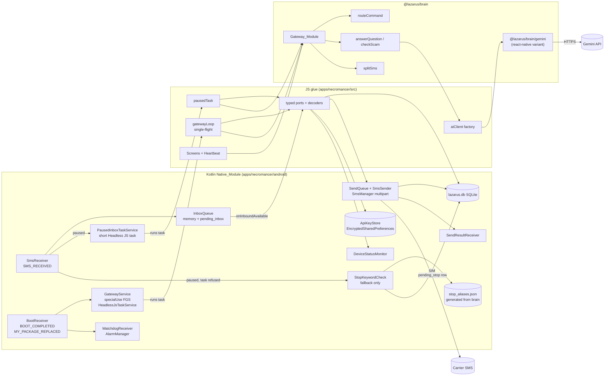
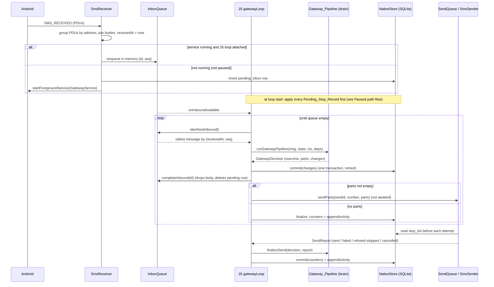
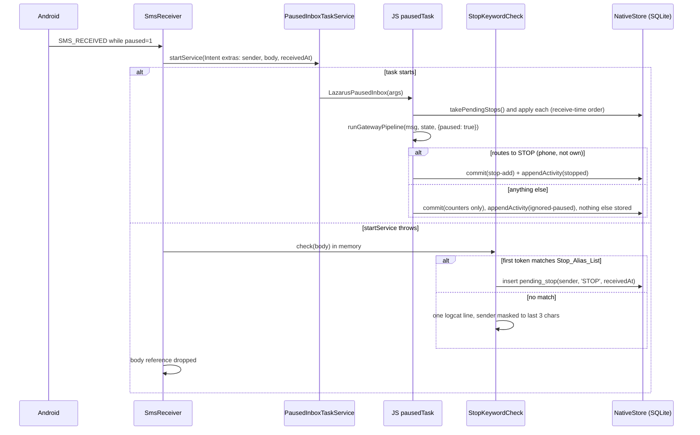
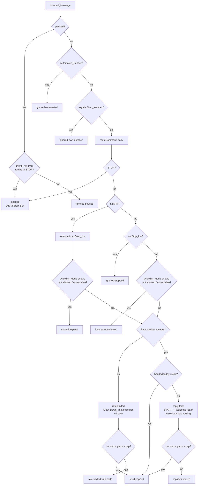
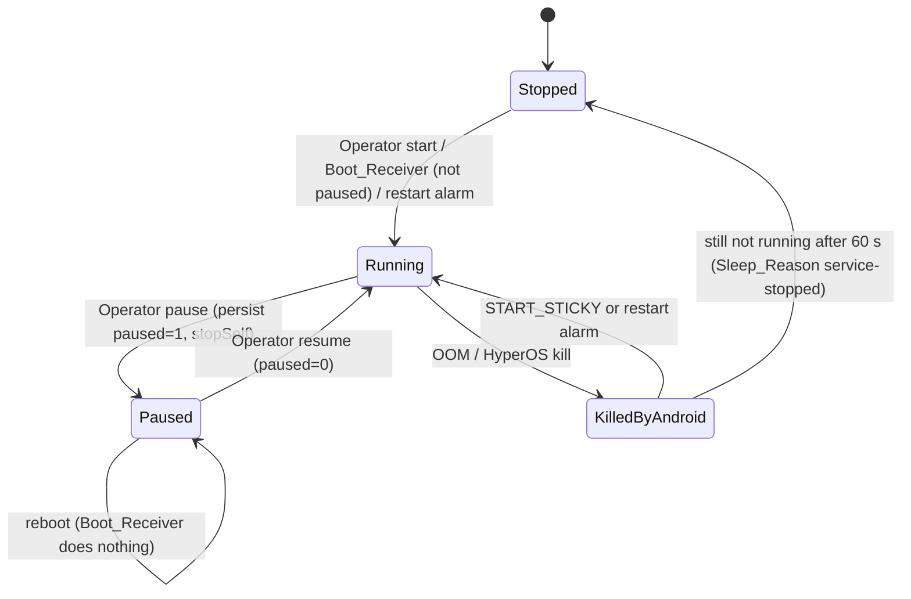

# Design Document: Necromancer SMS Gateway

## Overview

Necromancer turns an old Xiaomi phone (Android 15, HyperOS, sideloaded debug APK) into the Lazarus SMS gateway. The design splits the work into three layers:

1. **Gateway_Module in `packages/brain`** (pure TypeScript, Vitest + fast-check). It holds every gateway decision: number normalizing, printing and masking, the Gateway_Pipeline check order, the Rate_Limiter, the Daily_Send_Cap, send-result accounting, the Heartbeat_Model, day counters, Settings serialization, Allowlist edits, API key validation and masking, and the Fixed_Gateway_Texts. It has no React Native, Android, storage, network or clock dependency. Every time value is a parameter.
2. **JavaScript glue in `apps/necromancer/src`** (React Native 0.88.1, Hermes, New Architecture, Jest). It runs the single-flight gateway loop, wires the Gateway_Module to typed native ports, creates the AI_Client, and renders the four screens. It contains no decision logic of its own (Requirement 17.7).
3. **Kotlin Native_Module in `apps/necromancer/android`**. It receives SMS, sends multipart SMS through `SmsManager`, runs the `specialUse` foreground service that hosts a long-lived Headless JS task, starts a short Paused_Path_Task while the Operator has paused the gateway, runs the Stop_Keyword_Check only when Android refuses that task, restarts after boot and package replacement, stores state in SQLite, stores the Gemini_Api_Key in EncryptedSharedPreferences, and reports Device_Status.

### Key design decisions

| Decision | Choice | Reason |
| --- | --- | --- |
| Foreground service type | `specialUse` with `FOREGROUND_SERVICE_SPECIAL_USE` and a `PROPERTY_SPECIAL_USE_FGS_SUBTYPE` | `dataSync` has a 6 hour per 24 hour limit on Android 15 and cannot be started from `BOOT_COMPLETED`. `specialUse` has neither limit. Play policy review of `specialUse` does not apply to a sideloaded APK. |
| JS while UI is closed | `GatewayService` extends `HeadlessJsTaskService` and runs one long-lived task `LazarusGateway` (timeout 0, allowed in foreground) | One shared Hermes runtime for UI and gateway, no second JS engine, supported in bridgeless mode through the app's `ReactHost`. |
| Native → JS message flow | Pull model: native emits `onInboundAvailable`, JS calls `takeNextInbound()` | Ordering and single-flight are enforced in one place (the JS loop) and the native side never pushes a second message before JS asks. |
| Persistence | One native SQLite database (`lazarus.db`, WAL) exposed through `NativeStore` | The native Sms_Sender must check the Stop_List itself (Requirement 3.8) and the Boot_Receiver must read the pause flag without JS. A single native store is the only source of truth. Transactions make Stop_List writes atomic. No AsyncStorage dependency. |
| Gemini client on Hermes | Add a React Native variant of `@lazarus/brain/gemini` selected by the `react-native` export condition, using `fetch` against the Gemini REST API | `@google/genai` 3.2.0 has no `react-native` export condition and depends on `google-auth-library`, `ws` and `protobufjs`, which are Node-oriented. The REST call needs only `fetch` and `AbortController`, which React Native provides. The factory name and options stay the same, so Requirement 16.17 holds. |
| API key storage | `androidx.security:security-crypto` EncryptedSharedPreferences behind an `ApiKeyStore` Kotlin interface | User decision. The library is deprecated since 1.1.0 but still works; the interface lets a later change swap it for a direct Keystore AES-GCM store without touching JS. |
| Debug APK | `react { debuggableVariants = [] }` | A sideloaded debug APK must run without Metro, so the JS bundle and Hermes bytecode are packaged into the debug variant. |
| Navigation | A small state-based screen switcher in `App.tsx` | Four screens, no deep links; no navigation library needed. |
| Paused path | `PausedInboxTaskService` runs one short Headless JS task `LazarusPausedInbox` per message; the body travels only in the start Intent's extras (memory) | The Command_Router decides STOP, so the paused path matches the live path exactly. Nothing is stored for a non-STOP message (Requirement 9.10, 9.12). |
| Paused-path fallback | If `startService` throws, Kotlin `StopKeywordCheck` runs on the body in memory. A match stores a 3-field Pending_Stop_Record in a `pending_stop` table with no body column; no match drops the message with one masked logcat line | A STOP is never lost and no body is stored during a pause (Requirement 9.13, 9.14, 14.13). |
| Stop_Alias_List in Kotlin | Build-time asset `stop_aliases.json` generated from `@lazarus/brain` by a Gradle task before `mergeDebugAssets`, written under `android/app/build/generated/`, never committed | The fallback runs exactly when JS could not start, so the list must be on disk without JS. A JS-written copy would be missing or stale after an APK update while paused, because the Boot_Receiver starts nothing while paused and JS may not run until the Operator opens the app. A generated asset ships inside every APK, cannot drift from `ALIAS_TABLE` and is not a hand-kept list (Requirement 17.7). |
| Heartbeat drawing | RN `Animated` with the native driver on plain `View`s | No SVG dependency; reduced motion is read from `AccessibilityInfo`. |

### Implementation decisions (recorded after spec execution)

These were open in the first draft and are now fixed. Each one has a requirement criterion and tests.

| # | Decision | Requirement | Where |
|---|---|---|---|
| D1 | A first attempt with any `failed-other` part is not retried, even if other parts failed with a radio or no-service error. | 8.11 | `SendTracker.shouldRetry` |
| D2 | A retry re-sends every part; the Send_Report holds only the second attempt's results, `attempts: 2`. | 8.12 | `SendTracker` |
| D3 | While paused, a non-STOP message counts as "ignored": the Paused_Path_Task commits a counters-only change. The requirement wins over the earlier "no commit" test note, which is corrected below. | 13.12, 13.16 | `pausedTask.ts` |
| D4 | A due Slow_Down_Text that would exceed the Daily_Send_Cap gives `send-capped`, 0 parts, and no `slowdown-record`. | 5.14 | `completeReply` |
| D5 | Unparseable stored state or a non-list Stop_List decodes to `unreadable`; the loop holds the queue and retries, never starts with an empty Stop_List. | 3.11, 3.14 | `decodeStoredState`, `loadStateUntilReadable` |
| D6 | An unreadable paused flag counts as not paused in the receivers; the service reads it again before processing. | 9.18 | `SmsReceiveLogic.branch`, `BootDecision`, `GatewayLifecycle` |
| D7 | Live settings reload: after a successful save the Settings_Screen calls `settingsSync.publish({ settings?, allowlistChanges? })`; the loop replaces `state.settings`, applies only `allow-add`/`allow-remove`, and refreshes the cap banner and notification. The Settings_Screen and the headless task share one JS runtime, so a module-level channel is enough. The loop subscribes before its first load and replays early updates onto the loaded state, so a save made while the loop starts is not lost. | 15.9 | `gateway/settingsSync.ts`, `applySettingsUpdate` |

### Research summary

- **Android 15 foreground services.** Apps targeting Android 15 cannot start `dataSync`, `camera`, `mediaPlayback`, `phoneCall`, `mediaProjection` or `microphone` foreground services from a `BOOT_COMPLETED` receiver, and `dataSync` is limited to 6 hours in 24. `BOOT_COMPLETED`, `LOCKED_BOOT_COMPLETED` and `MY_PACKAGE_REPLACED` receivers and apps exempt from battery optimisation may start other foreground service types from the background ([Android: background start restrictions](https://developer.android.com/develop/background-work/services/fgs/restrictions-bg-start), [Android 15 behaviour changes](https://developer.android.com/about/versions/15/behavior-changes-15#fgs-boot-completed)). The battery Setup_Step therefore also unlocks restarts from alarms and from the SMS receiver.
- **`remoteMessaging` type** was considered. Its documented use is continuing a text conversation across a user's own devices, which does not describe an SMS auto-reply gateway, so `specialUse` is the honest declaration.
- **EncryptedSharedPreferences** must be excluded from Auto Backup, because a restored file cannot be decrypted without the original Keystore key ([EncryptedSharedPreferences reference](https://developer.android.com/reference/androidx/security/crypto/EncryptedSharedPreferences)). The library is deprecated in 1.1.0 ([release notes](https://developer.android.com/jetpack/androidx/releases/security)). On Android 12 and later `allowBackup="false"` does not stop device-to-device transfer, so `dataExtractionRules` must exclude the data too.
- **`@google/genai` 3.2.0** (installed at the repo root) declares `browser`, `node` and default export conditions only, and depends on `google-auth-library`, `p-retry`, `protobufjs` and `ws`. Metro resolves the default condition, which is not tested on Hermes. The REST endpoint `POST https://generativelanguage.googleapis.com/v1beta/models/{model}:generateContent` with the `x-goog-api-key` header covers the one call the adapter makes.
- **Cellular service state** through `TelephonyManager.getServiceState()` needs `READ_PHONE_STATE`. A `TelephonyCallback.ServiceStateListener` (API 31+) or `PhoneStateListener.LISTEN_SERVICE_STATE` (API 26–30) needs no permission, so the Native_Module caches the last reported state.
- **HyperOS Autostart** lives in `com.miui.securitycenter/com.miui.permcenter.autostart.AutoStartManagementActivity`. The component may be missing or not exported on some builds, so the design always checks `resolveActivity` and falls back to App info.
- **Restricted settings.** There is no public API. The app-op `android:access_restricted_settings` can be read with `AppOpsManager.unsafeCheckOpNoThrow` on Android 13+; the design uses it inside `try/catch` and falls back to a heuristic (permission denied instantly with no dialog and no rationale on first ask).

Content was rephrased for compliance with licensing restrictions.

### Existing brain API used

| Symbol | Signature (from `packages/brain/src`) |
| --- | --- |
| `routeCommand` | `(input: string) => RoutedCommand` with `{ command, argument, language, argumentMissing }` |
| `answerQuestion` | `(deps: AnswerDeps, question: string, language?: Language) => Promise<string>`; never rejects; worst case 2 × `CALL_TIMEOUT_MS` (8 s) = 16 s |
| `checkScam` | `(deps: AnswerDeps, argument: string, language?: Language) => Promise<string>`; never rejects |
| `splitSms` / `joinSms` | `(text: string) => string[]` (1–4 parts, `(n/total) ` prefixes) / `(parts: string[]) => string` |
| `FIXED_TEXTS` | `Record<Language, FixedTexts>`; `FIXED_TEXTS[lang].tryLater` is the Try_Later_Text |
| `createMockClient` | `(steps: readonly MockStep[]) => MockClient` with `calls: readonly Prompt[]` |
| `createMemoryCache` | `(maxEntries?: number) => AnswerCache` |
| `AnswerDeps` | `{ client: AiClient; cache: AnswerCache; clock: () => number; secrets?; timeoutMs? }` |
| `createGeminiClient` | `@lazarus/brain/gemini`: `(options?: GeminiOptions) => AiClient`; `GeminiOptions = { env?, model?, genai?, log? }` |
| `DEFAULT_GEMINI_MODEL` | `'gemini-3.5-flash-lite'` |
| `ALIAS_TABLE` | `aliases.ts`: `ReadonlyMap<string, Command>`; STOP keys are `stop`, `band`, `بند` |
| `TRAILING_PUNCT` | `router.ts` (module-private): `/[.,!?:;]+$/`, stripped from the first token before the alias lookup |

## Architecture

### Component view



### Inbound message flow (service running)



The loop awaits the pipeline and the commit for each message before it takes the next one (Requirements 1.7, 3.6). It does not await the send: the native `SendQueue` holds later Reply_Parts in order while a multipart SMS or its retry wait is in progress (Requirement 8.7). All commits go through one JS promise chain so a send finalization never interleaves with a pipeline commit.

Reply deadline. The 30-second hand-over target of Requirement 6.12 holds while no earlier multipart SMS is in a Send_Timeout wait (60 s, Requirement 8.8) or a retry wait (30 s, Requirement 8.3). In the normal case the budget is: queue wait under 2 s, router and checks under 10 ms, Answer_Service at most 16 s (backstop 25 s), commit under 100 ms. During a radio failure the `SendQueue` holds later parts behind the failing send (Requirement 8.7), so their hand-over can be later than 30 s. The design accepts this and does not reorder sends; see Known limitations.

### Paused path flow (Requirements 9.10–9.17)



The Intent is started with `startService` (not a sticky redelivered Intent), so the body exists only in process memory. Both the Gateway_Service loop and the Paused_Path_Task call `applyPendingStops` before they process any other message, including Pending_Inbox rows (Requirement 9.15, 1.6).

### Gateway_Pipeline check order (Requirement 7.3)



The router is called once, right after the Own_Number check, because STOP and START handling need the Command. Requirement 7.5 holds because automated and own-number messages exit before the router runs.

Allowlist_Mode outcomes by Command:

| Allowlist_Mode | Allowlist | STOP | START | Other Commands |
| --- | --- | --- | --- | --- |
| off | any | `stopped` | Stop_List removal, then rate, cap, Welcome_Back_Text | continue |
| on | number listed | `stopped` | Stop_List removal, then rate, cap, Welcome_Back_Text | continue |
| on | number not listed | `stopped` | Stop_List removal, `started`, 0 parts (4.8) | `ignored-not-allowed` (4.1) |
| on | `'unreadable'` | `stopped` | Stop_List removal, `started`, 0 parts (4.11) | `ignored-not-allowed` (4.9) |

In the two `started`, 0-part rows the decision has no `rate-record`, `slowdown-record` or `handed` change (Requirement 4.8, 4.11, 5.7).

Pending_Stop_Records are not Inbound_Messages and do not enter this chart. `applyPendingStop` runs only the Automated_Sender, Own_Number and STOP steps (see Paused path).

### Gateway_Service lifecycle



## Components and Interfaces

### 1. Gateway_Module (`packages/brain/src/gateway.*.ts`)

New files, all exported from `packages/brain/src/index.ts`. Every function is pure unless marked async; async functions take every dependency as a parameter.

| File | Contents |
| --- | --- |
| `gateway.types.ts` | `CanonicalNumber`, `InboundMessage`, `GatewaySettings`, `GatewayState`, `Outcome`, `OUTCOMES`, `StateChange`, `GatewayDecision`, `SendReport`, `ActivityEntry`, `DayCounters`, `DeviceStatus`, `ServiceStatus`, `Heartbeat`, `SLEEP_REASONS` |
| `gateway.number.ts` | `normalizeSender`, `printNumber`, `maskNumber`, `maskSender`, `isCanonicalNumber`, `isValidCountryCode` |
| `gateway.rate.ts` | `checkRate`, `pruneRate`, `slowDownDue` |
| `gateway.counters.ts` | `localDayKey`, `countersFor`, `reserveParts`, `releaseParts`, `recordFinal` |
| `gateway.texts.ts` | `GATEWAY_TEXTS` (Fixed_Gateway_Texts) |
| `gateway.pipeline.ts` | `evaluateInbound`, `completeReply`, `runGatewayPipeline`, `finalizeSend`, `applyChanges`, `orderInbound` |
| `gateway.heartbeat.ts` | `deriveHeartbeat` |
| `gateway.activity.ts` | `buildActivityEntry`, `trimActivityLog`, `ACTIVITY_LOG_MAX` (200) |
| `gateway.settings.ts` | `DEFAULT_SETTINGS`, `serializeSettings`, `parseSettings`, `validateSettingsField`, `addToAllowlist`, `ALLOWLIST_MAX` (500) |
| `gateway.key.ts` | `validateApiKey`, `maskApiKey`, `API_KEY_INVALID_MESSAGE` |
| `gateway.state.ts` | `decodeStoredState`, `serializeChanges` (JSON wire format to the Native_Module) |
| `gateway.pending.ts` | `PendingStopRecord`, `decodePendingStopRecord`, `applyPendingStop`, `orderPendingStops` |
| `stopAliases.ts` | `STOP_ALIAS_LIST`, `KEYWORD_TRAILING_PUNCTUATION`, `STOP_MARKER`, `stopKeywordCheck` (reference model of the Kotlin check), `stopAliasAsset()` |
| `scripts/export-stop-aliases.ts` (outside `src`) | Writes `stopAliasAsset()` as JSON to the path given by `--out`; run by Gradle |

#### Number functions

```ts
export type CanonicalNumber = string & { readonly __brand: 'CanonicalNumber' };

export type SenderIdentity =
  | { readonly kind: 'phone'; readonly number: CanonicalNumber }
  | { readonly kind: 'automated'; readonly masked: string };

/** Requirement 2.1–2.5, 2.11, 2.12. defaultCountryCode falls back to '92' when invalid or absent. */
export function normalizeSender(address: string, defaultCountryCode?: string): SenderIdentity;
/** Requirement 2.7: identical to the Canonical_Number. */
export function printNumber(number: CanonicalNumber): string;
/** Requirement 2.9: '+' kept, all digits but the last 3 become '•'. */
export function maskNumber(number: CanonicalNumber): string;
/** Requirement 2.13. */
export function maskSender(address: string): string;
export function isCanonicalNumber(value: string): value is CanonicalNumber; // /^\+[1-9]\d{6,14}$/
```

`normalizeSender` algorithm:

1. If `address` contains any character outside `0-9`, `+`, space, `-`, `.`, `(`, `)`, or a `+` anywhere except the first position, return automated.
2. Remove spaces, hyphens, dots and parentheses → `s`.
3. Build candidate digits: `+d…` → `d…`; `00d…` → `d…`; `0[1-9]…` → `cc` + rest after the `0`; `[1-9]…` → `s`; anything else → automated.
4. If the original stripped digit count (without `+`) is outside 7–15, or the candidate is outside 7–15 digits, or starts with `0`, return automated (Requirement 2.5, 2.11).
5. Return `{ kind: 'phone', number: '+' + candidate }`.

`maskSender(address)` = `'•'` when empty, `address` when length ≤ 3, otherwise `'•'.repeat(len − 3) + last 3`. Length is measured in UTF-16 code units, which is what the Activity_Log stores.

#### Core types

```ts
export const OUTCOMES = [
  'replied', 'stopped', 'started', 'ignored-stopped', 'ignored-not-allowed',
  'ignored-automated', 'ignored-own-number', 'ignored-paused',
  'rate-limited', 'send-capped', 'send-failed',
] as const;
export type Outcome = (typeof OUTCOMES)[number];

export interface InboundMessage {
  readonly id: string;          // native row id, opaque
  readonly seq: number;         // creation order from the Sms_Receiver
  readonly sender: string;      // Sender_Address exactly as Android reported it
  readonly body: string;        // kept in memory only
  readonly receivedAt: number;  // ms since epoch, phone clock
}

export interface GatewaySettings {
  readonly allowlistMode: boolean;
  readonly perNumberLimit: number;      // 1..60
  readonly rateWindowMinutes: number;   // 1..1440
  readonly dailySendCap: number;        // 1..2000
  readonly defaultCountryCode: string;  // /^[1-9]\d{0,2}$/
  readonly ownNumber: CanonicalNumber | null;
}

export interface DayCounters {
  readonly dayKey: string;     // 'YYYY-MM-DD' in local time
  readonly received: number;   // all Inbound_Messages
  readonly repliesSent: number;// outcomes replied + started (Requirement 13.12)
  readonly replied: number;    // outcome replied only (notification, Requirement 9.2)
  readonly partsSent: number;  // parts reported 'sent'
  readonly ignored: number;    // outcomes starting with 'ignored-'
  readonly handed: number;     // parts reserved for the Sms_Sender (Daily_Send_Cap basis)
}

export interface GatewayState {
  readonly stopList: ReadonlySet<CanonicalNumber>;
  readonly allowlist: ReadonlySet<CanonicalNumber> | 'unreadable';
  readonly rate: ReadonlyMap<CanonicalNumber, readonly number[]>; // accepted receive times
  readonly slowDown: ReadonlyMap<CanonicalNumber, number>;        // receive time of last Slow_Down_Text
  readonly counters: DayCounters;
  readonly settings: GatewaySettings;
}

export interface PipelineContext {
  readonly paused: boolean;
  readonly today: string; // localDayKey(receivedAt, tzOffsetMinutes) computed by the glue
}

export type StateChange =
  | { readonly type: 'stop-add'; readonly number: CanonicalNumber }
  | { readonly type: 'stop-remove'; readonly number: CanonicalNumber }
  | { readonly type: 'rate-record'; readonly number: CanonicalNumber; readonly at: number }
  | { readonly type: 'slowdown-record'; readonly number: CanonicalNumber; readonly at: number }
  | { readonly type: 'counters'; readonly counters: DayCounters }
  | { readonly type: 'allow-add'; readonly number: CanonicalNumber }
  | { readonly type: 'allow-remove'; readonly number: CanonicalNumber };

export interface GatewayDecision {
  readonly messageId: string;
  readonly receivedAt: number;
  readonly sender: SenderIdentity;
  readonly command: Command | null;   // null when the router was not called
  readonly language: Language;
  readonly outcome: Outcome;          // provisional when parts.length > 0
  readonly parts: readonly string[];  // 0..4
  readonly changes: readonly StateChange[];
}
```

`GatewayDecision` and `StateChange` never contain the body text (Requirement 14.7).

#### Pipeline

```ts
export interface AnswerRequest {
  readonly kind: 'question' | 'scam';
  readonly argument: string;
  readonly language: Language;
}

export type EvalStep =
  | { readonly kind: 'final'; readonly decision: GatewayDecision }
  | { readonly kind: 'reply'; readonly pending: PendingReply; readonly text: string }
  | { readonly kind: 'answer'; readonly pending: PendingReply; readonly request: AnswerRequest };

export interface PipelineDeps {
  /** null when no readable Gemini_Api_Key (Requirement 16.18). */
  readonly answer: AnswerDeps | null;
  readonly route?: (input: string) => RoutedCommand;               // default routeCommand
  readonly split?: (text: string) => string[];                      // default splitSms
  readonly answerQuestion?: typeof answerQuestion;
  readonly checkScam?: typeof checkScam;
  readonly answerTimeoutMs?: number;                                // default 25_000
  readonly startTimer?: (ms: number, fire: () => void) => () => void; // default setTimeout/clearTimeout
}

/** Synchronous: all checks up to the point where a Reply_Text is needed. */
export function evaluateInbound(
  msg: InboundMessage, state: GatewayState, ctx: PipelineContext,
  route: (input: string) => RoutedCommand, aiAvailable: boolean,
): EvalStep;

/** Synchronous: splits the Reply_Text and applies the Daily_Send_Cap (Requirement 5.8). */
export function completeReply(
  pending: PendingReply, replyText: string, state: GatewayState,
  split: (text: string) => string[],
): GatewayDecision;

/** Async wrapper: evaluate → (answer with 25 s backstop) → complete. Never rejects. */
export function runGatewayPipeline(
  msg: InboundMessage, state: GatewayState, ctx: PipelineContext, deps: PipelineDeps,
): Promise<GatewayDecision>;

/** Pure fold used by the JS mirror and by tests; the Native_Module applies the same list in SQL. */
export function applyChanges(state: GatewayState, changes: readonly StateChange[]): GatewayState;

/** Requirement 1.7: ascending receivedAt, ties by seq. */
export function orderInbound(messages: readonly InboundMessage[]): InboundMessage[];
```

Reply text selection inside `evaluateInbound` (Requirement 6):

| Routed command | `argumentMissing` / argument | Reply_Text source | AI call |
| --- | --- | --- | --- |
| HELP | any | `GATEWAY_TEXTS[lang].help` | no |
| QUESTION | blank argument | `GATEWAY_TEXTS[lang].help` | no |
| QUESTION | non-blank, key present | `answerQuestion(deps, argument, lang)` | yes |
| SCAM | `false`, key present | `checkScam(deps, argument, lang)` | yes |
| QUESTION / SCAM (non-blank / `false`) | key absent | `FIXED_TEXTS[lang].tryLater` | no |
| SCAM / REMIND / TRANSLATE | `true` | `GATEWAY_TEXTS[lang].usage[command]` | no |
| REMIND / TRANSLATE | `false` | `GATEWAY_TEXTS[lang].notAvailable` | no |
| START (after Stop_List handling) | any | `GATEWAY_TEXTS[lang].welcomeBack` | no |

`runGatewayPipeline` races the Answer_Service call against `startTimer(25_000)`. A late answer is ignored once the timer has fired (Requirement 6.13, 6.14). The Answer_Service already caps itself at 16 s, so the timer is a backstop. Any exception from the router or splitter is caught; the pipeline then uses `FIXED_TEXTS[lang].tryLater` (lang = routed language, or `en` if routing threw) and splits it with `splitSms` inside a second `try`. If that also throws, the decision falls back to the literal single part `FIXED_TEXTS[lang].tryLater`, which is known to fit 1 part (Requirement 6.15).

Rate and cap rules:

- `checkRate(times, t, limit, windowMs)` → `{ accepted: boolean }`; counts times `τ` with `t − windowMs < τ ≤ t` (Requirement 5.1, 5.2). A `rate-record` change is emitted only on accept.
- `slowDownDue(lastSlowDown, t, windowMs)` is true when there is no Slow_Down_Text with receive time `> t − windowMs` (Requirement 5.3, 5.4).
- Stored times older than 24 hours (the largest Rate_Window) are pruned on apply, so changing the Rate_Window never loses relevant records (Requirement 5.10).
- `reserveParts(counters, today, n)` increments `handed`. The cap check is `countersFor(c, today).handed + parts.length > dailySendCap` → `send-capped` (Requirement 5.8); `handed === dailySendCap` before routing → `send-capped` with no AI call (Requirement 5.12).

Send finalization:

```ts
export type PartResult = 'sent' | 'failed-radio' | 'failed-no-service' | 'failed-other';
export type SendReport =
  | { readonly status: 'done'; readonly results: readonly PartResult[]; readonly attempts: 1 | 2 }
  | { readonly status: 'refused-stopped' }
  | { readonly status: 'cancelled' }; // removed from the hold queue after STOP (Requirement 3.9)

export interface FinalOutcome {
  readonly outcome: Outcome;
  readonly partsSent: number;
  readonly changes: readonly StateChange[]; // counters update (and handed release on refuse/cancel)
}

/** Requirement 3.8, 3.9, 8.4, 8.5, 8.10, 13.12. report is null when decision.parts is empty. */
export function finalizeSend(
  decision: GatewayDecision, report: SendReport | null, counters: DayCounters, today: string,
): FinalOutcome;
```

| Report | Final Outcome | partsSent | `handed` |
| --- | --- | --- | --- |
| `null` (no parts) | decision outcome | 0 | unchanged |
| `done`, all `sent` | decision outcome (`replied`, `started`, `rate-limited`) | `parts.length` | unchanged |
| `done`, any `failed-*` | `send-failed` | count of `sent` in the last attempt | unchanged |
| `refused-stopped` or `cancelled` | `ignored-stopped` | 0 | released by `parts.length` |

#### Paused path

`evaluateInbound` with `ctx.paused === true`: if the sender is a Phone_Number that is not the Own_Number and the body routes to STOP, return `stopped` with a `stop-add` change (Requirement 9.11). Every other message returns `ignored-paused` with no changes (Requirement 9.10). The router runs only for Phone_Numbers that are not the Own_Number. The Paused_Path_Task calls this through `runGatewayPipeline` with `answer: null`, so it never calls the AI_Client and never starts the Gateway_Service (Requirement 9.12).

#### Stop_Alias_List and the Stop_Keyword_Check contract

```ts
/** Keys of ALIAS_TABLE that map to STOP, in table order: ['stop', 'band', 'بند']. */
export const STOP_ALIAS_LIST: readonly string[];
/** The characters the Command_Router strips from the end of the first token: '.,!?:;'. */
export const KEYWORD_TRAILING_PUNCTUATION: string;
/** Fixed value stored in a Pending_Stop_Record in place of the body. */
export const STOP_MARKER = 'STOP';

/** Reference model of the Kotlin fallback (Requirement 9.13 glossary definition). */
export function stopKeywordCheck(body: string): boolean;

export interface StopAliasAsset {
  readonly v: 1;
  readonly aliases: readonly string[];
  readonly trailingPunctuation: string;
  readonly stopMarker: string;
}
export function stopAliasAsset(): StopAliasAsset;
```

- `STOP_ALIAS_LIST` is computed as `[...ALIAS_TABLE].filter(([, c]) => c === 'STOP').map(([k]) => k)`, so it cannot drift from the router.
- `router.ts` builds its `TRAILING_PUNCT` regex from `KEYWORD_TRAILING_PUNCTUATION` instead of a literal. Router behaviour does not change; the existing router tests guard that.
- `stopKeywordCheck(body)`: trim with the JS whitespace set, take the text before the first whitespace run, remove trailing characters in `KEYWORD_TRAILING_PUNCTUATION`, lowercase, and test membership in `STOP_ALIAS_LIST`. It does not apply `normalizeMessage` (fullwidth letters, odd spaces), which is the documented limitation.
- **Build-time asset.** `android/app/build.gradle` registers `generateStopAliases` (an `Exec` task, inputs `packages/brain/src/aliases.ts` and `stopAliases.ts`, output `build/generated/lazarus/assets/stop_aliases.json`), wires it before `merge*Assets`, and adds the output directory to `android.sourceSets.main.assets.srcDirs`. The task runs `node --import ./scripts/ts-resolve.mjs ./scripts/export-stop-aliases.ts --out <file>` in `packages/brain`. Node 24 strips the types natively; `ts-resolve.mjs` is a 10-line `module.register` resolve hook that maps relative `.js` specifiers to the sibling `.ts` file, the same mapping Metro's `resolveRequest` uses. The React Native build already needs Node for bundling, so this adds no tool.
- Kotlin `StopKeywordCheck` loads the asset once with `context.assets.open("stop_aliases.json")`, rejects it unless `v == 1`, and applies the same steps as `stopKeywordCheck` with `trim()`, a split on `Regex("\\s+")`, `trimEnd { it in trailingPunctuation }` and `lowercase(Locale.ROOT)`. Kotlin keeps no keyword or punctuation literal.

#### Pending_Stop_Records

```ts
export interface PendingStopRecord {
  readonly id: number;           // SQLite rowid of the pending_stop row (handle, not a stored field)
  readonly sender: string;       // Sender_Address exactly as Android reported it
  readonly marker: typeof STOP_MARKER;
  readonly receivedAt: number;
}
/** Trust-boundary decoder: accepts only {id, sender, marker:'STOP', receivedAt}; any other key or marker → null. */
export function decodePendingStopRecord(raw: unknown): PendingStopRecord | null;
/** Ascending receivedAt, ties by id. */
export function orderPendingStops(records: readonly PendingStopRecord[]): PendingStopRecord[];
/**
 * Requirement 9.15. Runs only Automated_Sender, Own_Number and STOP handling.
 * Returns a decision with command 'STOP', 0 parts and outcome
 * 'ignored-automated' | 'ignored-own-number' (no changes) or 'stopped' (one stop-add).
 */
export function applyPendingStop(record: PendingStopRecord, state: GatewayState): GatewayDecision;
```

`applyPendingStop` ignores `paused`, Allowlist_Mode, the Rate_Limiter and the Daily_Send_Cap, like any STOP (Requirement 3.2). It never calls the router, because the record holds no body. `buildActivityEntry` uses `decision.command`, so every applied record produces an Activity_Entry with the Command STOP and the record's receive time.

#### Heartbeat_Model

```ts
export const SLEEP_REASONS = [
  'paused-by-operator', 'no-sms-permission', 'no-notification-permission',
  'service-stopped', 'airplane-mode', 'no-signal', 'battery-optimised',
] as const; // priority order, Requirement 13.3
export type SleepReason = (typeof SLEEP_REASONS)[number];

export interface DeviceStatus {
  readonly smsPermission: boolean;          // RECEIVE_SMS and SEND_SMS
  readonly notificationPermission: boolean;
  readonly batteryOptimisationIgnored: boolean;
  readonly inService: boolean;
  readonly airplaneMode: boolean;
}
export type ServiceStatus = 'running' | 'stopped' | 'paused';

export type Heartbeat =
  | { readonly state: 'ALIVE' }
  | { readonly state: 'SENDING' }
  | { readonly state: 'SLEEPING'; readonly reason: SleepReason };

export function deriveHeartbeat(device: DeviceStatus, service: ServiceStatus, sending: boolean): Heartbeat;
```

The union type makes "reason if and only if SLEEPING" a compile-time fact; the property test checks the runtime values too.

#### Settings, Allowlist and key

```ts
export const DEFAULT_SETTINGS: GatewaySettings; // off, 5, 60, 200, '92', null
export function serializeSettings(s: GatewaySettings): string; // JSON {"v":1,...}
export type ParsedSettings =
  | { readonly status: 'ok'; readonly settings: GatewaySettings }
  | { readonly status: 'missing'; readonly settings: GatewaySettings }  // defaults, no message
  | { readonly status: 'invalid'; readonly settings: GatewaySettings }; // defaults, show reset message
export function parseSettings(raw: string | null): ParsedSettings;

export type FieldResult<T> = { readonly ok: true; readonly value: T } | { readonly ok: false; readonly range: string };
export function validateSettingsField(
  field: 'perNumberLimit' | 'rateWindowMinutes' | 'dailySendCap' | 'defaultCountryCode' | 'ownNumber',
  input: string, defaultCountryCode: string,
): FieldResult<number | string | CanonicalNumber | null>;

export type AllowlistAdd =
  | { readonly status: 'added'; readonly number: CanonicalNumber }
  | { readonly status: 'duplicate'; readonly number: CanonicalNumber }
  | { readonly status: 'invalid' }   // Requirement 4.5
  | { readonly status: 'full' };     // Requirement 4.10
export function addToAllowlist(list: ReadonlySet<CanonicalNumber>, input: string, defaultCountryCode: string): AllowlistAdd;

export type KeyCheck = { readonly ok: true; readonly key: string } | { readonly ok: false };
export function validateApiKey(raw: string): KeyCheck;       // trim, /^[A-Za-z0-9_-]{30,64}$/
export function maskApiKey(key: string): string;             // '••••' + key.slice(-4)
export const API_KEY_INVALID_MESSAGE: string; // fixed text, never echoes input (Requirement 16.4)
```

#### Fixed_Gateway_Texts

```ts
export interface GatewayTexts {
  readonly help: string;
  readonly slowDown: string;
  readonly welcomeBack: string;
  readonly notAvailable: string;
  readonly usage: Readonly<Record<'SCAM' | 'REMIND' | 'TRANSLATE', string>>;
}
export const GATEWAY_TEXTS: Readonly<Record<Language, GatewayTexts>>;
```

Each text uses the keywords the Command_Router recognises in that Language (`ALIAS_TABLE`): English `HELP STOP SCAM REMIND TRANSLATE`, Roman Urdu `MADAD BAND DHOKA YAAD TARJUMA`, Urdu `مدد بند دھوکہ یاد ترجمہ`. Example English Help_Text (GSM-7, under 160 units): `Lazarus: text any question. SCAM <msg> checks a message. STOP ends texts, START resumes. REMIND and TRANSLATE coming soon.` Tests enforce: no newline, `en` and `roman-ur` texts are GSM-7, `ur` texts are Urdu script, `splitSms` gives 1 part (the `ur` Help_Text at most 2), and every usage hint's example routes to its own Command.

### 2. Gemini client for React Native (`packages/brain/src/gemini.*.ts`)

Changes to the existing adapter, with unchanged behaviour for Node:

- Move everything in `gemini.entry.ts` except the `@google/genai` import and `defaultGenai` into a new `gemini.core.ts` (`mapSdkError`, `createGeminiCore(key, model, makeGenai, log)`, `GenaiLike`, `GeminiOptions`). `gemini.entry.ts` re-exports them and keeps `createGeminiClient` with the SDK default. Existing tests keep importing `gemini.entry.ts`.
- Add `gemini.native.ts`, exporting `createGeminiClient(options?: GeminiOptions & { fetch?: FetchLike; requestTimeoutMs?: number })`. It never reads `process.env`; an absent `env` means no key. Its default `genai` is `createRestGenai(key, fetch)`.
- `packages/brain/package.json` exports become:

```json
"./gemini": {
  "react-native": "./src/gemini.native.ts",
  "default": "./src/gemini.entry.ts"
}
```

```ts
/** Minimal fetch shape; brain's tsconfig has no DOM lib. */
export interface FetchLike {
  (url: string, init: { method: 'POST'; headers: Record<string, string>; body: string; signal?: unknown }):
    Promise<{ readonly ok: boolean; readonly status: number; json(): Promise<unknown> }>;
}
export function createRestGenai(apiKey: string, fetch: FetchLike, timeoutMs?: number): GenaiLike;
```

`createRestGenai.models.generateContent({ model, contents, config })` sends:

```json
POST https://generativelanguage.googleapis.com/v1beta/models/{model}:generateContent
x-goog-api-key: <key>
{ "systemInstruction": { "parts": [{ "text": "<system>" }] },
  "contents": [{ "role": "user", "parts": [{ "text": "<user>" }] }],
  "generationConfig": { "maxOutputTokens": 300, "temperature": 0.3 } }
```

It returns `{ text }` joined from `candidates[0].content.parts[*].text`. A non-2xx response throws `{ name: 'GeminiHttpError', status, message: error.status }` (for example `RESOURCE_EXHAUSTED`), which `mapSdkError` already maps to `quota`, `timeout`, `network` or `unknown`. A thrown `TypeError` from `fetch` maps to `network`; an abort maps to `timeout` through `AbortError`. The key goes only in the header, never in the URL, a log line or an error message. The Prompt the Answer_Service builds holds only the sanitised argument and Language rules, so Requirement 6.9 holds by construction.

The app creates the client as:

```ts
import { createGeminiClient } from '@lazarus/brain/gemini';
const client = createGeminiClient({ env: { GEMINI_API_KEY: key } }); // no model, no process.env (Requirement 16.17)
```

### 3. JS glue (`apps/necromancer/src`)

| Module | Responsibility |
| --- | --- |
| `native/specs/NativeGateway.ts`, `NativeStore.ts`, `NativeDevice.ts`, `NativeKeyStore.ts` | Codegen TurboModule specs |
| `native/ports.ts` | Typed wrappers; decode and validate every native payload at the trust boundary; expose `GatewayPorts` so Jest can mock one object |
| `gateway/loop.ts` | `startGatewayLoop(ports, clock)`: singleton guard, load state, drain queue in order, run pipeline, commit with retries, hand parts, finalize sends, append activity |
| `gateway/commitQueue.ts` | One promise chain for all writes; 3 retries at 1 s for Stop_List changes (Requirement 3.12) |
| `gateway/pausedTask.ts` | Headless task `LazarusPausedInbox`: load state, `applyPendingStops`, run `runGatewayPipeline` with `paused: true` and `answer: null` on the in-memory body, commit, append activity, end. Never starts the Gateway_Service |
| `gateway/pendingStops.ts` | `applyPendingStops(ports, state)`: `takePendingStops()` → `decodePendingStopRecord` → `orderPendingStops` → for each record `applyPendingStop` then `store.applyPendingStop(id, changes, entry)` with the 3 × 1 s retries; on final failure leave the row and continue (Requirement 9.16) |
| `gateway/ai.ts` | Read key → `createGeminiClient` + `createMemoryCache` → `AnswerDeps`; hold only the client and the Masked_Key; rebuild on save or remove |
| `gateway/store.ts` | Small observable store (React `useSyncExternalStore`) for heartbeat, counters, banners, activity list |
| `ui/theme.ts` | Design tokens from `.kiro/steering/design.md` |
| `ui/Heartbeat.tsx` | Heartbeat line, pulse and glow, reduced motion |
| `ui/startScreen.ts` | `chooseStartScreen(perms, setupMarks)` (Requirement 12.13) |
| `ui/screens/PermissionScreen.tsx`, `SetupScreen.tsx`, `MainScreen.tsx`, `SettingsScreen.tsx` | Screens |
| `index.js` | `registerComponent`, `registerHeadlessTask('LazarusGateway')`, `registerHeadlessTask('LazarusPausedInbox')` |

Loop outline:

```ts
export async function startGatewayLoop(ports: GatewayPorts, clock: Clock): Promise<void> {
  if (running) return; running = true;
  const loaded = await loadStateUntilReadable(ports);   // holds queue while Stop_List unreadable (3.11, 15.8)
  let state = loaded.state;
  let ai = await createAnswerDeps(ports.keyStore, clock); // null when no key (16.18)
  state = await applyPendingStops(ports, state);          // before Pending_Inbox and live messages (9.15)
  ports.gateway.attachLoop();
  for (;;) {
    const msg = await ports.gateway.takeNextInbound();    // ordered natively by (receivedAt, seq)
    if (msg === null) { await ports.gateway.waitForInbound(); continue; }
    const ctx = { paused: false, today: localDayKey(msg.receivedAt, clock.tzOffsetMinutes(msg.receivedAt)) };
    const decision = await runGatewayPipeline(msg, state, ctx, { answer: ai.current });
    state = applyChanges(state, decision.changes);
    await commits.enqueue(decision.changes);              // before next message (3.6)
    await ports.gateway.completeInbound(msg.id);          // body dropped, pending row deleted (14.7)
    if (decision.outcome === 'stopped') await ports.gateway.cancelPendingSends(numberOf(decision)); // 3.9
    if (decision.parts.length === 0) finalize(decision, null);
    else ports.gateway.sendParts(decision.messageId, numberOf(decision), decision.parts).then((r) => finalize(decision, r));
  }
}
```

### 4. Kotlin Native_Module (`android/app/src/main/java/dev/lazarus/necromancer/`)

#### TurboModule specs

```ts
// NativeGateway.ts
export type InboundPayload = { id: string; seq: number; sender: string; body: string; receivedAt: number };
export type SendReportPayload = { status: string; results: string[]; attempts: number };
export interface Spec extends TurboModule {
  startService(): Promise<void>;
  pauseService(): Promise<void>;          // persists paused=1, stops service, removes notification
  resumeService(): Promise<void>;         // persists paused=0, starts service
  getServiceStatus(): Promise<string>;    // 'running' | 'stopped' | 'paused'
  attachLoop(): void;                     // JS loop is ready; receiver may now queue in memory
  takeNextInbound(): Promise<InboundPayload | null>;
  completeInbound(id: string): Promise<void>;
  sendParts(sendId: string, number: string, parts: string[]): Promise<SendReportPayload>;
  cancelPendingSends(number: string): Promise<number>;
  takePendingStops(): Promise<string>;    // JSON array of pending_stop rows, decoded by decodePendingStopRecord
  updateNotification(stateWord: string, repliedToday: number): void;
  readonly onInboundAvailable: EventEmitter<void>;
  readonly onSendState: EventEmitter<boolean>;
  readonly onServiceStatus: EventEmitter<string>;
}

// NativeStore.ts
export interface Spec extends TurboModule {
  loadState(): Promise<string>;           // JSON; decoded by decodeStoredState
  commit(changesJson: string): Promise<void>;   // one SQLite transaction
  saveSettings(raw: string): Promise<void>;
  appendActivity(entryJson: string): Promise<void>; // insert + trim to 200 in one transaction
  // One transaction: DELETE pending_stop row id (must delete 1 row, else rollback and resolve false),
  // apply changes, insert + trim activity. Rejects on any SQLite error; the row then stays (9.16).
  applyPendingStop(id: number, changesJson: string, entryJson: string): Promise<boolean>;
  // Paused_Path_Task only: STOP routed but its commit failed after retries; stores the 3 fields (9.13, 14.13).
  savePendingStop(sender: string, receivedAt: number): Promise<void>;
  loadActivity(): Promise<string>;
  clearActivity(): Promise<void>;
  getSetupMarks(): Promise<string>;       // {"autostart":bool,"recents":bool}
  setSetupMark(step: string, done: boolean): Promise<void>;
}

// NativeDevice.ts
export type DeviceStatusPayload = { smsPermission: boolean; notificationPermission: boolean;
  batteryOptimisationIgnored: boolean; inService: boolean; airplaneMode: boolean };
export interface Spec extends TurboModule {
  getDeviceStatus(): Promise<DeviceStatusPayload>;
  isRestrictedSettingsBlocked(): Promise<boolean>;
  openAppInfo(): Promise<void>;
  openAutostart(): Promise<boolean>;      // false → App info opened instead
  requestIgnoreBatteryOptimisation(): Promise<boolean>; // false → battery settings opened
  openAirplaneSettings(): Promise<void>;
  openMobileNetworkSettings(): Promise<void>;
  readonly onDeviceStatus: EventEmitter<DeviceStatusPayload>;
}

// NativeKeyStore.ts
export type KeyRead = { status: string; key: string | null }; // 'present' | 'absent' | 'unreadable'
export interface Spec extends TurboModule {
  readKey(): Promise<KeyRead>;
  saveKey(key: string): Promise<void>;    // replaces unreadable data too (16.21)
  deleteKey(): Promise<void>;
}
```

Runtime permission requests use React Native's `PermissionsAndroid` (`RECEIVE_SMS`, `SEND_SMS`, `POST_NOTIFICATIONS`); `never_ask_again` maps to "missing, open App info" (Requirement 11.6), and `isRestrictedSettingsBlocked()` decides whether to show the four restricted-settings steps (Requirement 11.7).

#### Kotlin classes

| Class | Role |
| --- | --- |
| `LazarusPackage` | `BaseReactPackage` registering the four modules; added in `MainApplication` |
| `SmsReceiver` | Manifest receiver for `android.provider.Telephony.SMS_RECEIVED`, `android:permission="android.permission.BROADCAST_SMS"`, exported. Uses `Telephony.Sms.Intents.getMessagesFromIntent`, groups by `originatingAddress` in PDU order, joins `messageBody`, stamps `System.currentTimeMillis()`. Reads the paused flag: paused → `startService(PausedInboxTaskService)` with the message in Intent extras, and if that throws (`IllegalStateException`, including `BackgroundServiceStartNotAllowedException`) → `StopKeywordCheck`: match → `PendingStopStore.insert(sender, receivedAt)`, no match → one line `"SmsReceiver: dropped while paused (from <LogMask.tail3(sender)>)"` (Requirement 9.13, 9.14); running and loop attached → `InboxQueue.enqueueMemory`; otherwise → insert `pending_inbox` row and `startForegroundService`. Never deletes or edits the inbox (the app is not the default SMS app and holds no `READ_SMS`/`WRITE_SMS`). Decode failures log one line with the exception class and, when an address exists, only `LogMask.tail3` of it (Requirement 1.9). |
| `StopKeywordCheck` | Loads `stop_aliases.json` once (lazy, thread-safe). `matches(body): Boolean` as defined under "Stop_Alias_List and the Stop_Keyword_Check contract". If the asset is missing or has the wrong `v`, `matches` returns false and logs `"StopKeywordCheck: asset unreadable"` once, so a broken build can never create a false opt-out. |
| `PendingStopStore` | `insert(sender, receivedAt)` writes one `pending_stop` row with columns `sender`, `marker = asset.stopMarker`, `received_at`. The method signature takes no body, so the body cannot reach storage (Requirement 14.13). Logs `"PendingStop: stored (from <tail3>)"` (Requirement 14.14). |
| `LogMask` | `tail3(s)`: `•` for each character except the last 3; the same rule as `maskSender`. The only Kotlin masking helper, used only in logcat lines (Requirement 17.7 exception). |
| `InboxQueue` | Process singleton. Memory deque plus the `pending_inbox` table; `takeNext()` returns the oldest by `(receivedAt, seq)`. On service start loads pending rows first. `seq` from an `AtomicLong` seeded with `max(seq)` from the table. |
| `GatewayService` | Extends `HeadlessJsTaskService`. `onStartCommand` calls `startForeground(id, notification, FOREGROUND_SERVICE_TYPE_SPECIAL_USE)` before the task starts, returns `START_STICKY`. Task config: `HeadlessJsTaskConfig("LazarusGateway", args, 0, true)`. Holds a partial `WakeLock` only while a message is being processed. `onTaskRemoved` and `onDestroy` (when not paused) schedule `RestartReceiver` 5 s later with `AlarmManager.setAndAllowWhileIdle`. |
| `GatewayNotification` | Channel `gateway` (low importance). Text: `"Lazarus is ALIVE · 12 replies today"`; never a number other than the count (Requirement 9.2). `setOngoing(true)`, content intent opens `MainActivity`, `deleteIntent` re-posts within 5 s. |
| `PausedInboxTaskService` | Plain `HeadlessJsTaskService`, task `LazarusPausedInbox`, timeout 15 s, `START_NOT_STICKY` so Android never redelivers the Intent (the body stays in memory only). One task per Inbound_Message (Requirement 9.12). If the task times out, the body is gone and the message gets no Activity_Entry, like the refused case. |
| `SendQueue` / `SmsSender` | FIFO, one multipart send at a time, Handler on a background `HandlerThread`. Before every attempt reads `stop_list` from SQLite; on hit reports `refused-stopped` (Requirement 3.8). Validates each part with `SmsMessage.calculateLength(part, false)[0] == 1`; otherwise reports `failed-other` without sending. Sends with `getSystemService(SmsManager::class.java).createForSubscriptionId(SmsManager.getDefaultSmsSubscriptionId())` (`SmsManager.getDefault()` below API 31) and `sendMultipartTextMessage(number, null, ArrayList(parts), sentIntents, null)`. |
| `SendResultReceiver` | Not exported. Each sent `PendingIntent` is explicit, `FLAG_IMMUTABLE or FLAG_ONE_SHOT`, request code from an incrementing counter, extras `sendId`, `attempt`, `part`. Maps `RESULT_OK` → `sent`; `RESULT_ERROR_GENERIC_FAILURE` → `failed-radio`; `RESULT_ERROR_NO_SERVICE`, `RESULT_ERROR_RADIO_OFF` → `failed-no-service`; all others → `failed-other`. |
| `SendTracker` | Per attempt: 60 s timeout per part (`failed-no-service` on expiry, Requirement 8.8); on any `failed-radio`/`failed-no-service` waits 30 s and retries the whole list once (Requirement 8.3); emits `onSendState(true/false)`. `cancel(number)` removes queued items and items waiting for the retry and resolves them `cancelled`. |
| `BootReceiver` | `BOOT_COMPLETED` and `MY_PACKAGE_REPLACED`. If not paused: `startForegroundService(GatewayService)` and schedule `WatchdogReceiver` in 60 s. If paused: nothing. |
| `WatchdogReceiver` / `RestartReceiver` | Watchdog posts one "Open Necromancer and check the Setup screen" notification if the service is still not running (Requirement 10.5). Restart tries `startForegroundService`. |
| `LazarusDb` | `SQLiteOpenHelper`, WAL. All writes in `beginTransaction`/`setTransactionSuccessful`. |
| `ApiKeyStore` | Interface `read(): KeyRead`, `write(key)`, `delete()`. Implementation `EncryptedApiKeyStore` (`MasterKey.KeyScheme.AES256_GCM`, file `lazarus_key`). Any `GeneralSecurityException` or `IOException` → `unreadable` with one log line `"ApiKeyStore: read failed (<ExceptionClass>)"`. `write` after a failure deletes the file and the Keystore alias, then recreates both (Requirement 16.21). |
| `DeviceStatusMonitor` | Permission checks via `ContextCompat.checkSelfPermission`; notifications via `NotificationManagerCompat.areNotificationsEnabled()`; battery via `PowerManager.isIgnoringBatteryOptimizations`; airplane via `Settings.Global.AIRPLANE_MODE_ON`; service state via `TelephonyCallback.ServiceStateListener` (API 31+) or `PhoneStateListener` (26–30). Emits `onDeviceStatus` on change. |
| `RestrictedSettings` | `AppOpsManager.unsafeCheckOpNoThrow("android:access_restricted_settings", uid, pkg)` on API 33+ inside `try/catch`; `MODE_ERRORED` or `MODE_IGNORED` → blocked. Fallback heuristic in JS: first request denied in under 300 ms with no rationale. |
| `SettingsIntents` | Autostart: `ComponentName("com.miui.securitycenter", "com.miui.permcenter.autostart.AutoStartManagementActivity")` if it resolves, else `ACTION_APPLICATION_DETAILS_SETTINGS`. Battery: `ACTION_REQUEST_IGNORE_BATTERY_OPTIMIZATIONS` with `package:` URI, else `ACTION_IGNORE_BATTERY_OPTIMIZATION_SETTINGS`, else App info. Airplane: `ACTION_AIRPLANE_MODE_SETTINGS`. Network: `ACTION_NETWORK_OPERATOR_SETTINGS`, else `ACTION_WIRELESS_SETTINGS`. |

Native code never writes a body or a full Sender_Address or Canonical_Number to logcat. Log lines name the event and the exception class, plus `LogMask.tail3` of the address in the three lines Requirement 17.7 allows (decode failure 1.9, paused drop 9.14, Pending_Stop_Record 14.14). This satisfies Requirements 14.6 and 14.12 as well.

#### Manifest and build changes

```xml
<uses-permission android:name="android.permission.RECEIVE_SMS" />
<uses-permission android:name="android.permission.SEND_SMS" />
<uses-permission android:name="android.permission.POST_NOTIFICATIONS" />
<uses-permission android:name="android.permission.RECEIVE_BOOT_COMPLETED" />
<uses-permission android:name="android.permission.FOREGROUND_SERVICE" />
<uses-permission android:name="android.permission.FOREGROUND_SERVICE_SPECIAL_USE" />
<uses-permission android:name="android.permission.REQUEST_IGNORE_BATTERY_OPTIMIZATIONS" />
<uses-permission android:name="android.permission.WAKE_LOCK" />
<uses-permission android:name="android.permission.INTERNET" />

<application android:allowBackup="false"
             android:fullBackupContent="false"
             android:dataExtractionRules="@xml/data_extraction_rules" ...>
  <service android:name=".gateway.GatewayService"
           android:exported="false"
           android:foregroundServiceType="specialUse">
    <property android:name="android.app.PROPERTY_SPECIAL_USE_FGS_SUBTYPE"
              android:value="SMS auto-reply gateway: receives SMS questions and sends short answers by SMS while the screen is off" />
  </service>
  ...
</application>
```

`res/xml/data_extraction_rules.xml` excludes `sharedpref`, `database`, `file` and `root` domains from both `<cloud-backup>` and `<device-transfer>`. `WAKE_LOCK` is a normal permission outside the 17.4 list and is needed for the partial wake lock; 17.5 does not forbid it.

| File | Change |
| --- | --- |
| `android/build.gradle` | `minSdkVersion = 26` (was 24), `targetSdkVersion = 35` (was 36), `compileSdkVersion` stays 37 (≥ 35) |
| `android/app/build.gradle` | `react { debuggableVariants = [] }`; add `androidx.security:security-crypto:1.1.0`; register `generateStopAliases` before `merge*Assets` and add `build/generated/lazarus/assets` to the main assets `srcDirs` |
| `packages/brain/scripts/` | `export-stop-aliases.ts` and `ts-resolve.mjs`; `package.json` script `"export:stop-aliases"` for running it by hand |
| `apps/necromancer/package.json` | `"@lazarus/brain": "file:../../packages/brain"`; `codegenConfig` for the four specs |
| `metro.config.js` | `watchFolders: [packages/brain]`, `nodeModulesPaths` for app and repo root, `resolveRequest` mapping relative `./x.js` imports inside `packages/brain/src` to `./x.ts` (brain uses NodeNext-style `.js` suffixes) |
| `jest.config.js` | `moduleNameMapper`: `^@lazarus/brain$` → `packages/brain/src/index.ts`, `^@lazarus/brain/gemini$` → `gemini.native.ts`, `^(\.{1,2}/.*)\.js$` → `$1`; `transformIgnorePatterns` lets Babel transform brain sources |
| `README.md` | Debug build command `cd android && ./gradlew assembleDebug`, sideload with `adb install -r app/build/outputs/apk/debug/app-debug.apk`; a "Known limitations" section with the three limitations from the requirements Introduction (Requirement 17.12, see Known limitations below) |

### 5. UI

- `theme.ts` exports exactly the tokens: `bg #0B0F0C`, `surface #141A16`, `text #E6F2E9`, `muted #8FA396`, `soul #39FF88`, `ember #FFB347`, `blood #FF4D5E`, `radius 14`, `space {4,8,12,16,24,32}`, `fontMin 16`. Computed contrast on `bg`: text ≈ 17:1, muted ≈ 7.2:1, blood ≈ 5.9:1, soul and ember above 12:1; on `surface` muted ≈ 6.6:1. Buttons use `bg`-coloured text on `soul` (above 14:1).
- **Heartbeat.** A flat `View` line plus a spike made of two rotated segments. ALIVE: `Animated.loop` of the spike's `scaleY` and `opacity` every 1.5 s, colour `soul`; an Inbound_Message event triggers one extra pulse within 1 s (`onInboundAvailable` is mirrored into the UI store). SENDING: line colour `ember` with a looping opacity glow on a halo `View`. SLEEPING: flat line in `muted`, no animation, one sentence (≤ 120 characters) and one fix button chosen from a table keyed by Sleep_Reason (Requirement 13.7). Reduced motion (`AccessibilityInfo.isReduceMotionEnabled` plus the `reduceMotionChanged` listener): no loops, static line in the state colour. The state word is always shown as text (Requirement 13.10). All animations use `useNativeDriver: true`.
- **Main_Screen** shows the heartbeat, the 4 day counters, banners (cap reached, AI key missing, Stop_List or Allowlist unreadable, settings reset, phone status unreadable), the Activity_Log newest first with a clear button and confirmation, start/pause/resume control, and buttons to Setup and Settings.
- **Permission_Screen** lists the three explanations (each ≤ 300 characters), the privacy statement above the continue button, and per-permission status that re-checks on `AppState` `active`.
- **Setup_Screen** lists the 6 Setup_Steps in order, each with a ≤ 120-character "what breaks if skipped" line, live done marks from Device_Status and the key store, manual marks for Autostart and recent-apps from `NativeStore`, fallback instructions shown after a failed intent, and the Key_Input_Field (`autoCorrect={false}`, `autoComplete="off"`, `autoCapitalize="none"`, `spellCheck={false}`, `secureTextEntry` off so paste is visible only as typed, value held in component state and cleared on save and on unmount).
- **Settings_Screen** edits each Settings field with `validateSettingsField`, adds Allowlist entries with `addToAllowlist`, shows Allowlist and Stop_List entries as `maskNumber` output, and shows the Stop_List read-only.

Fallback instructions shown on the Setup_Screen:

| Step | Instruction text (HyperOS 2, Android 15) |
| --- | --- |
| Restricted_Settings | 1. Open App info. 2. Tap the ⋮ menu at the top right. 3. Tap "Allow restricted settings". 4. Come back to Necromancer. |
| Autostart | App info → Autostart → turn on. Or Security app → App manager → Necromancer → Autostart. |
| Battery | App info → Battery saver → No restrictions. |
| Recent apps | Open recent apps, long-press Necromancer, tap the lock icon. |

## Data Models

### SQLite schema (`lazarus.db`, version 1)

```sql
CREATE TABLE stop_list   (number TEXT PRIMARY KEY);                       -- Canonical_Number
CREATE TABLE allowlist   (number TEXT PRIMARY KEY);                       -- max 500 enforced in brain
CREATE TABLE rate_record (number TEXT NOT NULL, at INTEGER NOT NULL);     -- accepted receive times
CREATE INDEX rate_record_number ON rate_record(number, at);
CREATE TABLE slowdown    (number TEXT PRIMARY KEY, at INTEGER NOT NULL);
CREATE TABLE counters    (id INTEGER PRIMARY KEY CHECK (id = 1), json TEXT NOT NULL); -- DayCounters
CREATE TABLE kv          (key TEXT PRIMARY KEY, value TEXT NOT NULL);     -- settings, paused, setup marks
CREATE TABLE activity    (id INTEGER PRIMARY KEY AUTOINCREMENT, received_at INTEGER NOT NULL,
                          who TEXT NOT NULL, command TEXT NOT NULL, outcome TEXT NOT NULL);
CREATE TABLE pending_inbox (id TEXT PRIMARY KEY, seq INTEGER NOT NULL, sender TEXT NOT NULL,
                          body TEXT NOT NULL, received_at INTEGER NOT NULL);
CREATE TABLE pending_stop (sender TEXT NOT NULL,                           -- Pending_Stop_Record: exactly 3 columns
                          marker TEXT NOT NULL CHECK (marker = 'STOP'),
                          received_at INTEGER NOT NULL);                   -- no body column (14.13)
```

- `kv` keys: `settings` (string from `serializeSettings`), `paused` (`"0"`/`"1"`), `setup.autostart`, `setup.recents`.
- `commit(changesJson)` applies a `StateChange[]` in one transaction. `rate-record` also deletes rows with `at <= newAt − 86_400_000`. `stop-add` uses `INSERT OR IGNORE` so the list keeps one entry (Requirement 3.1).
- `appendActivity` inserts and then runs `DELETE FROM activity WHERE id NOT IN (SELECT id FROM activity ORDER BY received_at DESC, id DESC LIMIT 200)` in the same transaction (Requirement 14.3).
- `pending_inbox` is the only table that holds a body. A row is deleted in `completeInbound`, which the loop calls right after the Outcome is committed (Requirement 14.7). It is never written while paused.
- `pending_stop` declares exactly the 3 columns of Requirement 9.13. The `id` that `takePendingStops` returns is SQLite's implicit `rowid`, a storage handle used to order ties and to delete the row; it is not a declared column and holds no message content. A row is deleted only inside the `applyPendingStop` transaction that also writes the Stop_List change and the Activity_Entry, so a failed write leaves the row for the next start (Requirement 9.16). Rows are part of `lazarus.db`, so they survive restarts and reboots (Requirement 9.17).
- `loadState()` returns `{"stopList":[...],"allowlist":[...]|null,"rate":[[n,[t...]]...],"slowDown":[[n,t]...],"counters":{...}|null,"settings":"<raw>"|null,"paused":bool}`. A failed `stop_list` read rejects the whole promise; a failed `allowlist` read returns `null`, which `decodeStoredState` maps to `'unreadable'`. `decodeStoredState` drops any number that fails `isCanonicalNumber`.

### Activity_Entry

```ts
export interface ActivityEntry {
  readonly receivedAt: number;
  readonly who: string;              // maskNumber(...) or maskSender(...)
  readonly command: Command | 'NONE';// 'NONE' when the router did not run
  readonly outcome: Outcome;
}
export function buildActivityEntry(decision: GatewayDecision, outcome: Outcome): ActivityEntry;
export function trimActivityLog(log: readonly ActivityEntry[], entry: ActivityEntry): ActivityEntry[]; // newest first, ≤ 200
```

### Settings wire format

```json
{"v":1,"allowlistMode":false,"perNumberLimit":5,"rateWindowMinutes":60,"dailySendCap":200,"defaultCountryCode":"92","ownNumber":null}
```

`parseSettings` accepts only `v === 1`, the exact key set, booleans and integers in range, a valid country code and `null` or a Canonical_Number; anything else is `invalid`.

### Api_Key_Store

EncryptedSharedPreferences file `lazarus_key` with one entry `gemini_api_key`, `MasterKey` alias `_lazarus_key_master_`. Never in `lazarus.db`, never in `kv`, never in JS storage.

### Stop alias asset (`assets/stop_aliases.json`, generated)

```json
{"v":1,"aliases":["stop","band","بند"],"trailingPunctuation":".,!?:;","stopMarker":"STOP"}
```

Written UTF-8 by `export-stop-aliases.ts` from `stopAliasAsset()`. The file lives only under `android/app/build/generated/` and in the APK.

### Pending_Stop_Record wire format (`takePendingStops`)

```json
[{"id":7,"sender":"+92 300 1234567","marker":"STOP","receivedAt":1767225600000}]
```

`decodePendingStopRecord` rejects an entry with any extra key, a marker other than `STOP_MARKER`, a non-string sender or a non-integer time; a rejected entry is skipped and left in storage, and one masked log line is written.

## Correctness Properties

*A property is a characteristic or behavior that should hold true across all valid executions of a system-essentially, a formal statement about what the system should do. Properties serve as the bridge between human-readable specifications and machine-verifiable correctness guarantees.*

Reflection on redundancy: the per-rule normalizer criteria (2.1–2.5, 2.11, 2.12) are merged into one reference-model property; 2.7 is covered by the round-trip property; 2.9 and 2.10 form one invariant; 3.1, 3.2 and 9.11 form one "STOP is recorded in every state" property; 3.4, 3.5, 3.13, 4.8 and 4.11 form one START property; the Stop_Keyword_Check soundness and completeness checks form one property because both compare the same reference model with the router; 9.15 is split into a per-record property and an ordering property because they test different functions; 14.14 is covered by the `maskSender` rule (Property 5) plus Kotlin examples, so it gets no new property; 4.2 and 4.3 are one metamorphic property; 5.1 and 5.2 are one model-based property; 5.3 and 5.4 are one property; 5.7 and 7.5 are one "early exits leave state untouched" property; 13.1–13.3, 13.13 and 13.14 are one model-based property kept separate from the 13.4 invariant, because Requirement 18.2 names 13.4 explicitly. Every requirement listed in Requirement 18.2 keeps its own property.

### Property 1: Normalizer matches the reference rules

*For any* string built from digits, separators (space, `-`, `.`, `(`, `)`), an optional `+`, letters and other characters, and *for any* valid Default_Country_Code, `normalizeSender` returns the same result as a direct reference implementation of the `+`, `00`, national `0` and leading `1-9` rules, and returns automated whenever the input has a forbidden character, a misplaced `+`, a digit count outside 7–15, or a result starting with `0`.

**Validates: Requirements 2.1, 2.2, 2.3, 2.4, 2.5, 2.11, 2.12**

### Property 2: Normalizing a Canonical_Number is idempotent

*For any* Canonical_Number `c` and *any* valid Default_Country_Code, `normalizeSender(c)` returns `{ kind: 'phone', number: c }`.

**Validates: Requirements 2.6**

### Property 3: Print then normalize round trip

*For any* Canonical_Number `c`, `printNumber(c) === c` and `normalizeSender(printNumber(c))` returns `c`.

**Validates: Requirements 2.7, 2.8**

### Property 4: Masked number invariant

*For any* Canonical_Number `c`, `maskNumber(c)` starts with `+`, has the same length as `c`, contains exactly 3 digit characters which equal the last 3 digits of `c` in order, and every other character is `•`.

**Validates: Requirements 2.9, 2.10**

### Property 5: Masked sender shape

*For any* string `s`, `maskSender(s)` is `•` when `s` is empty, equals `s` when `s` has 3 or fewer characters, and otherwise has the length of `s`, ends with the last 3 characters of `s`, and has `•` in every other position.

**Validates: Requirements 2.13, 7.6, 14.2**

### Property 6: STOP always wins

*For any* Canonical_Number, *any* initial Gateway_State, and *any* sequence of bodies drawn from STOP, START, HELP, SCAM, REMIND, TRANSLATE and free text in all three Languages (including the Roman Urdu and Urdu aliases), folding `runGatewayPipeline` with `applyChanges` over the sequence produces 0 Reply_Parts for each STOP and for each message after a STOP and before the next START, and every such non-START, non-STOP message gets the Outcome `ignored-stopped` with 0 Mock_Client calls.

**Validates: Requirements 3.10, 3.3, 3.1**

### Property 7: STOP is recorded in every state

*For any* Gateway_State (any Allowlist_Mode and Allowlist, any rate records, any day counters including at the cap, the Canonical_Number already on the Stop_List or not) and *for both* values of `paused`, a STOP from a Phone_Number that is not the Own_Number yields the Outcome `stopped`, 0 Reply_Parts, and a state in which the Stop_List contains the number exactly once, with all other state unchanged.

**Validates: Requirements 3.1, 3.2, 9.11**

### Property 8: START clears the Stop_List and replies only with Welcome_Back_Text

*For any* Gateway_State and *any* START message from a Phone_Number (not the Own_Number, gateway not paused), after the decision the number is not on the Stop_List, all other Stop_List entries are unchanged, the Outcome is one of `started`, `rate-limited`, `send-capped`, and if the Outcome is `started` with at least 1 Reply_Part then `joinSms(parts)` equals the Welcome_Back_Text in the message Language. When Allowlist_Mode is on and the number is not on the Allowlist, or the Allowlist is `'unreadable'`, the Outcome is `started` with 0 Reply_Parts and the rate records and counters (other than `received` bookkeeping at finalization) are unchanged.

**Validates: Requirements 3.4, 3.5, 3.13, 4.8, 4.11**

### Property 9: Allowlist gate

*For any* Gateway_State and *any* non-STOP, non-START message from a Phone_Number not on the Stop_List: if Allowlist_Mode is on and the number is not on the Allowlist (or the Allowlist is `'unreadable'`), the Outcome is `ignored-not-allowed` with 0 Reply_Parts, 0 Mock_Client calls and no rate or counter change; otherwise the decision equals the decision for the same message with Allowlist_Mode off.

**Validates: Requirements 4.1, 4.2, 4.3, 4.9**

### Property 10: Allowlist add keeps one canonical entry

*For any* Allowlist of up to 500 entries and *any* input string, `addToAllowlist` returns `invalid` exactly when `normalizeSender` reports automated, `duplicate` when the canonical form is already present, `full` when the list has 500 entries and the number is new, and otherwise `added` with the canonical number; applying `added` twice never produces two entries.

**Validates: Requirements 4.4, 4.5, 4.10**

### Property 11: Rate_Limiter matches the sliding-window model

*For any* limit in 1–60, window in 1–1440 minutes, and *any* list of accepted receive times and new receive time `t`, `checkRate` accepts exactly when fewer than `limit` stored times `τ` satisfy `t − window < τ ≤ t`, and a rejection emits no `rate-record` change.

**Validates: Requirements 5.1, 5.2**

### Property 12: At most Per_Number_Limit accepted per window

*For any* non-decreasing sequence of receive times from one Canonical_Number, *any* limit and window, and *any* start time `s`, the number of messages the pipeline accepts (records in the Rate_Limiter) with receive times in `[s, s + window)` is at most `limit`.

**Validates: Requirements 5.5**

### Property 13: Rate limiting is independent per number

*For any* two distinct Canonical_Numbers A and B and *any* interleaving of their message sequences (with a Daily_Send_Cap high enough not to bind), the Rate_Limiter accept/reject decisions for A's messages equal the decisions when A's sequence is processed alone.

**Validates: Requirements 5.6**

### Property 14: At most one Slow_Down_Text per window

*For any* sequence of over-limit messages from one Canonical_Number, every `rate-limited` decision with Reply_Parts has `joinSms(parts)` equal to the Slow_Down_Text in its Language, and no two such decisions have receive times less than one Rate_Window apart.

**Validates: Requirements 5.3, 5.4**

### Property 15: Early exits leave the limiter and counters untouched

*For any* Gateway_State and *any* message whose Outcome is `stopped`, `ignored-stopped`, `ignored-not-allowed`, `ignored-automated`, `ignored-own-number`, `ignored-paused`, or `started` under Allowlist_Mode for a non-allowed number or an `'unreadable'` Allowlist, the decision's changes contain no `rate-record`, no `slowdown-record` and no `handed` increase; for `ignored-automated` and `ignored-own-number` the changes are empty and the injected router and Mock_Client record 0 calls.

**Validates: Requirements 5.7, 7.5, 4.11**

### Property 16: The Daily_Send_Cap is never exceeded

*For any* sequence of messages, any Daily_Send_Cap in 1–2000 and any starting counters for the same day, after every decision `handed ≤ dailySendCap`; every `send-capped` decision has 0 Reply_Parts; and when `handed` already equals the cap before a non-excluded message, the decision is `send-capped` with 0 Mock_Client calls.

**Validates: Requirements 5.8, 5.12**

### Property 17: Reply source follows the command table

*For any* accepted message (Phone_Number, not stopped, allowed, within limits and cap) and *any* Language, `joinSms(parts)` equals: the Help_Text for HELP or a blank QUESTION (including an empty body); the Not_Available_Text for REMIND or TRANSLATE with an argument; the Usage_Hint_Text of that command when `argumentMissing` is true; and the Mock_Client-driven Answer_Service reply for QUESTION and SCAM with an argument. The Answer_Service is called only in the last case.

**Validates: Requirements 1.8, 6.2, 6.3, 6.4, 6.5, 6.6, 6.7**

### Property 18: Accepted replies have 1 to 4 parts

*For any* message and state whose decision has a Reply_Text, the decision has between 1 and 4 Reply_Parts, and with the default splitter the parts equal `splitSms` of that Reply_Text.

**Validates: Requirements 6.8, 6.10**

### Property 19: The AI never sees sender data

*For any* Sender_Address that is a Phone_Number, *any* receive time and *any* QUESTION or SCAM body, every Prompt recorded by the Mock_Client contains none of: the raw Sender_Address digits, the Canonical_Number, the Masked_Number, or the decimal receive time.

**Validates: Requirements 6.9**

### Property 20: Automated senders and the Own_Number are ignored

*For any* Automated_Sender address and *any* body (including STOP, START, HELP in every Language), the Outcome is `ignored-automated` with 0 Reply_Parts; and *for any* Own_Number and *any* national or international formatting of it with the configured Default_Country_Code, the Outcome is `ignored-own-number` with 0 Reply_Parts.

**Validates: Requirements 7.1, 7.2**

### Property 21: Exactly one valid Outcome

*For any* Inbound_Message, Gateway_State, context (paused or not) and Mock_Client script (text, error, hang, throw), `runGatewayPipeline` resolves to exactly one decision whose Outcome is in `OUTCOMES`, and `finalizeSend` of that decision with *any* SendReport also returns an Outcome in `OUTCOMES`.

**Validates: Requirements 7.4**

### Property 22: Send finalization accounting

*For any* decision with `n` Reply_Parts and *any* SendReport: a `done` report with all `sent` keeps the decision Outcome and counts `n` parts sent; a `done` report with any failure gives `send-failed` and counts exactly the `sent` results; `refused-stopped` and `cancelled` give `ignored-stopped`, count 0 and release `n` handed parts; a decision with 0 parts finalizes with count 0 and no send.

**Validates: Requirements 3.8, 3.9, 8.4, 8.5, 8.10**

### Property 23: Paused gateway answers nothing

*For any* Gateway_State and *any* message received while paused that is not a STOP from a Phone_Number other than the Own_Number, the Outcome is `ignored-paused` with 0 Reply_Parts and no state changes in the decision; the only write is the day-counters change from send finalization (Requirement 13.16).

**Validates: Requirements 9.10**

### Property 24: Heartbeat invariant

*For any* Device_Status, ServiceStatus and sending flag, `deriveHeartbeat` returns exactly one of ALIVE, SENDING, SLEEPING, and has a Sleep_Reason from `SLEEP_REASONS` if and only if the state is SLEEPING.

**Validates: Requirements 13.4**

### Property 25: Heartbeat matches the priority table

*For any* Device_Status, ServiceStatus and sending flag, `deriveHeartbeat` returns SLEEPING with the first applying reason in the order `paused-by-operator`, `no-sms-permission`, `no-notification-permission`, `service-stopped`, `airplane-mode`, `no-signal` (airplane off and not in service), `battery-optimised`; returns SENDING when no reason applies and sending is true; and ALIVE otherwise.

**Validates: Requirements 13.1, 13.2, 13.3, 13.13, 13.14**

### Property 26: Day counters match a naive count

*For any* sequence of final Outcomes with receive times spread over several local days, folding `recordFinal` gives counters for the last day equal to a direct count of that day's messages: received, `replied` plus `started`, parts sent, and Outcomes starting with `ignored-`; a message on a new day starts from zero.

**Validates: Requirements 13.12, 5.13**

### Property 27: Activity_Log keeps the newest 200

*For any* existing log and *any* sequence of new entries, repeated `trimActivityLog` yields at most 200 entries, ordered by receive time newest first, and they are exactly the 200 (or fewer) newest entries of the combined input.

**Validates: Requirements 14.3, 14.4**

### Property 28: Activity entries never reveal the number

*For any* Canonical_Number or Automated_Sender address, *any* body and *any* state, the Activity_Entry built from the decision has a `who` field produced by `maskNumber` or `maskSender`, and its `who`, `command` and `outcome` fields contain no substring of 4 or more consecutive digits of the Canonical_Number.

**Validates: Requirements 14.8, 14.1, 14.2**

### Property 29: Bodies never reach stored data

*For any* message whose body contains a unique marker token, the serialized `changes`, the Activity_Entry and the serialized decision (without `parts`) contain no occurrence of the marker.

**Validates: Requirements 14.7**

### Property 30: Settings round trip

*For any* valid GatewaySettings value, `parseSettings(serializeSettings(s))` returns status `ok` and settings equal to `s`.

**Validates: Requirements 15.4**

### Property 31: Invalid settings fall back to defaults

*For any* string that is not a valid serialization (random text, truncated JSON, valid JSON with one field out of range or of the wrong type, extra or missing keys), `parseSettings` returns status `invalid` with `DEFAULT_SETTINGS`; `parseSettings(null)` returns `missing` with `DEFAULT_SETTINGS`.

**Validates: Requirements 15.3, 15.5**

### Property 32: API key validator rule

*For any* string `v`, `validateApiKey(v)` accepts exactly when `v.trim()` matches `^[A-Za-z0-9_-]{30,64}$`, and an accepted result's key equals `v.trim()`.

**Validates: Requirements 16.3**

### Property 33: Masked key invariant

*For any* key accepted by `validateApiKey`, `maskApiKey(key)` has exactly 8 characters, starts with `••••`, and ends with the last 4 characters of the key.

**Validates: Requirements 16.12, 16.13**

### Property 34: No key means busy reply only for AI commands

*For any* message and state, the decision with `answer: null` equals the decision with a Mock_Client-backed `answer` when the routed command is not QUESTION-with-argument or SCAM-with-argument; for those two, `joinSms(parts)` equals the Try_Later_Text in the routed Language and the Mock_Client records 0 calls.

**Validates: Requirements 16.18**

### Property 35: Inbound ordering

*For any* list of Inbound_Messages, `orderInbound` returns a permutation of the list sorted by receive time ascending, with ties in ascending `seq`.

**Validates: Requirements 1.7**

### Property 36: Stop_Keyword_Check is sound and covers plain STOP forms

*For any* string `b`, if `stopKeywordCheck(b)` is true then `routeCommand(b).command === 'STOP'`; and *for any* entry of `STOP_ALIAS_LIST`, any letter-case change of it, any run of 0 to 3 characters from `KEYWORD_TRAILING_PUNCTUATION`, any leading and separating whitespace (space, tab, newline) and any tail, `stopKeywordCheck` returns true.

**Validates: Requirements 9.13, 17.7**

### Property 37: Applying a Pending_Stop_Record

*For any* Gateway_State (any Allowlist_Mode, Allowlist, rate records and counters, including at the cap) and *any* Pending_Stop_Record whose sender is an Automated_Sender, a formatting of the Own_Number, or another Phone_Number, `applyPendingStop` returns 0 Reply_Parts and the Command STOP, and returns `ignored-automated` with no changes, `ignored-own-number` with no changes, or `stopped` with exactly one `stop-add` of `normalizeSender(sender)` respectively; the Activity_Entry built from it has the record's receive time, the Command STOP and a masked `who`.

**Validates: Requirements 9.15, 3.2, 7.1, 7.2**

### Property 38: Pending_Stop_Records are applied in receive-time order

*For any* list of Pending_Stop_Records, `orderPendingStops` returns a permutation of the list sorted by receive time ascending with ties in ascending `id`, and folding `applyPendingStop` with `applyChanges` over that order gives a Stop_List equal to the start Stop_List plus the canonical numbers of the phone, non-own records.

**Validates: Requirements 9.15**

### Property 39: Pending_Stop_Record decoding is strict

*For any* sender string, receive time and id, `decodePendingStopRecord({ id, sender, marker: 'STOP', receivedAt })` returns a record with the same values; and *for any* such object with one extra key added (for example `body`), the marker changed, or a field of the wrong type, it returns `null`.

**Validates: Requirements 14.13, 9.13**

## Error Handling

| Failure | Detection | Handling | Requirement |
| --- | --- | --- | --- |
| PDU decode fails or address missing | `getMessagesFromIntent` throws or `originatingAddress` null | Drop that SMS, one logcat line `"SmsReceiver: decode failed (<Exception>)"`, no reply | 1.9 |
| Process dies with messages in the memory queue | n/a | Messages arriving while the loop is attached are memory-only by design (Requirement 14.7). Lost messages get no reply; this is the accepted trade-off. Messages arriving while not attached are in `pending_inbox` and survive. | 1.6, 14.7 |
| Stop_List read fails at start | `loadState()` rejects | Loop does not take messages; Heartbeat input `service: 'stopped'` → SLEEPING `service-stopped`; Main_Screen banner "Stop list could not be loaded, replies are paused"; retry every 30 s. Stored data is never rewritten. Held messages are processed (with STOP still winning) once a read succeeds. | 3.11, 15.8 |
| Stop_List write fails | `commit` rejects for a batch with `stop-add`/`stop-remove` | In-memory state keeps the change; retry 3 times at 1 s; then banner "Stop list could not be saved". The native Sms_Sender check uses SQLite, so until the write succeeds the JS loop also refuses to call `sendParts` for numbers in its in-memory Stop_List. | 3.12, 3.8 |
| Allowlist read fails | `allowlist: null` in `loadState` | `'unreadable'`; Allowlist_Mode on → `ignored-not-allowed` for every non-STOP, non-START message; banner. START removes the number from the Stop_List and records `started` with 0 Reply_Parts and no rate or counter change; STOP records `stopped`. | 4.9, 4.11 |
| Settings unparseable | `parseSettings` → `invalid` | Use defaults, keep lists, dismissible banner | 15.5 |
| Settings save fails | `saveSettings` rejects | Settings_Screen error "Change not saved"; in-memory settings revert to last persisted | 15.7 |
| Activity append fails | `appendActivity` rejects | Log one masked line from JS (`maskNumber`/`maskSender` only), continue processing and sending | 14.12 |
| Router or splitter throws | `try/catch` in `runGatewayPipeline` | Try_Later_Text in best-known Language | 6.15 |
| Answer_Service slow | 25 s timer | Try_Later_Text; late answer ignored | 6.13, 6.14 |
| Gemini HTTP error, quota, network | `mapSdkError` | Answer_Service returns its own fixed reply (never rejects) | 6.13 |
| No or unreadable API key | `readKey` → `absent`/`unreadable` | `answer: null` → Try_Later_Text for AI commands; banner with button to the AI key Setup_Step; `unreadable` adds "paste the key again" under the step | 16.18–16.20 |
| Part does not fit one segment natively | `SmsMessage.calculateLength` | `failed-other`, no retry → `send-failed` | 8.4 |
| Radio or no-service failure | Sent `PendingIntent` result codes | One retry after 30 s, Stop_List re-checked first | 8.3 |
| No sent result | 60 s timer per part | `failed-no-service` | 8.8 |
| Sender on Stop_List at send time | SQLite check in `SendQueue` | `refused-stopped`, 0 parts counted | 3.8 |
| STOP while replies are queued | `cancelPendingSends` | Queued and retry-waiting items resolve `cancelled` → `ignored-stopped` | 3.9 |
| Foreground start refused | `ForegroundServiceStartNotAllowedException` | Messages stay in `pending_inbox`; watchdog notification after 60 s; Main_Screen shows `service-stopped` with a start button | 9.9, 10.5 |
| Paused task start refused | `startService` throws in `SmsReceiver` | `StopKeywordCheck` on the in-memory body. Match → one `pending_stop` row (sender, `STOP`, receive time) and one masked log line. No match → no row, no Activity_Entry, one masked log line `"dropped while paused"`. The body is never written. | 9.13, 9.14, 14.13, 14.14 |
| Stop alias asset missing or invalid | `StopKeywordCheck` load fails | Check returns false (no false opt-out), one log line. A build with a missing asset fails the Jest asset test and the JVM test before release. | 17.7 |
| Pending_Stop_Record write fails | SQLite exception in `PendingStopStore.insert` | One masked log line; that STOP is lost. This is the only path where a paused STOP can be lost and needs both a refused task and a failed local write. | 9.13 |
| Pending_Stop_Record apply fails | `applyPendingStop` rejects after 3 retries at 1 s | Row stays; in-memory state keeps the `stop-add`, so the JS loop still refuses sends to that number; Stop_List save banner; applied again at the next start of the Gateway_Service or a Paused_Path_Task. | 9.16, 3.12 |
| Pending_Stop_Record malformed | `decodePendingStopRecord` → `null` | Skip, leave row, one masked log line | 14.13, trust boundary |
| Paused task cannot commit a STOP | `commit` rejects after 3 retries in `pausedTask` | Call `savePendingStop(sender, receivedAt)` so the STOP is applied at the next start; log a masked line. | 9.11, 9.13 |
| Earlier send in Send_Timeout or retry wait | `SendQueue` busy | Later Reply_Parts wait in receive-time order; their hand-over can exceed 30 s. Accepted and documented (Known limitations). | 6.12, 8.7 |
| Notification permission missing | `areNotificationsEnabled()` false | Service still runs; Sleep_Reason `no-notification-permission` with fix button | 9.7 |
| Device_Status not reported in 5 s | JS timer | Keep last heartbeat, show "Phone status could not be read" | 13.15 |
| Keystore key lost or file corrupt | `GeneralSecurityException` / `IOException` | `unreadable`, one log line with the exception class, app keeps running; a new save recreates file and alias | 16.20, 16.21 |
| Malformed native payload | Decoders in `ports.ts` | Drop the field (for example an invalid number) and log a masked line; never crash | trust boundary |

### Known limitations

These match the Known limitations in the requirements Introduction. The Necromancer_App README repeats them in a "Known limitations" section (Requirement 17.12).

1. **Reply delay during radio failures.** The 30-second hand-over target (Requirement 6.12) holds only while no earlier multipart SMS is in a Send_Timeout wait (60 s) or a retry wait (30 s). One failing send can hold later replies for up to about 60 + 30 + 60 seconds per part set, because the `SendQueue` sends one multipart SMS at a time (Requirement 8.7).
2. **Fallback STOP detection while paused.** `StopKeywordCheck` uses the router's STOP keywords and trailing punctuation but not `normalizeMessage`, so a STOP written in unusual characters (for example fullwidth letters) can be missed when Android refuses the Paused_Path_Task.
3. **Unlogged paused messages.** When Android refuses the Paused_Path_Task and the body fails the check, the message is dropped with no Activity_Entry, so the Main_Screen counters do not include it.

## Testing Strategy

### Brain_Test_Suite (`packages/brain`, Vitest 5 + fast-check 4, `vitest --run`)

- Runs in Node with the existing `test.setup.ts` guard, which fails any test that calls global `fetch` or reads `GEMINI_*` outside `gemini.*.test.ts`. All receive times, `today` keys and timers are explicit parameters; pipeline tests pass `startTimer` doubles or use `vi.useFakeTimers()`.
- The AI_Client is always `createMockClient`; the Sms_Sender is a recording double that returns a scripted `SendReport`, fed into `finalizeSend`.
- Shared arbitraries in `gateway.arbitraries.ts`: `canonicalNumber`, `formattedNumber(cc)` (separators, `00`, national `0`), `automatedAddress`, `body(language)` built from router aliases and free text, `gatewayState`, `settings`, `deviceStatus`, `sendReport`, `apiKey`, `pendingStopRecord` (phone, automated and Own_Number senders), `stopAliasBody` (alias, case change, trailing punctuation, whitespace, tail; reuses `router.arbitraries.ts`).
- **One property-based test per correctness property**, each with `{ numRuns: 100 }` or more, and named with the requirement numbers, for example `it('Req 3.10: STOP always wins', ...)`. Each test carries the tag comment:
  `// Feature: necromancer-sms-gateway, Property 6: STOP always wins`
  The Requirement 18.2 list maps to: 2.6 → Property 2, 2.8 → Property 3, 2.10 → Property 4, 3.10 → Property 6, 5.5 → Property 12, 5.6 → Property 13, 7.4 → Property 21, 13.4 → Property 24, 14.8 → Property 28, 15.4 → Property 30, 16.13 → Property 33.
- On failure fast-check reports the shrunk counterexample and seed and Vitest exits non-zero (Requirement 18.5). The whole suite must finish within 120 s (Requirement 18.6); async pipeline properties use instant Mock_Client steps.
- **Example tests** (kept few and specific):
  - One test per Outcome (11) asserting Outcome and part count, and one per Sleep_Reason (7) (Requirement 18.4).
  - STOP safety examples from Requirement 18.7: STOP under Allowlist_Mode for a non-listed sender, over the limit, at the cap, while paused; `refused-stopped` → `ignored-stopped`; START from a non-listed stopped sender under Allowlist_Mode; one test per adjacent pair in the Requirement 7.3 order.
  - Boundaries from Requirement 18.8: message `limit` accepted, `limit + 1` rejected, accepted again at the first time outside the oldest record's window; parts that bring `handed` exactly to the cap pass, one more part is `send-capped`.
  - No-key examples from Requirement 18.9 and key boundaries from Requirement 18.10 (30/64 accepted, 29/65 rejected, empty, whitespace, `!`, padded valid key).
  - Requirement 4.11 and 18.7: START from a stopped number with Allowlist_Mode on and `allowlist: 'unreadable'` → `stop-remove`, `started`, 0 parts; a HELP in the same state → `ignored-not-allowed`.
  - Requirement 18.13: `applyPendingStop` with a Phone_Number (→ `stopped`, one `stop-add`, 0 parts), an alphanumeric sender (→ `ignored-automated`, Stop_List unchanged) and a national-format Own_Number (→ `ignored-own-number`, Stop_List unchanged); `STOP_ALIAS_LIST` deep-equals the `ALIAS_TABLE` keys that map to STOP; `stopAliasAsset()` equals `{ v: 1, aliases: STOP_ALIAS_LIST, trailingPunctuation: KEYWORD_TRAILING_PUNCTUATION, stopMarker: STOP_MARKER }`.
  - `stopKeywordCheck` examples: `STOP`, `stop!`, `Band.`, `بند`, `  STOP please` pass; `STOPPED`, `!!! stop`, `please stop`, empty body fail; a fullwidth `ＳＴＯＰ` fails (documents the limitation).
  - Requirement 6.1, 6.2, 6.3, 6.8: injected router, answer and splitter spies called exactly once with the exact body/argument/Language. Requirement 6.13, 6.14: hanging Mock_Client with fake timers; a deferred answer resolved after 25 s produces only Try_Later parts. Requirement 6.15: throwing router.
  - Requirement 6.11: exhaustive check of 3 Languages × all Fixed_Gateway_Texts (finite, no PBT needed), plus alias routing of each usage example.
  - `gemini.native.unit.test.ts`: fake `fetch` records URL `…/models/gemini-3.5-flash-lite:generateContent`, header `x-goog-api-key`, body shape; 429 → `quota`, 503 → `network`, abort → `timeout`; no `process.env` read; the key never appears in thrown messages or log lines. Existing `gemini.*.test.ts` still pass after the `gemini.core.ts` extraction.

### App_Test_Suite (`apps/necromancer`, Jest 29 with `@react-native/jest-preset`)

Property-based testing does not fit this layer: it is UI rendering and native wiring with no logic of its own, so it uses example-based tests with the four native modules replaced by one `GatewayPorts` mock (Requirement 18.11). Brain is used for real.

- **Loop glue:** order of calls `loadState` → `readKey` → `takePendingStops` and every `applyPendingStop` → `attachLoop` → `takeNextInbound`; `commit` resolves before the next `takeNextInbound` (3.6); `completeInbound` after commit; `cancelPendingSends` after `stopped`; Stop_List write failure retries 3 times at 1 s then shows the banner (3.12); `loadState` rejection holds the queue and shows SLEEPING `service-stopped` (3.11); `appendActivity` rejection does not stop processing (14.12); a rejected `readKey` (`unreadable`) does not crash (16.20).
- **Paused path and Pending_Stop_Records (Requirement 18.14):**
  - The mock records `savePendingStop` and `pending_stop` writes as raw argument lists. For a paused STOP `STOP please call me` whose commit fails, the stored record has exactly the keys `sender`, `marker`, `receivedAt`, `marker === 'STOP'`, and its JSON contains none of the body's characters after the keyword nor the typed keyword itself (9.13, 14.13).
  - With one persisted record and one Inbound_Message (once live, once from the Pending_Inbox), `applyPendingStop` resolves before `takeNextInbound` is called, and the Inbound_Message's pipeline run sees the number on the Stop_List (9.15).
  - `applyPendingStop` resolving `true` → no further call for that id; rejecting 4 times → the id is applied again on the next loop start (9.16).
  - `pausedTask` with a HELP body → one Activity_Entry `ignored-paused`, exactly one `commit` holding only a `counters` change (the ignored count, Requirement 13.12 and 13.16), no `savePendingStop`, no `startService`, no AI_Client call (9.10, 9.12).
- **Stop alias asset:** a test runs `export-stop-aliases.ts` into a temp file and checks it equals `stopAliasAsset()`, and a source guard fails if any Kotlin file under `android/app/src` contains the literals `"band"` or `"بند"` (17.7).
- **README:** a test checks that `apps/necromancer/README.md` has a `Known limitations` heading and mentions the 60-second Send_Timeout, the 30-second retry wait, the fallback STOP detection and the unlogged paused messages (17.12).
- **Start screen and setup:** `chooseStartScreen` for each permission/marks combination (12.13); 6 Setup_Steps in order with done marks from mocked Device_Status and key status (12.6); intent failure shows fallback instructions that stay visible (12.3, 12.5); Main_Screen button only when all done (12.9).
- **Key UI:** Key_Input_Field cleared after save and the Masked_Key shown (16.5, 16.11); invalid key shows `API_KEY_INVALID_MESSAGE` and no save call (16.4); remove-key dialog confirm and cancel (16.7–16.9); missing-key banner (16.19).
- **Permission_Screen:** explanations ≤ 300 characters and privacy text before the button; only missing permissions requested; `never_ask_again` shows App info button; restricted path shows the 4 steps.
- **Main_Screen and Heartbeat:** each Heartbeat state renders its word; reduced motion renders no `Animated.loop`; SLEEPING shows one sentence ≤ 120 characters and the correct fix action per reason; cap banner; activity clear dialog; no rendered text contains 4+ consecutive digits of any mocked Canonical_Number.
- **Theme:** a test computes WCAG contrast for every text/background pair used and checks ≥ 4.5:1, every font size ≥ 16, radius 14 and spacing values in the allowed set (17.8, 17.9).
- **Source guards:** a test scans `apps/necromancer/src` for `process.env`, `GEMINI_API_KEY`, `GEMINI_MODEL` and `: any`/`as any` and fails on a match (16.1, 17.6).

### Native and device checks

- Kotlin JVM unit tests (no device) for pure helpers: PDU grouping by address, result-code mapping, `SendTracker` retry and timeout with a fake clock, boot decision from the paused flag.
- Kotlin JVM tests for the paused fallback, reading the generated `stop_aliases.json`: `StopKeywordCheck` gives the same answers as the brain `stopKeywordCheck` examples above; `SmsReceiver`'s refused-task branch with a fake store and logger writes one `pending_stop` row for a STOP and none for HELP, and writes exactly one log line whose address part equals `LogMask.tail3` (9.13, 9.14, 14.14); `LogMask.tail3` for empty, 1 to 3 characters, a long number and an alphanumeric sender ID; a missing asset makes `matches` false.
- Manual device checklist on the Xiaomi phone (Android 15, HyperOS): install the debug APK, permission and setup flow, Urdu multipart receive, multipart send order, screen off for 1 hour, swipe away from recents, reboot with and without pause, airplane mode heartbeat, STOP then message, START, rate limit with Slow_Down_Text, missing key busy reply, STOP while paused then resume (no reply, number on the Stop_List). A refused Paused_Path_Task cannot be forced on a stock phone, so the fallback and the survival of `pending_stop` rows across restarts (9.17, a plain property of `lazarus.db`) are covered by the JVM and Jest tests above.
- Smoke checks: `./gradlew assembleDebug` with zero errors (17.2), manifest permission list (17.4, 17.5), `tsc --noEmit` in both packages (17.6), a secret scan of `apps/necromancer` and the built APK for strings matching the key pattern (16.2, 17.11).
