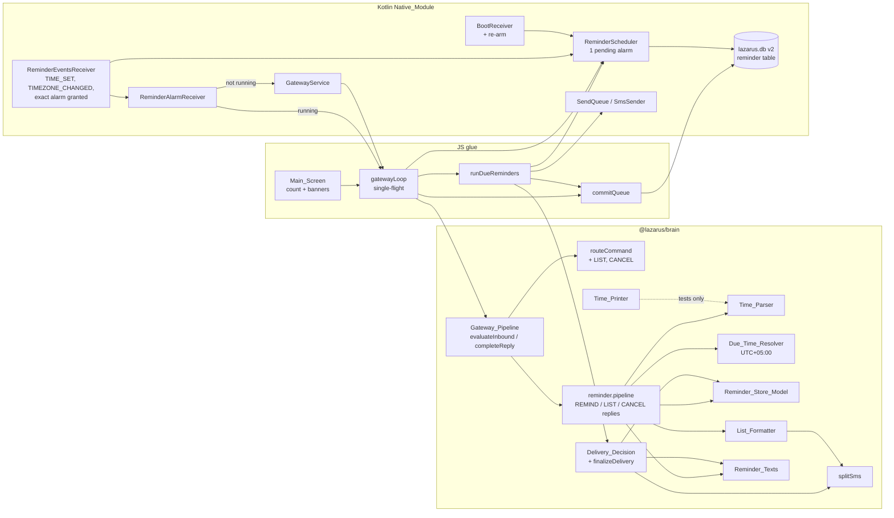
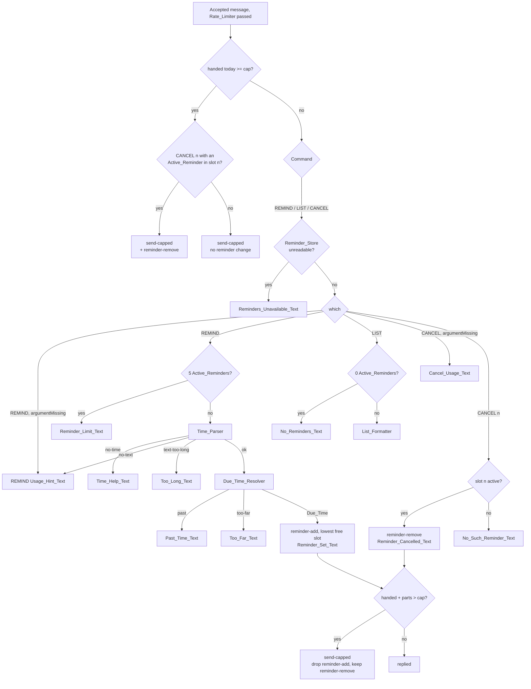

# Design Document: SMS Reminders

## Overview

This feature turns `REMIND <time> <text>` from a "not ready yet" reply into a working reminder, and adds the LIST and CANCEL commands. It follows the three-layer split of the necromancer-sms-gateway design:

1. **Reminder_Module in `packages/brain`** (pure TypeScript, Vitest + fast-check). It parses and prints Time_Expressions, resolves Due_Times in Pakistan_Time (fixed UTC+05:00), assigns Reminder_Slots, decides the reply to REMIND, LIST and CANCEL inside the existing Gateway_Pipeline, decides each reminder delivery, and holds the Reminder_Texts. Every time value is a parameter. Nothing in it reads the clock, the time zone, storage or the network.
2. **JavaScript glue in `apps/necromancer/src`**. The existing single-flight gateway loop gains one more kind of work item, "run due reminders". It commits reminder changes through the existing commit queue, hands Reminder_Delivery_Texts to the existing Sms_Sender, and shows the reminder count and two new banners on the Main_Screen. It contains no time parsing, slot, formatting or delivery logic (Requirement 11.12).
3. **Kotlin Native_Module in `apps/necromancer/android`**. A new `reminder` table in `lazarus.db` (schema version 2), a `ReminderScheduler` that keeps one AlarmManager alarm for the earliest Due_Time, and receivers that wake the gateway loop when that alarm fires, after boot, package replacement, clock or time zone changes, and when exact alarm access is granted.

### Key design decisions

| Decision | Choice | Reason |
| --- | --- | --- |
| Where reminder state lives in the brain | A new required field `reminders: ReminderState` on `GatewayState`, folded by `applyChanges` like every other part of the state | STOP must remove reminders in the same state change that adds the Stop_List entry (Requirement 8.1). Keeping both in one state value and one `StateChange[]` batch makes that a single commit. TypeScript strict mode then flags every fixture that builds a `GatewayState`, so no test silently runs without reminders. |
| How STOP removes reminders | Every `stopped` decision (live, paused and Pending_Stop_Record) carries `{ type: 'reminder-remove-all', number }` right after `stop-add`, whether or not the in-memory store lists a reminder for that number | The in-memory store can be `unreadable`, and a commit can fail after SQLite has already written the row. Always emitting the delete costs one `DELETE ... WHERE number = ?` and removes every such doubt. |
| Second line of defence for STOP | The Delivery_Decision checks the Stop_List first (Requirement 8.4), and the load step removes reminders of stopped numbers before the scheduler arms an alarm (Requirement 8.8) | STOP always wins even if the reminder delete was not persisted. |
| Reminder_Id | `r:<messageId>` of the REMIND Inbound_Message | Each Inbound_Message creates at most one Reminder, and the native message id is unique, so the id is unique and deterministic. The brain needs no random source. |
| Time zone | A fixed constant `PK_OFFSET_MS = 18_000_000`. All wall-clock math uses `Date.UTC`-free integer arithmetic on epoch milliseconds | Pakistan has no daylight saving time. Fixed arithmetic does not depend on the Hermes or Node time zone database, and Requirement 14.5 checks this under two process time zones. |
| Time display in replies | 24-hour `H:MM` with day of month and month name, for example `15 Jan 20:00` (`15 جنوری 20:00` in Urdu) | The `ur` texts may not contain Latin letters other than command keywords (Requirement 9.2), so `am`/`pm` cannot appear there. One 24-hour format for all Languages keeps a single formatter and matches what the Time_Printer prints. |
| Exactly-once delivery | Before the Reply_Parts are handed to the Sms_Sender, the glue commits a `reminder-handed` marker (column `handed_at`) together with the Daily_Send_Cap reservation. A row found with `handed_at` set at load time is recorded as `reminder-failed` and deleted | Satisfies Requirements 10.15 and 11.14 across restarts: a handed reminder is never handed again. |
| Who wakes JS | Kotlin never decides anything about a reminder. The alarm receiver either emits `onRemindersDue` to the running loop or starts the Gateway_Service; the loop runs the due reminders between Inbound_Messages | The loop is already single-flight, so an alarm and a boot trigger at the same moment cannot both deliver the same reminder (Requirement 11.14). |
| Earliest Due_Time for the alarm | Kotlin reads `SELECT MIN(due_at) FROM reminder WHERE handed_at IS NULL` itself | Boot, package replacement and time changes must re-arm the alarm even while the gateway is paused and JS is not running (Requirement 11.6). A MIN query is storage, not reminder logic, so Requirement 11.12 still holds. |
| Exact alarms | Declare `SCHEDULE_EXACT_ALARM` only; use `setExactAndAllowWhileIdle(RTC_WAKEUP, ...)` when `canScheduleExactAlarms()` is true (always on API 26–30), else `setAndAllowWhileIdle(RTC_WAKEUP, ...)` | `USE_EXACT_ALARM` is reserved for alarm clock and calendar apps (Requirement 11.8). On Android 14 and later `SCHEDULE_EXACT_ALARM` is denied by default for new installs, so the inexact fallback and the Main_Screen warning are the normal case until the Operator grants it. |
| Schema upgrade failure | Migration runs inside a SQLite `SAVEPOINT` in `onUpgrade`; on failure it rolls back to the savepoint, the version still becomes 2, and the Reminder_Store is reported unreadable. Every later open retries `CREATE TABLE IF NOT EXISTS reminder` inside its own savepoint | `SQLiteOpenHelper` cannot keep version 1 and open the database at the same time. Throwing from `onUpgrade` would make the whole `lazarus.db` unopenable, so the Stop_List would be unreadable and every reply would stop. Only reminders may break (Requirement 12.4, 12.7). |
| Kotlin JVM tests with real SQLite | Add `org.xerial:sqlite-jdbc` as `testImplementation`. Migration and table DDL run through a small `SqlConn` interface with an Android adapter and a JDBC adapter | Existing Kotlin tests are plain JUnit with no Robolectric. sqlite-jdbc is free, small, and gives real `UNIQUE` and savepoint behaviour for Requirement 14.8. |
| Cap accounting for deliveries | Reserve all parts in `handed` at hand-off; on the Send_Report release the parts that were not sent and add the sent parts to `partsSent`. `received`, `replied` and `repliesSent` do not change | Requirement 10.4, 10.6, 10.7. A delivery is not an Inbound_Message. The release differs from inbound replies (where failed parts stay reserved), because Requirement 10.7 counts only parts reported as sent. |

### Research summary

- **Exact alarm permission.** On Android 14 and later, `SCHEDULE_EXACT_ALARM` is no longer pre-granted to most newly installed apps targeting Android 13+; it starts as denied, and apps must check `canScheduleExactAlarms()` before calling `setExactAndAllowWhileIdle()`, otherwise a `SecurityException` is thrown ([Android 14: exact alarms denied by default](https://developer.android.com/about/versions/14/changes/schedule-exact-alarms)). The app targets SDK 35, so Necromancer on the Xiaomi test phone starts without exact alarms. The permission can be withdrawn at any time, which is why `ReminderScheduler` also catches `SecurityException` (Requirement 11.13).
- **Permission state broadcast.** When the user grants the permission, Android sends `AlarmManager.ACTION_SCHEDULE_EXACT_ALARM_PERMISSION_STATE_CHANGED` to the app. Revocation kills the app and cancels its alarms instead of sending a broadcast. The design re-arms on the broadcast and on every start.
- **Starting the foreground service from an alarm.** Apps targeting Android 12+ may start a foreground service from the background only under listed exemptions; one is handling an exact alarm, and another is being exempt from battery optimisation ([background start restrictions](https://developer.android.com/develop/background-work/services/fgs/restrictions-bg-start)). The existing Setup_Step already asks for the battery exemption, so the inexact alarm path can also start the `specialUse` Gateway_Service. If both exemptions are missing, the start is refused, and the reminder waits for the next start under the Late_Window rule (Known limitations).
- **Implicit broadcasts.** `ACTION_TIME_CHANGED` (`android.intent.action.TIME_SET`), `ACTION_TIMEZONE_CHANGED`, `BOOT_COMPLETED` and `MY_PACKAGE_REPLACED` are on the list of implicit broadcasts that manifest receivers still get on Android 8+, so no running process is needed for Requirement 11.6.
- **RTC alarms and clock changes.** `RTC_WAKEUP` alarms use wall-clock epoch time. After the Operator changes the clock, the stored `due_at` values still mean the same instants, and re-arming with the same epoch value is enough.
- **Doze.** Even `setExactAndAllowWhileIdle` is rate-limited while idle (roughly one alarm per app per 9 minutes in deep Doze). The design keeps only one pending alarm and delivers every due reminder in one run, so several reminders due close together still arrive in one wake-up.

Content was rephrased for compliance with licensing restrictions.

### Existing code this design builds on

| Symbol | Where | Used for |
| --- | --- | --- |
| `routeCommand`, `ALIAS_TABLE`, `ROMAN_URDU_ALIASES`, `ENGLISH_KEYWORD`, `COMMANDS` | `router.ts`, `aliases.ts`, `router.types.ts` | LIST and CANCEL routing (Requirement 1) |
| `printCommand` | `printer.ts` | Unchanged code; LIST and CANCEL get `ENGLISH_KEYWORD` entries |
| `evaluateInbound`, `completeReply`, `applyChanges`, `replyFor`, `evaluateLimits` | `gateway.pipeline.ts` | REMIND, LIST and CANCEL replies; STOP removal; cap handling |
| `applyPendingStop` | `gateway.pending.ts` | STOP from a Pending_Stop_Record also removes reminders |
| `decodeStoredState`, `serializeChanges` | `gateway.state.ts` | Reminder wire format |
| `countersFor`, `reserveParts`, `releaseParts` | `gateway.counters.ts` | Daily_Send_Cap for deliveries |
| `maskNumber`, `trimActivityLog` | `gateway.number.ts`, `gateway.activity.ts` | Masked Activity_Entries for Delivery_Outcomes |
| `splitSms` | `sms.ts` | Every Reply_Parts count check |
| `GATEWAY_TEXTS` | `gateway.texts.ts` | Help_Text update; REMIND usage hint reused |
| `createCommitQueue`, `touchesStopList` | `apps/necromancer/src/gateway/commitQueue.ts` | Reminder commits; STOP batches keep the 3 × 1 s retries |
| `handOver`, `finalize`, `LoopContext` | `apps/necromancer/src/gateway/loopSupport.ts` | Pattern for the reminder hand-off |
| `LazarusDb`, `StoreSchema`, `StoreSql`, `StoreWire` | `android/.../store/` | Schema v2, new change types |
| `GatewayLifecycle.alarmMode`, `BootReceiver` | `android/.../gateway/` | Exact or inexact choice; boot re-arm |

## Architecture

### Component view



### REMIND, LIST and CANCEL inside the Gateway_Pipeline

The existing check order (Automated_Sender, Own_Number, router, STOP, START, Stop_List, Allowlist_Mode, Rate_Limiter, `handed >= cap`) runs unchanged before any reminder handling (Requirement 5.10). The new branch replaces the `REMIND` row of the reply-text table and adds rows for LIST and CANCEL.



Every leaf records exactly one Outcome (`replied` or `send-capped`) and one Reply_Text (Requirement 5.14). No leaf calls the Answer_Service (Requirement 5.9). The reminder that a REMIND adds always belongs to `r.sender.number`; the argument text is never read for a number (Requirement 5.12).

### Due reminder flow

```mermaid
sequenceDiagram
  participant AM as AlarmManager
  participant AR as ReminderAlarmReceiver
  participant GS as GatewayService
  participant L as JS gatewayLoop
  participant B as Delivery_Decision (brain)
  participant C as commitQueue / NativeStore
  participant S as SendQueue / SmsSender
  participant RS as ReminderScheduler
  AM->>AR: alarm at earliest due_at
  AR->>AR: read paused flag
  alt paused
    AR->>RS: reschedule() only
  else loop attached
    AR-->>L: onRemindersDue
  else service not running
    AR->>GS: startForegroundService
    GS->>L: loop start (prepare runs due reminders)
  end
  L->>L: next work item = reminders (between Inbound_Messages)
  loop each due reminder, ascending (dueAt, id)
    L->>B: decideDelivery(reminder, state, now, today)
    alt final outcome (stopped / not-allowed / expired / capped)
      B-->>L: outcome, reminder-remove
      L->>C: commit + appendActivity
    else send
      B-->>L: parts, [reminder-handed, counters reserve]
      L->>C: commit (awaited; on failure no send)
      L->>S: sendParts("reminder:<id>", number, parts) (not awaited)
      S-->>L: SendReport
      L->>B: finalizeDelivery(reminder, parts, report)
      L->>C: commit [reminder-remove, counters] + appendActivity
    end
  end
  L->>RS: reschedule()
```

### Gateway loop work order

The loop already takes one Inbound_Message at a time. It now has a `remindersDue` flag that is set by `onRemindersDue`, by loop start, by resume, and by a 60-second retry timer after a failed Reminder_Store read (Requirement 11.15). Before each `takeNextInbound()` the loop runs `runDueReminders` if the flag is set, and its idle wait races `waitForInbound()` against the flag. So reminder deliveries and Inbound_Messages never interleave, and every reminder change is committed before the next message or reminder is processed (Requirement 12.5).

## Components and Interfaces

### 1. Command_Router changes (`packages/brain/src`)

| File | Change |
| --- | --- |
| `router.types.ts` | `COMMANDS` becomes `['HELP','STOP','START','SCAM','REMIND','TRANSLATE','LIST','CANCEL','QUESTION']` (Requirement 1.11) |
| `aliases.ts` | `ALIAS_TABLE` adds `list`, `fehrist`, `فہرست` → LIST and `cancel`, `mansookh`, `منسوخ` → CANCEL. `ROMAN_URDU_ALIASES` adds `fehrist`, `mansookh`, so `detectLanguage` returns `roman-ur` for them (1.10). `ENGLISH_KEYWORD` adds `LIST: 'LIST'`, `CANCEL: 'CANCEL'` (1.8) |
| `router.ts` | After the alias lookup, a strict-form check for the two new Commands (below) |
| `printer.ts` | No code change; the new `ENGLISH_KEYWORD` entries are enough |

```ts
const SLOT_TOKEN = /^[0-9\u06F0-\u06F9]{1,3}$/;

/** Requirement 1.2–1.6: LIST and CANCEL only in their strict form, else QUESTION. */
function strictForm(command: 'LIST' | 'CANCEL', rest: string, text: string, language: Language): RoutedCommand {
  const question: RoutedCommand = { command: 'QUESTION', argument: text, language, argumentMissing: false };
  if (command === 'LIST') return rest === '' ? { command, argument: '', language, argumentMissing: false } : question;
  if (rest === '') return { command, argument: '', language, argumentMissing: true };
  return SLOT_TOKEN.test(rest) ? { command, argument: rest, language, argumentMissing: false } : question;
}
```

`rest` is already the Normalized_Message after the first space, so `cancel 2 3` has `rest === '2 3'`, which fails `SLOT_TOKEN` (no space allowed) and routes to QUESTION. The STOP rule is untouched because `stop` is looked up first and never reaches `strictForm` (1.7). The round trip of 1.9 holds because a LIST or CANCEL Routed_Command prints as `LIST`, `CANCEL` or `CANCEL <digits>`, and routing that text gives the same strict form.

The existing `gateway.texts.ts` Urdu Help_Text contains `فہرست` as an ordinary word ("مدد سے فہرست"). After this change `فہرست` is a LIST keyword, so the Help_Text is rewritten (see Reminder_Texts) and the existing "keywords in texts" test is extended to LIST and CANCEL.

### 2. Reminder_Module (`packages/brain/src/reminder.*.ts`)

| File | Contents |
| --- | --- |
| `reminder.types.ts` | `Reminder`, `ReminderId`, `ReminderSlot`, `ReminderState`, `TimeExpression`, `ParseResult`, `ParseError`, `DeliveryOutcome`, `DELIVERY_OUTCOMES`, constants |
| `reminder.clock.ts` | Pakistan_Time arithmetic: `pkDayStart`, `pkWallClock`, `formatWhen(dueAt, language)` |
| `reminder.parse.ts` | `parseReminder(argument): ParseResult` (Time_Parser) and `toDigitValue` |
| `reminder.print.ts` | `printTimeExpression(expr): string` (Time_Printer), `isValidTimeExpression(expr)` |
| `reminder.resolve.ts` | `resolveDueTime(expr, receivedAt): ResolveResult` (Due_Time_Resolver) |
| `reminder.store.ts` | Reminder_Store_Model: `activeFor`, `lowestFreeSlot`, `findBySlot`, `dueReminders`, `nextDueAt`, `applyReminderChange`, `reconcileOnLoad` |
| `reminder.list.ts` | `formatReminderList(reminders, language, split?)` (List_Formatter) |
| `reminder.texts.ts` | `REMINDER_TEXTS: Record<Language, ReminderTexts>` |
| `reminder.pipeline.ts` | `reminderReply(...)`, `cappedReminderChanges(...)`, `parseSlotArgument`, `reminderWriteFailed(...)` |
| `reminder.delivery.ts` | `decideDelivery(...)`, `finalizeDelivery(...)`, `buildDeliveryEntry(...)` |
| `reminder.state.ts` | `decodeReminders(value)` and `encodeReminder(r)` used by `gateway.state.ts` |
| `reminder.arbitraries.ts` | fast-check arbitraries (test-only, not exported from `index.ts`) |
| `gateway.checks.ts` | `notAllowed(number, state)` moved out of `gateway.pipeline.ts` unchanged, so the pipeline and the Delivery_Decision share one Allowlist rule without an import cycle |

Every public symbol is re-exported from `index.ts` under a `// Reminder_Module public API` block, except the arbitraries.

#### Time_Parser

```ts
export function parseReminder(argument: string): ParseResult;
export type ParseResult =
  | { readonly ok: true; readonly expr: TimeExpression; readonly text: string }
  | { readonly ok: false; readonly error: 'no-time' | 'no-text' | 'text-too-long' };
```

The parser is a small recursive-descent reader over whitespace-separated tokens, with each token's end offset kept so the Reminder_Text can be sliced from the original argument (Requirement 2.13).

1. **Tokenize.** Split on `/[ \t\n]+/` while recording offsets (2.2). A part matches only as a whole token, so `kalam`, `subahdam` and `8pmx` never match. Latin tokens are compared lowercased (2.1).
2. **Numbers.** A number token matches `/^[0-9\u06F0-\u06F9]+$/`. `toDigitValue` maps `۰`–`۹` to 0–9 (code point minus 0x06F0), so mixed digits give the same value (2.1).
3. **Grammar** (`?` = optional, `F` = at most one Filler_Word):

```
expr      := F? relative F?
           | F? dayWord? F? clockPart F?
clockPart := clock12 | clock24
           | period F? periodClock?
relative  := 'in' N unitEn
           | N unitUr ('baad' | 'بعد')
clock12   := H12 ('am'|'pm')          as one token: 8pm, 8:30pm, 8.30pm
           | H12 then token 'am'|'pm' as two tokens: 8 pm, 8:30 pm
clock24   := H:MM | HH:MM, hour 0–23, not followed by am/pm
periodClock := clock12 | clock24 with hour 0 or 13–23     → period dropped (2.7)
             | bare H or H:MM / H.MM with H in the period's range → period kept (2.5, 2.6)
```

   - `dayWord`: `today`, `aaj`, `آج` → `today`; `tomorrow`, `kal`, `کل` → `tomorrow`.
   - `period`: `morning`, `subah`, `صبح`; `evening`, `shaam`, `شام`; `night`, `raat`, `رات`.
   - Filler_Words: `at`, `ko`, `baje`, `کو`, `بجے`. One may appear before the first part, between parts and right after the expression (2.11). The `at` in `at 8pm` is the leading position.
   - `unitEn`: `minute(s)`, `min(s)`, `hour(s)`, `hr(s)`, `day(s)`. `unitUr`: `minute`, `ghante`, `ghanta`, `din`, `منٹ`, `گھنٹے`, `گھنٹہ`, `دن`.
   - `N`: 1 to 6 digits, value 1 to 999,999 (2.10, 2.12).
   - Range of a bare hour after a period (2.6): morning 1–12 (1–11 → same hour, 12 → 12:00), evening 1–11 → +12, night 6–11 → +12. Any other value is `no-time`.
4. **Longest match, then text.** The reader takes the longest valid expression. A `dayWord` with no `clockPart` is `no-time` (2.12). A `period` followed by a number outside its range is `no-time`, not "period alone plus text", because 2.12 lists it as an error.
5. **Remaining text.** The rest of the argument after the last consumed token, trimmed (2.13). Empty → `no-text` (2.14). More than 140 UTF-16 code units, counted with `text.length` (`REMINDER_TEXT_MAX`), → `text-too-long` (2.15). An emoji outside the BMP counts as 2, so every accepted text gives a Reminder_Delivery_Text of 1 to 3 parts (9.7; see Property 28 for the bound).

The parser uses only string and regex operations on tokens, has no recursion depth that grows with input, and catches nothing because nothing in it can throw for a string input. `text.length` counts a lone surrogate as one code unit and never throws, so 2.16 holds. It keeps no state, so 2.17 holds.

#### Time_Expression type and Time_Printer

```ts
export type DayWord = 'today' | 'tomorrow';
export type DayPeriod = 'morning' | 'evening' | 'night';
export type TimeExpression =
  /** hour is the 24-hour hour; period is set only for a bare hour after a Day_Period. */
  | { readonly kind: 'clock'; readonly day: DayWord | null; readonly period: DayPeriod | null;
      readonly hour: number; readonly minute: number }
  | { readonly kind: 'period'; readonly day: DayWord | null; readonly period: DayPeriod }
  | { readonly kind: 'relative'; readonly amount: number; readonly unit: 'minute' | 'hour' | 'day' };

export function printTimeExpression(expr: TimeExpression): string;
export function isValidTimeExpression(expr: TimeExpression): boolean;
```

`printTimeExpression` follows Requirement 4.1 exactly: `[today|tomorrow] [morning|evening|night] [H:MM]`, or `in N unit(s)`. With a period, the printed hour is `hour - 12` for 13–23 and `hour` otherwise, so `{clock, period: 'evening', hour: 18, minute: 0}` prints `evening 6:00`, and parsing `evening 6:00` takes the bare-hour branch back to the same value. Without a period, `9:05` is read as a 24-hour clock (2.4). The longest printed form is `tomorrow morning 12:59` (22 characters), and `in 999999 minutes` is 17, both within the 30 of 4.5.

`isValidTimeExpression` encodes Requirement 4.4: clock hour 0–23 and minute 0–59; a period on a clock only if the hour is in that period's range (morning 1–12, evening 13–23, night 18–23); relative amount 1–999,999. The arbitraries generate only valid values, and a unit test checks that `isValidTimeExpression` accepts every parser result.

#### Due_Time_Resolver

```ts
export const PK_OFFSET_MS = 18_000_000;
export const REMINDER_HORIZON_MS = 2_592_000_000;
export type ResolveResult =
  | { readonly ok: true; readonly dueAt: number }
  | { readonly ok: false; readonly error: 'past' | 'too-far' };
export function resolveDueTime(expr: TimeExpression, receivedAt: number): ResolveResult;
```

```ts
const DAY = 86_400_000;
/** Start of the Pakistan_Time day containing t, as epoch ms (3.2). */
export const pkDayStart = (t: number): number => Math.floor((t + PK_OFFSET_MS) / DAY) * DAY - PK_OFFSET_MS;

function wallClock(expr: Exclude<TimeExpression, { kind: 'relative' }>): number {
  const hm = expr.kind === 'clock' ? [expr.hour, expr.minute] : DEFAULT_PERIOD_TIME[expr.period]; // 9:00, 18:00, 21:00 (2.8)
  return hm[0] * 3_600_000 + hm[1] * 60_000;
}

export function resolveDueTime(expr, t) {
  let due: number;
  if (expr.kind === 'relative') {
    if (expr.amount > REMINDER_HORIZON_MS / UNIT_MS[expr.unit]) return { ok: false, error: 'too-far' }; // 3.7, no overflow
    due = t + expr.amount * UNIT_MS[expr.unit];                                                       // 3.5
  } else {
    const today = pkDayStart(t) + wallClock(expr);                                                     // seconds and ms = 0 (3.6)
    if (expr.day === 'tomorrow') due = today + DAY;                                                    // 3.3
    else if (expr.day === 'today') { if (today <= t) return { ok: false, error: 'past' }; due = today; } // 3.4
    else due = today > t ? today : today + DAY;                                                        // 3.2
  }
  return due - t > REMINDER_HORIZON_MS ? { ok: false, error: 'too-far' } : { ok: true, dueAt: due };
}
```

All values are integers below 2^53 for the receive-time range of 3.8, so every operation is exact. No `Date` object is created, so the process time zone cannot matter (3.1, 14.5).

#### Reminder_Store_Model

```ts
export type ReminderSlot = 1 | 2 | 3 | 4 | 5;
export type ReminderId = string & { readonly __brand: 'ReminderId' };
export interface Reminder {
  readonly id: ReminderId;               // 'r:' + messageId
  readonly number: CanonicalNumber;
  readonly slot: ReminderSlot;
  readonly dueAt: number;
  readonly text: string;                 // Reminder_Text, 1..140 UTF-16 code units
  readonly language: Language;
  readonly createdAt: number;            // receive time of the REMIND message
  readonly handedAt: number | null;      // delivery marker (exactly-once), not part of the body
}
export type ReminderState =
  | { readonly status: 'ok'; readonly reminders: readonly Reminder[] }
  | { readonly status: 'unreadable' };
export const REMINDER_LIMIT = 5;

export function activeFor(state: ReminderState, number: CanonicalNumber): readonly Reminder[];
export function lowestFreeSlot(active: readonly Reminder[]): ReminderSlot | null;     // 5.1, 7.6
export function findBySlot(active: readonly Reminder[], slot: number): Reminder | null;
/** Not handed, dueAt <= now, sorted by (dueAt, id) (10.11, 11.4). */
export function dueReminders(state: ReminderState, now: number): readonly Reminder[];
/** Earliest dueAt among reminders not handed; null if none (11.1–11.3). */
export function nextDueAt(state: ReminderState): number | null;
/** Load-time cleanup (8.8, 10.15): remove-all for stopped numbers, reminder-failed for handed rows. */
export function reconcileOnLoad(state: GatewayState, now: number): { changes: readonly StateChange[]; entries: readonly ActivityEntry[] };
```

New `StateChange` variants in `gateway.types.ts`:

```ts
| { readonly type: 'reminder-add'; readonly reminder: Reminder }
| { readonly type: 'reminder-remove'; readonly id: ReminderId }
| { readonly type: 'reminder-remove-all'; readonly number: CanonicalNumber }
| { readonly type: 'reminder-handed'; readonly id: ReminderId; readonly at: number }
```

`applyChange` in `gateway.pipeline.ts` delegates these four to `applyReminderChange(state.reminders, change)`. On an `unreadable` store every reminder change leaves the store `unreadable`; the change still goes to SQLite, which matters for `reminder-remove-all` after STOP. `reminder-add` is applied only if the number has fewer than 5 Active_Reminders and the slot is free, so the fold itself keeps the invariant of Requirement 5.13 even for a hand-built change list.

`reminder-add` is the only `StateChange` that carries body-derived text (the Reminder_Text). This is the exception the requirements confirm. The comment in `gateway.types.ts` that says no StateChange holds the body is updated to name it.

#### Pipeline integration (`reminder.pipeline.ts` and `gateway.pipeline.ts`)

```ts
export interface ReminderReply {
  readonly text: string;                 // Reply_Text
  readonly changes: readonly StateChange[]; // at most one reminder-add or reminder-remove
}
/** REMIND, LIST, CANCEL after all gateway checks passed (Requirements 5–7, 12.7). */
export function reminderReply(
  routed: RoutedCommand & { command: 'REMIND' | 'LIST' | 'CANCEL' },
  number: CanonicalNumber,
  messageId: string,
  receivedAt: number,
  reminders: ReminderState,
  split: (text: string) => string[],
): ReminderReply;
/** CANCEL at handed >= cap still removes the reminder (7.7); REMIND and LIST change nothing. */
export function cappedReminderChanges(routed: RoutedCommand, number: CanonicalNumber, reminders: ReminderState): readonly StateChange[];
/** `2`, `02`, `۲` → 2 (7.2). Only called on a router-validated token. */
export function parseSlotArgument(argument: string): number;
/** 12.11: the commit of a reminder-add/-remove failed; reply with Reminders_Unavailable_Text instead. */
export function reminderWriteFailed(decision: GatewayDecision, split: (text: string) => string[]): GatewayDecision;
```

Changes to existing pipeline functions:

| Function | Change |
| --- | --- |
| `replyFor` | `REMIND` with `argumentMissing` keeps the usage hint. `REMIND`, `LIST`, `CANCEL` otherwise call `reminderReply` and return `{ kind: 'reply', pending: { ...pending, changes: [...pending.changes, ...reply.changes] }, text: reply.text }`. `TRANSLATE` keeps `notAvailable` (9.10). |
| `evaluateLimits` | At `handed >= cap`, the `send-capped` decision also gets `cappedReminderChanges(...)` (7.7). |
| `completeReply` | When the cap blocks the parts, it drops `reminder-add` along with `slowdown-record` and keeps `reminder-remove` (5.11, 7.7). |
| `evaluateRouted`, `evaluatePaused` | STOP changes become `[stop-add, reminder-remove-all]` (8.1). |
| `applyPendingStop` (`gateway.pending.ts`) | The `stopped` decision also gets `reminder-remove-all` (8.1). |
| `applyChange` | Handles the four new change types. |

START restores nothing; reminders removed under STOP are gone, so the next LIST gets the No_Reminders_Text and the next REMIND gets slot 1 (8.5).

#### List_Formatter

```ts
export function formatReminderList(
  reminders: readonly Reminder[],      // the sender's Active_Reminders, 1..5
  language: Language,
  split: (text: string) => string[] = splitSms,
): string;
```

1. Sort by `(dueAt, slot)` (6.2).
2. Each entry is `<slot>) <when> <preview>`; entries are joined by `; ` after the Language's lead-in (for example `Your reminders: `). `when` uses `formatWhen`, the same function as the Reminder_Set_Text.
3. Preview length `L = 20`. If `split(reply(L)).length > 3`, try `L = 19, 18, …, 0` and take the first that gives at most 3 parts (6.3). At `L = 0` the entry is `<slot>) <when>`. The preview is the first `L` code points of the Reminder_Text (`Array.from(text).slice(0, L).join('')`), unchanged.
4. At `L = 0`, 5 entries of at most `5) 31 Sep 23:59` (16 characters) plus separators and the lead-in stay under 134 characters, so even the UCS-2 case fits in 2 parts. This is what makes Requirement 6.4 hold for all inputs.

The formatter gets only the sender's Active_Reminders from `activeFor`, so no other number's data can reach it (6.6).

#### Delivery_Decision

```ts
export const DELIVERY_OUTCOMES = ['reminder-sent','reminder-stopped','reminder-not-allowed',
  'reminder-capped','reminder-expired','reminder-failed'] as const;
export type DeliveryOutcome = (typeof DELIVERY_OUTCOMES)[number];
export const LATE_WINDOW_MS = 3_600_000;

export type DeliveryStep =
  | { readonly kind: 'wait' }                                                         // dueAt > now (10.13)
  | { readonly kind: 'final'; readonly outcome: Exclude<DeliveryOutcome, 'reminder-sent' | 'reminder-failed'>;
      readonly changes: readonly StateChange[] }                                      // reminder-remove
  | { readonly kind: 'send'; readonly parts: readonly string[];
      readonly changes: readonly StateChange[] };                                     // reminder-handed + counters reserve

export function decideDelivery(r: Reminder, state: GatewayState, now: number, today: string,
  split?: (text: string) => string[]): DeliveryStep;

export function finalizeDelivery(r: Reminder, partCount: number, report: SendReport,
  counters: DayCounters, today: string): { outcome: DeliveryOutcome; changes: readonly StateChange[] };

export function buildDeliveryEntry(r: Reminder, outcome: DeliveryOutcome, recordedAt: number): ActivityEntry;
```

`decideDelivery` order (10.1): `dueAt > now` → `wait`; `state.stopList.has(number)` → `reminder-stopped`; `notAllowed(number, state)` → `reminder-not-allowed`; `now > dueAt + LATE_WINDOW_MS` → `reminder-expired`; `countersFor(counters, today).handed + parts.length > cap` → `reminder-capped`; else `send` with `split(lead + text)` addressed to `r.number`. The function touches neither `rate` nor `slowDown` (10.9).

`finalizeDelivery`: all parts `sent` → `reminder-sent`; `refused-stopped` or `cancelled` → `reminder-stopped`; anything else → `reminder-failed`. Its counters change releases `partCount - sent` from `handed` and adds `sent` to `partsSent` (10.6, 10.7). Its changes always include `reminder-remove` (10.8).

`buildDeliveryEntry` returns `{ receivedAt: recordedAt, who: maskNumber(r.number), command: 'REMIND', outcome }` and never reads `r.text` (13.1, 13.4). `ActivityEntry.outcome` widens to `Outcome | DeliveryOutcome | 'reminders-failed'`. The extra value `reminders-failed` is not a Delivery_Outcome; it marks the one entry of Requirement 11.15 ("reminder processing failed"), built by `buildProcessingFailedEntry(at)` as `{ receivedAt: at, who: '', command: 'NONE', outcome: 'reminders-failed' }`, so it holds no number at all. `ACTIVITY_OUTCOMES = [...OUTCOMES, ...DELIVERY_OUTCOMES, 'reminders-failed']` is exported for the ports decoder.

#### Reminder_Texts

```ts
export interface ReminderTexts {
  readonly set: (slot: ReminderSlot, when: string) => string;
  readonly timeHelp: string;
  readonly timeHelpExamples: readonly string[]; // each appears verbatim in timeHelp (9.4, 9.5)
  readonly past: string;
  readonly tooFar: string;
  readonly tooLong: string;
  readonly limit: string;
  readonly noReminders: string;
  readonly cancelled: (slot: ReminderSlot) => string;
  readonly noSuch: string;
  readonly cancelUsage: string;
  readonly cancelExample: string;               // appears verbatim in cancelUsage (9.6)
  readonly unavailable: string;
  readonly deliveryLead: string;
  readonly listLead: string;
  readonly months: readonly string[];           // 12 names used by formatWhen
}
export const REMINDER_TEXTS: Readonly<Record<Language, ReminderTexts>>;
```

Keeping the examples as data lets tests route and parse exactly the strings the Sender sees, instead of scraping them from prose. Draft wording follows; the tests of Requirement 9 decide the final wording (for example a text is shortened if it does not fit 1 part).

| Item | `en` | `roman-ur` | `ur` |
| --- | --- | --- | --- |
| set | `Reminder {n} set for {when} Pakistan time. LIST shows all, CANCEL {n} removes it.` | `Yaad dahani {n} lag gayi: {when} Pakistan waqt. FEHRIST se sab dekhein, MANSOOKH {n} se hatayein.` | `یاد دہانی {n} لگ گئی: {when}۔ فہرست سے سب دیکھیں، منسوخ {n} سے ہٹائیں۔` |
| timeHelp | `Sorry, I could not read the time. Try: REMIND 8pm take medicine, REMIND tomorrow 9am call Ali, REMIND in 2 hours drink water` | `Waqt samajh nahi aaya. Maslan: YAAD 8pm dawai leni hai, YAAD kal subah 9 dawai, YAAD 2 ghante baad pani piyen` | `وقت سمجھ نہیں آیا۔ مثلاً: یاد شام کو دوا لینی ہے، یاد کل صبح 9 دوا، یاد 2 گھنٹے بعد پانی پیئیں` |
| past | `That time has already passed today. Try a later time or tomorrow.` | `Yeh waqt aaj guzar chuka hai. Baad ka waqt ya kal likhein.` | `یہ وقت آج گزر چکا ہے۔ بعد کا وقت یا کل لکھیں۔` |
| tooFar | `Reminders can be set up to 30 days ahead. Please pick an earlier time.` | `Yaad dahani sirf 30 din tak lag sakti hai. Pehle ka waqt likhein.` | `یاد دہانی صرف 30 دن تک لگ سکتی ہے۔ پہلے کا وقت لکھیں۔` |
| tooLong | `Reminder text is too long. Please keep it under 140 characters.` | `Baat bohat lambi hai. 140 huroof tak rakhein.` | `بات بہت لمبی ہے۔ 140 حروف تک رکھیں۔` |
| limit | `You already have 5 reminders. Text LIST to see them or CANCEL and a number to remove one.` | `Aap ki 5 yaad dahaniyan pehle se hain. FEHRIST se dekhein ya MANSOOKH aur number se hatayein.` | `آپ کی 5 یاد دہانیاں پہلے سے ہیں۔ فہرست سے دیکھیں یا منسوخ اور نمبر سے ہٹائیں۔` |
| noReminders | `You have no reminders. Set one like this: REMIND 8pm take medicine` | `Aap ki koi yaad dahani nahi. Maslan: YAAD 8pm dawai leni hai` | `آپ کی کوئی یاد دہانی نہیں۔ مثلاً: یاد شام کو دوا لینی ہے` |
| cancelled | `Reminder {n} cancelled.` | `Yaad dahani {n} mansookh ho gayi.` | `یاد دہانی {n} منسوخ ہو گئی۔` |
| noSuch | `No reminder with that number. Text LIST to see your reminders.` | `Is number ki yaad dahani nahi. FEHRIST likh kar dekhein.` | `اس نمبر کی یاد دہانی نہیں۔ فہرست لکھ کر دیکھیں۔` |
| cancelUsage | `Send CANCEL and the reminder number, for example CANCEL 1. Text LIST to see the numbers.` | `MANSOOKH aur number bhejein, maslan MANSOOKH 1. Number FEHRIST se dekhein.` | `منسوخ اور نمبر بھیجیں، مثلاً منسوخ 1۔ نمبر فہرست سے دیکھیں۔` |
| unavailable | `Reminders are not working right now. Please try again later.` | `Yaad dahani abhi kaam nahi kar rahi. Thori dair baad koshish karein.` | `یاد دہانی ابھی کام نہیں کر رہی۔ کچھ دیر بعد کوشش کریں۔` |
| deliveryLead | `Reminder: ` | `Yaad dahani: ` | `یاد دہانی: ` |
| listLead | `Your reminders: ` | `Aap ki yaad dahaniyan: ` | `آپ کی یاد دہانیاں: ` |

`{n}` is the slot as one ASCII digit and `{when}` is `formatWhen(dueAt, language)`: `D Mon H:MM` with `en`/`roman-ur` month abbreviations `Jan`…`Dec` and Urdu month names `جنوری`…`دسمبر`. Every `en` and `roman-ur` item is GSM-7 basic (no `[`, `]`, `{`, `}`, `~`, `|`, `\`, `^`, `€`), and every `ur` item uses Urdu script plus ASCII digits, spaces and punctuation (9.2). The Urdu examples use only Urdu-script keywords, so `detectLanguage` keeps them `ur`.

The Help_Text in `gateway.texts.ts` changes so REMIND is an available command and TRANSLATE stays "coming soon" (9.8), for example `en`: `Lazarus: text any question. SCAM <msg> checks a message. REMIND 8pm <text> sets a reminder, LIST shows them. STOP ends texts. HELP shows this.` The `ur` Help_Text uses `فہرست` only as the LIST keyword.

### 3. JS glue (`apps/necromancer/src`)

| Module | Change |
| --- | --- |
| `native/specs/NativeReminders.ts` | New TurboModule spec (below) |
| `native/specs/NativeStore.ts` | No new method. `loadState()` JSON gains `reminders`; `commit()` accepts the new change types |
| `native/ports.ts` | `RemindersPort` with decoders; `GatewayPorts.reminders`; `ACTIVITY_OUTCOMES` used in the activity decoder |
| `gateway/reminders.ts` | New. `runDueReminders(ctx)`, `reconcileReminders(ctx)`, `rescheduleSafely(ctx)` |
| `gateway/loop.ts` | `remindersDue` flag; `prepare` runs `reconcileReminders` then `runDueReminders` after `applyPendingStops`; `drain` runs reminders before each take; idle wait races `waitForInbound()` and `onRemindersDue`; `processMessage` handles 12.11 |
| `gateway/loopSupport.ts` | `LoopContext` gains `remindersDue: boolean`; `showReminderStatus(ctx)` updates the count and banners |
| `gateway/pausedTask.ts` | No code change: the brain adds `reminder-remove-all` to the STOP decision and the existing commit path persists it |
| `gateway/store.ts` | `reminderCount: number \| null` in the snapshot; banners `reminders-unreadable`, `reminders-save-failed`, `reminders-may-be-late` |
| `ui/screens/MainScreen.tsx` | Reminder count row; the three banners; "Allow exact alarms" button calling `reminders.openExactAlarmSettings()`; re-checks `getExactAlarmAccess()` on `AppState` `active` |

```ts
// NativeReminders.ts
export interface Spec extends TurboModule {
  /** Re-arms the single reminder alarm from MIN(due_at) of rows not handed, or cancels it. */
  reschedule(): Promise<void>;
  /** Arms the alarm 60 s from now (Requirement 11.15). */
  scheduleRetry(): Promise<void>;
  /** true on API 26–30; canScheduleExactAlarms() on API 31+. */
  getExactAlarmAccess(): Promise<boolean>;
  /** ACTION_REQUEST_SCHEDULE_EXACT_ALARM with package: URI; App info if it does not resolve. */
  openExactAlarmSettings(): Promise<void>;
  readonly onRemindersDue: CodegenTypes.EventEmitter<void>;
}
```

`runDueReminders` outline:

```ts
export async function runDueReminders(ctx: LoopContext): Promise<void> {
  ctx.remindersDue = false;
  if (ctx.state.reminders.status === 'unreadable') {             // 11.15, 12.7
    ctx.log('reminders: store unreadable, retry in 60 s');
    await recordProcessingFailed(ctx);                           // buildProcessingFailedEntry: no number, no text
    await ctx.ports.reminders.scheduleRetry().catch(() => ctx.log('reminders: retry alarm failed'));
    return;
  }
  for (const r of dueReminders(ctx.state.reminders, ctx.clock.now())) {   // (dueAt, id) order, 10.11
    const now = ctx.clock.now();
    const today = todayKey(ctx.clock, now);
    const step = decideDelivery(r, ctx.state, now, today);
    if (step.kind === 'wait') continue;
    if (step.kind === 'final') { await recordDelivery(ctx, r, step.outcome, step.changes, now); continue; }
    try {
      await ctx.commits.enqueue(step.changes);                   // handed marker + reservation first
    } catch {
      ctx.log('reminders: hand-off marker not saved, will retry');
      ctx.remindersDue = true;                                   // reminder untouched, nothing sent
      break;
    }
    ctx.state = applyChanges(ctx.state, step.changes);           // later decisions see the reservation
    void sendReminder(ctx, r, step.parts, today);                // not awaited; finalizeDelivery on report
  }
  await rescheduleSafely(ctx);
  showReminderStatus(ctx);
}
```

`recordDelivery` applies the changes in memory first (so the reminder is never decided again), commits them through `commitQueue.run` with up to 3 retries at 1 s, and on final failure raises `reminders-save-failed` (10.14). The Activity_Entry from `buildDeliveryEntry` is appended in the same chain; an append failure is logged with no data and changes nothing else (13.8).

`processMessage` change for 12.11: when `decision.changes` contains `reminder-add` or `reminder-remove`, the loop commits before applying the changes to memory. If that commit rejects, it builds `reminderWriteFailed(decision, splitSms)`, applies and commits that decision's changes instead, and hands over its parts. Batches with `stop-add` keep the existing behaviour: memory first, then the commit with Stop_List retries (8.6).

Every `ctx.log` line in these modules is a fixed string or contains at most `maskNumber(number)`. No log line, banner or error contains a Reminder_Text or a LIST reply (13.2, 13.3).

### 4. Kotlin Native_Module

| Class | Role |
| --- | --- |
| `store/StoreSchema` | `VERSION = 2`; `REMINDER_DDL` (Data Models); `MIGRATIONS[1→2]` |
| `store/SqlConn`, `AndroidSqlConn` | `exec(sql, args)`, `query(...)`, `savepoint(name, block)`; JVM tests use a JDBC implementation |
| `store/ReminderMigration` | `migrate(conn)`: `SAVEPOINT v2; CREATE TABLE IF NOT EXISTS reminder ...; CREATE INDEX IF NOT EXISTS ...; RELEASE v2`. On any exception: `ROLLBACK TO v2; RELEASE v2`, returns `false` |
| `store/LazarusDb` | `onUpgrade(1, 2)` calls `ReminderMigration.migrate` and stores the result in `reminderTableReady`. `onOpen` retries the migration if not ready. `loadSnapshot()` adds `reminders` (null if not ready or the read fails). `commit` maps the four new change types |
| `store/StoreWire`, `StoreSql` | Parse `reminder-add` (strict: id string, canonical number, slot 1–5, safe-integer times, text 1–140 UTF-16 code units checked with Kotlin `String.length`, language one of 3), `reminder-remove`, `reminder-remove-all`, `reminder-handed`; encode reminder rows for `loadState`. Error messages never contain the number or the text |
| `reminder/ReminderScheduler` | `reschedule(context)`: query `MIN(due_at)` where `handed_at IS NULL`; none → `cancel`; else arm. `retryIn60s(context)`. One explicit `PendingIntent` to `ReminderAlarmReceiver`, request code `REMINDER_ALARM`, `FLAG_UPDATE_CURRENT or FLAG_IMMUTABLE`, so a new alarm replaces the old one (11.10) |
| `reminder/ReminderAlarmPolicy` | Pure: `mode(sdkInt, canExact)` delegates to `GatewayLifecycle.alarmMode`; `onTrigger(paused, serviceRunning, loopAttached)` → `RESCHEDULE_ONLY` / `NOTIFY_LOOP` / `START_SERVICE` |
| `reminder/ReminderAlarmReceiver` | Not exported. `goAsync()`, reads paused, applies `onTrigger` |
| `reminder/ReminderEventsReceiver` | Exported, system broadcasts only: `TIME_SET`, `TIMEZONE_CHANGED`, `ACTION_SCHEDULE_EXACT_ALARM_PERMISSION_STATE_CHANGED`. Calls `reschedule` and then the same trigger path as the alarm (11.6) |
| `gateway/BootReceiver` | Also calls `ReminderScheduler.reschedule` for `BOOT_COMPLETED` and `MY_PACKAGE_REPLACED`, paused or not (11.6) |
| `reminder/ReminderModule` | TurboModule for `NativeReminders`; emits `onRemindersDue` through the React context when the loop is attached |
| `LazarusPackage` | Registers `ReminderModule` |

Arming:

```kotlin
fun arm(alarms: AlarmManager, at: Long, pi: PendingIntent, sdk: Int) {
  val canExact = sdk < 31 || alarms.canScheduleExactAlarms()
  try {
    when (ReminderAlarmPolicy.mode(sdk, canExact)) {
      AlarmMode.EXACT -> alarms.setExactAndAllowWhileIdle(AlarmManager.RTC_WAKEUP, at, pi)
      AlarmMode.INEXACT -> alarms.setAndAllowWhileIdle(AlarmManager.RTC_WAKEUP, at, pi)
    }
  } catch (e: SecurityException) {                       // access withdrawn between check and call (11.13)
    alarms.setAndAllowWhileIdle(AlarmManager.RTC_WAKEUP, at, pi)
  }
}
```

The comment on `GatewayLifecycle.alarmMode` ("the app declares no SCHEDULE_EXACT_ALARM") is updated. The watchdog and restart alarms keep their current logic; they now get exact alarms too when the Operator grants access.

Manifest additions:

```xml
<uses-permission android:name="android.permission.SCHEDULE_EXACT_ALARM" />
<uses-permission android:name="android.permission.USE_EXACT_ALARM" tools:node="remove" />

<receiver android:name=".reminder.ReminderAlarmReceiver" android:exported="false" />
<receiver android:name=".reminder.ReminderEventsReceiver" android:exported="true">
  <intent-filter>
    <action android:name="android.intent.action.TIME_SET" />
    <action android:name="android.intent.action.TIMEZONE_CHANGED" />
    <action android:name="android.app.action.SCHEDULE_EXACT_ALARM_PERMISSION_STATE_CHANGED" />
  </intent-filter>
</receiver>
```

All three actions are protected system broadcasts, so another app cannot trigger the receiver. Even if one could, the receiver only re-arms an alarm and wakes the loop, which then applies every brain check. `manifest.test.ts` is updated for the new permission and receivers. The existing `database` exclusion in `data_extraction_rules.xml` already covers the `reminder` table (12.9).

Kotlin logs for reminders are fixed strings such as `"ReminderScheduler: armed exact"` or `"ReminderMigration: failed (<ExceptionClass>)"`. They never contain a number, a time of a specific Sender's reminder or a Reminder_Text.

## Data Models

### SQLite schema version 2 (`lazarus.db`)

Version 1 tables are unchanged. Version 2 adds:

```sql
CREATE TABLE IF NOT EXISTS reminder (
  id          TEXT PRIMARY KEY,                                  -- Reminder_Id 'r:<messageId>'
  number      TEXT NOT NULL,                                     -- Canonical_Number
  slot        INTEGER NOT NULL CHECK (slot BETWEEN 1 AND 5),
  due_at      INTEGER NOT NULL,                                  -- Due_Time, epoch ms
  text        TEXT NOT NULL CHECK (length(text) BETWEEN 1 AND 140), -- Reminder_Text
  language    TEXT NOT NULL CHECK (language IN ('en', 'ur', 'roman-ur')),
  created_at  INTEGER NOT NULL,
  handed_at   INTEGER,                                           -- NULL until handed to the Sms_Sender
  UNIQUE (number, slot)                                          -- 12.2
);
CREATE INDEX IF NOT EXISTS reminder_due ON reminder(handed_at, due_at);
```

SQLite's `length()` counts characters (code points) for TEXT, not UTF-16 code units. Every text of at most 140 UTF-16 code units has at most 140 code points, so the `CHECK` never rejects a valid Reminder_Text; it is a looser safety bound. The exact 140 UTF-16 code unit rule is enforced by `StoreWire` (Kotlin `String.length`) before the insert and by `decodeReminders` on load. A lone surrogate has no valid UTF-8 form, so `StoreWire` rejects a `reminder-add` whose text contains one, and the commit fails as a persistence failure (12.11). Real SMS bodies decoded by Android are valid UTF-16, so this path exists only for robustness; the brain round trip of 12.8 is checked on texts without lone surrogates.

| Change | SQL |
| --- | --- |
| `reminder-add` | `INSERT INTO reminder(id, number, slot, due_at, text, language, created_at, handed_at) VALUES (?,?,?,?,?,?,?,NULL)` (a `UNIQUE` violation fails the transaction, 12.2, 12.11) |
| `reminder-remove` | `DELETE FROM reminder WHERE id = ?` |
| `reminder-remove-all` | `DELETE FROM reminder WHERE number = ?` |
| `reminder-handed` | `UPDATE reminder SET handed_at = ? WHERE id = ?` |

Every change of one `StateChange[]` batch runs in the existing single `commit` transaction (12.5). A deleted row is gone from the table when the transaction commits, so its Reminder_Text no longer appears in `lazarus.db` (12.10, 13.5). WAL mode means old page images can stay in the `-wal` file until the next checkpoint; the existing database is excluded from backup and transfer, and the requirement is about reads of the table, which no longer return the text.

### `loadState()` wire format addition

```json
{"stopList":[...], "...": "...",
 "reminders":[{"id":"r:42","number":"+923001234567","slot":1,"dueAt":1736953200000,
               "text":"take medicine","language":"en","createdAt":1736917200000,"handedAt":null}]}
```

`reminders` is `null` when the table is not ready or its read fails. `decodeReminders` returns `{ status: 'unreadable' }` for `null`, a non-array, or any entry with a wrong key set, a non-canonical number, a slot outside 1–5, a text outside 1–140 UTF-16 code units (`text.length`), an unknown language, a non-safe-integer time, or two entries with the same `(number, slot)` (12.7). Otherwise it returns `{ status: 'ok', reminders }`. A missing `reminders` key (an older native build) decodes as `unreadable`, never as empty.

### `serializeChanges` additions

```json
{"type":"reminder-add","reminder":{"id":"r:42","number":"+923001234567","slot":1,"dueAt":1736953200000,"text":"take medicine","language":"en","createdAt":1736917200000,"handedAt":null}}
{"type":"reminder-remove","id":"r:42"}
{"type":"reminder-remove-all","number":"+923001234567"}
{"type":"reminder-handed","id":"r:42","at":1736953201000}
```

`encodeReminder` and `decodeReminders` are inverses on valid Reminders, which is the round trip of Requirement 12.8.

### Activity_Entry for a Delivery_Outcome

```ts
{ receivedAt: recordedAt, who: maskNumber(number), command: 'REMIND', outcome: 'reminder-sent' }
```

The existing `activity` table stores `outcome` as TEXT, so no schema change is needed. The ports decoder accepts `ACTIVITY_OUTCOMES`.

### Gateway_State

```ts
export interface GatewayState {
  // ...existing fields
  readonly reminders: ReminderState;
}
```

`gatewayState()` in `gateway.arbitraries.ts` generates `{ status: 'ok', reminders: [] }` by default and takes an optional reminder arbitrary, so existing property tests keep their meaning. Hand-built fixtures in existing tests add `reminders: EMPTY_REMINDERS`.

## Correctness Properties

*A property is a characteristic or behavior that should hold true across all valid executions of a system-essentially, a formal statement about what the system should do. Properties serve as the bridge between human-readable specifications and machine-verifiable correctness guarantees.*

Reflection on the prework removed these overlaps: 1.2, 1.3, 1.5 and 1.12 are one routing property; 2.4, 2.9, 2.10, 2.13 and 4.4 are implied by the printer round trip; 3.6, 3.11 and the day rules 3.2–3.4 are one wall-clock property; 3.10 joins 3.9; 5.12 and 7.6 join the REMIND property; 7.1, 7.3 and 7.5 join the CANCEL property; 8.1–8.3 are one STOP property; 10.2–10.5, 10.9 and 10.13 are one model-based delivery property. 4.3 is implied by 4.2 but stays separate because Requirement 14.2 names it.

### Property 1: LIST and CANCEL route only in their strict form

*For any* LIST or CANCEL Keyword in any letter case, with or without a trailing punctuation run from `.,!?:;`, and *for any* trailing text of 0 to 500 characters: a LIST Keyword routes to LIST with an empty argument when the trailing text is empty and to QUESTION with the full Normalized_Message otherwise; a CANCEL Keyword routes to CANCEL with `argumentMissing` true when the trailing text is empty, to CANCEL with the token unchanged when the trailing text is a single token of 1 to 3 ASCII or Extended Arabic-Indic digits, and to QUESTION otherwise.

**Validates: Requirements 1.1, 1.2, 1.3, 1.4, 1.5, 1.6, 1.12**

### Property 2: LIST and CANCEL print and route round trip

*For any* Routed_Command with the Command LIST or CANCEL produced by `routeCommand`, routing `printCommand` of it returns the same `command`, `argument` and `argumentMissing`.

**Validates: Requirements 1.8, 1.9**

### Property 3: Router stays total and STOP keeps precedence

*For any* string of 0 to 1,000 characters, `routeCommand` returns one of the 9 Commands without throwing, and *for any* string whose first token is a STOP Keyword (followed by anything, including `list` or `cancel 2`), the Command is STOP.

**Validates: Requirements 1.7, 1.11**

### Property 4: Time_Parser never throws

*For any* string, including empty, whitespace-only, lone-surrogate and longer-than-10,000-character strings, `parseReminder` returns either a Time_Expression with a Reminder_Text of 1 to 140 UTF-16 code units or one of `no-time`, `no-text`, `text-too-long`, and does not throw.

**Validates: Requirements 2.16**

### Property 5: Time_Parser is deterministic

*For any* string, two calls of `parseReminder` with that string return deeply equal results.

**Validates: Requirements 2.17**

### Property 6: Surface form does not change the parse

*For any* valid Time_Expression and Reminder_Text satisfying the conditions of Requirement 4.2, the parse of the printed text is unchanged when Latin letters change case, when any ASCII digit is replaced by the Extended Arabic-Indic digit of the same value, when any single separating space is replaced by a run of spaces, tabs and newlines, and when one Filler_Word is inserted at a position Requirement 2.11 allows. Appending one letter to any Time_Expression token gives `no-time` or a parse that does not consume that token, except when the longer word is itself a token of the same kind with the same value, in which case the parse is unchanged; in this grammar that happens only for the unit words `minute`, `min`, `hour`, `hr` and `day` plus `s` (`minutes`, `mins`, `hours`, `hrs`, `days`).

**Validates: Requirements 2.1, 2.2, 2.11**

### Property 7: Bare hours follow the Day_Period ranges

*For any* Day_Period word, optional Filler_Word and bare hour from 0 to 99 with optional `:MM`, the parse succeeds with that Day_Period kept exactly when the hour lies in the range of Requirement 2.6, the resulting 24-hour hour equals the mapping of Requirement 2.6, and every other hour gives `no-time`. *For any* bare hour 1 to 12 with no Day_Period and no `am` or `pm`, the parse is `no-time`.

**Validates: Requirements 2.5, 2.6, 2.12**

### Property 8: 12-hour clocks map to the right 24-hour time

*For any* hour 1 to 12, optional minutes 00 to 59 written after `:` or `.`, `am` or `pm` in any case, written directly after the number or after one space, the parsed Clock_Time has hour `h % 12` for `am` and `h % 12 + 12` for `pm`, and the given minutes.

**Validates: Requirements 2.3**

### Property 9: Time_Printer round trip

*For any* valid Time_Expression and *for any* Reminder_Text of 1 to 140 UTF-16 code units with no leading or trailing whitespace whose first token is not a Filler_Word, Day_Word, Day_Period, `am`, `pm`, duration unit, `baad`, `بعد` or a digit-led token, parsing `printTimeExpression(expr) + ' ' + text` returns a Time_Expression equal to `expr` and a Reminder_Text equal to `text`, and the returned Time_Expression satisfies `isValidTimeExpression`.

**Validates: Requirements 4.2, 4.4, 2.4, 2.9, 2.10, 2.13**

### Property 10: Printed and original expressions resolve the same

*For any* valid Time_Expression and *for any* receive time from 0 to 4,102,444,800,000, `resolveDueTime` of the parsed printed expression equals `resolveDueTime` of the original, to the millisecond or as the same Parse_Error.

**Validates: Requirements 4.3**

### Property 11: Printer output is short, total and stable

*For any* valid Time_Expression, `printTimeExpression` does not throw, returns the same non-empty lowercase single-line text of at most 30 characters on repeated calls, and the text matches the format grammar of Requirement 4.1 (no Filler_Word, no leading or trailing space, single spaces).

**Validates: Requirements 4.1, 4.5**

### Property 12: Due_Time is in the future and within 30 days

*For any* Time_Expression and *for any* integer receive time from 0 to 4,102,444,800,000, every Due_Time returned by `resolveDueTime` is an integer strictly greater than the receive time and at most the receive time plus 2,592,000,000.

**Validates: Requirements 3.8**

### Property 13: Due_Time_Resolver never throws and is deterministic

*For any* Time_Expression and *for any* integer receive time from 0 to 4,102,444,800,000, `resolveDueTime` returns a Due_Time, `past` or `too-far` without throwing, and returns an equal result on a second call.

**Validates: Requirements 3.9, 3.10**

### Property 14: Clock and period times land on the right Pakistan_Time day and minute

*For any* Time_Expression with a Clock_Time or Day_Period and *for any* receive time `t`, a returned Due_Time `d` has, in Pakistan_Time (`d + 18,000,000`), the hour and minute of the expression (or the default time of its Day_Period) with seconds and milliseconds 0; with no Day_Word, `d > t` and `d - 86,400,000 <= t`; with `tomorrow`, `pkDayStart(d) = pkDayStart(t) + 86,400,000`; with `today`, the result is `past` exactly when the same-day time is at or before `t`, and otherwise `pkDayStart(d) = pkDayStart(t)`.

**Validates: Requirements 3.1, 3.2, 3.3, 3.4, 3.6, 3.11**

### Property 15: Relative durations add exactly

*For any* Relative_Duration of N units and *for any* receive time `t`, the result is `t + N × unit` when that sum is at most `t + 2,592,000,000`, and `too-far` otherwise.

**Validates: Requirements 3.5, 3.7**

### Property 16: A successful REMIND adds one correct reminder

*For any* Gateway_State in which the sender passes every gateway check, has fewer than 5 Active_Reminders and the cap allows 1 part, and *for any* REMIND body whose argument parses and resolves (including bodies whose Reminder_Text contains other phone numbers), the decision has Outcome `replied`, exactly 1 Reply_Part that does not contain the Reminder_Text, and exactly one `reminder-add` whose number is the sender's Canonical_Number, whose slot is the lowest slot from 1 to 5 not used by the sender's Active_Reminders, and whose Due_Time, Reminder_Text, Language and creation time equal the resolver output, the parser output, the routed Language and the receive time.

**Validates: Requirements 5.1, 5.2, 5.12, 7.6**

### Property 17: The Reminder_Limit is checked first

*For any* Gateway_State in which the sender already has 5 Active_Reminders and *for any* REMIND body with a non-empty argument, the reply is the Reminder_Limit_Text in the routed Language, no reminder change is produced, and exactly one Outcome is recorded.

**Validates: Requirements 5.8, 5.14**

### Property 18: Reminder_Limit and distinct slots hold over any sequence

*For any* sequence of REMIND, LIST, CANCEL, STOP and START messages from a set of Canonical_Numbers, folded through `evaluateInbound`, `completeReply` and `applyChanges`, every Canonical_Number has at most 5 Active_Reminders after every step, and their Reminder_Slots are pairwise distinct values from 1 to 5.

**Validates: Requirements 5.13**

### Property 19: Reminder commands are local and respect early exits

*For any* REMIND, LIST or CANCEL message and *for any* Gateway_State, the pipeline makes no Answer_Service call, never replies with the Not_Available_Text, and gives the same Reply_Text and the same reminder changes with and without a Gemini_Api_Key; and *for any* such message ended by the Automated_Sender, Own_Number, Stop_List, Allowlist_Mode, Rate_Limiter or `handed >= cap` check, the decision has no `reminder-add` (and a `reminder-remove` only in the CANCEL case of Requirement 7.7).

**Validates: Requirements 5.9, 5.10, 9.9**

### Property 20: LIST replies fit 3 parts and show every reminder

*For any* 1 to 5 Active_Reminders of one Canonical_Number with Reminder_Texts of 1 to 140 UTF-16 code units in any script, and *for any* Language, `formatReminderList` returns a reply that gives 1 to 3 Reply_Parts from `splitSms`, contains each reminder's slot and `formatWhen` Due_Time exactly once in ascending `(dueAt, slot)` order, uses one shared preview length that is 20 when the full list fits and otherwise the largest length from 0 to 19 that fits, and each preview is that many leading code points of the Reminder_Text.

**Validates: Requirements 6.2, 6.3, 6.4**

### Property 21: LIST shows only the sender's reminders and changes nothing

*For any* Reminder_Store holding reminders of several Canonical_Numbers with distinct marker texts, the reply to LIST from one number contains no marker text, slot entry or Due_Time of any other number, and the decision has no reminder change.

**Validates: Requirements 6.6, 6.7**

### Property 22: CANCEL removes at most one reminder, the sender's slot n

*For any* Reminder_Store, *for any* sender and *for any* CANCEL argument n from 0 to 999, the decision contains at most one `reminder-remove`; it exists exactly when the sender has an Active_Reminder in slot n, its id is that reminder's id, and after the fold every other reminder (the sender's and every other number's) is unchanged in every field.

**Validates: Requirements 7.1, 7.3, 7.5, 7.8**

### Property 23: Slot arguments read as base-10 numbers

*For any* integer n from 0 to 999 and *for any* 1 to 3 character string that writes n in base 10 with optional leading zeros, using any mix of ASCII and Extended Arabic-Indic digits, `parseSlotArgument` returns n.

**Validates: Requirements 7.2**

### Property 24: STOP removes all reminders for that number

*For any* Gateway_State (with a readable or unreadable Reminder_Store) and *for any* Canonical_Number, the `stopped` decision for a STOP from that number, whether live, paused or from a Pending_Stop_Record, contains `stop-add` and `reminder-remove-all` for that number in the same change list, and after the fold the store holds no reminder of that number and exactly the same reminders of every other number as before.

**Validates: Requirements 8.1, 8.2, 8.3**

### Property 25: STOP always wins for reminders

*For any* sequence of Inbound_Messages and delivery decisions for one Canonical_Number, folded in order, every `decideDelivery` call made after a STOP from that number and before its next START returns no Reply_Parts and, for a due reminder, the outcome `reminder-stopped`, including reminders whose Due_Time was before the STOP and still inside the Late_Window and reminders whose removal was not applied.

**Validates: Requirements 8.4, 8.7**

### Property 26: Load reconciliation removes stopped and handed reminders

*For any* Gateway_State, `reconcileOnLoad` returns changes that, after the fold, leave no reminder of a Stop_List number and no reminder with `handedAt` set; each removed handed reminder of a number not on the Stop_List gets exactly one Activity_Entry with the outcome `reminder-failed`; every other reminder is unchanged.

**Validates: Requirements 8.8, 10.15**

### Property 27: Time_Help examples always resolve

*For any* Language, *for any* example in `timeHelpExamples` and *for any* receive time from 0 to 4,102,444,800,000, the example routes to REMIND with `argumentMissing` false, parses with no Parse_Error and a Reminder_Text of 1 to 140 UTF-16 code units, and resolves to a Due_Time.

**Validates: Requirements 9.5**

### Property 28: Reminder_Delivery_Text fits 1 to 3 parts

*For any* Reminder_Text the Time_Parser accepts (1 to 140 UTF-16 code units), including texts filled to the limit with UCS-2 characters, emoji outside the BMP, GSM-7 extension characters or a mix with spaces, and *for any* Language, the delivery text starts with that Language's lead-in followed by the unchanged Reminder_Text, gives 1 to 3 Reply_Parts from `splitSms`, and joining the parts after removing their `(i/n) ` prefixes gives back the delivery text exactly.

Why 140 UTF-16 code units is safe: the longest lead-in is `Yaad dahani: ` (13 units; `Reminder: ` is 10, `یاد دہانی: ` is 11), so a UCS-2 delivery text is at most 153 units. A multi-part UCS-2 part holds 67 − 6 = 61 units of content. The splitter backs off at most 1 unit to keep a surrogate pair whole and then at most 14 more to cut after a space in the last 15 units, so each non-final part holds at least 46 units. Two parts hold at least 92, leaving at most 61 for the third, which fits. The bound is tight: 141 units with the Roman Urdu lead-in can need 4 parts. GSM-7 has more room: 13 + 2 × 140 = 293 septets against at least 2 × (146 − 28) + 147 = 383.

**Validates: Requirements 9.7**

### Property 29: Delivery_Decision matches the check-order model

*For any* Reminder, Gateway_State, current time and day key, `decideDelivery` equals a reference model that returns `wait` if `dueAt > now`, else the first applying outcome of Stop_List, Allowlist_Mode (including an unreadable Allowlist), `now > dueAt + 3,600,000` and `handed + parts > cap`, else `send` with `splitSms(lead + text)`; the `send` step reserves exactly those parts, every step leaves `rate` and `slowDown` unchanged, and `now = dueAt + 3,600,000` and `handed + parts = cap` both lead to `send`.

**Validates: Requirements 10.1, 10.2, 10.3, 10.4, 10.5, 10.9, 10.13, 8.4**

### Property 30: Exactly one Delivery_Outcome

*For any* due Reminder, Gateway_State and current time, `decideDelivery` returns either one of `reminder-stopped`, `reminder-not-allowed`, `reminder-expired`, `reminder-capped` with 0 Reply_Parts, or no outcome with 1 or more Reply_Parts; and *for any* Send_Report of those parts, `finalizeDelivery` returns exactly one of the 6 Delivery_Outcomes.

**Validates: Requirements 10.10**

### Property 31: Delivery finalization accounting

*For any* sent Reminder with p Reply_Parts, *for any* Send_Report and *for any* counters, `finalizeDelivery` returns `reminder-sent` exactly when all p parts are `sent`, `reminder-stopped` for `refused-stopped` or `cancelled`, and `reminder-failed` otherwise; its counters change adds the number of `sent` parts s to `partsSent`, lowers `handed` by `p - s` (never below 0), leaves `received`, `replied` and `repliesSent` unchanged, and its changes include `reminder-remove` for that reminder.

**Validates: Requirements 10.6, 10.7, 10.8**

### Property 32: A run of due reminders never exceeds the cap

*For any* Gateway_State and current time, folding `decideDelivery` over `dueReminders(state, now)` in the returned order and applying each step's changes before the next decision gives `handed <= dailySendCap` after every step, and the order is ascending by `(dueAt, id)` and excludes handed reminders.

**Validates: Requirements 10.11, 11.4, 11.14**

### Property 33: Reminder wire format round trip

*For any* valid Reminder with a Reminder_Text of 1 to 140 UTF-16 code units in English, Urdu script or Roman Urdu, decoding the `loadState` form produced from `encodeReminder` returns a Reminder equal in every field, and the `reminder-add` change survives `serializeChanges` with the same fields.

**Validates: Requirements 12.8**

### Property 34: Malformed stored reminders make the store unreadable

*For any* list of stored reminder entries in which at least one entry has a slot outside 1 to 5, a text outside 1 to 140 UTF-16 code units, an unknown Language, a non-canonical number, a non-integer time, a wrong key set, or a `(number, slot)` pair already used by another entry, `decodeReminders` returns `unreadable`; a `null` or missing value also returns `unreadable`.

**Validates: Requirements 12.7**

### Property 35: Delivery Activity_Entries never reveal the number or the text

*For any* Reminder and *for any* Delivery_Outcome, `buildDeliveryEntry` returns an entry whose `who` equals `maskNumber(number)`, whose command is REMIND and whose outcome is that Delivery_Outcome; no field other than `receivedAt` contains a run of 4 or more consecutive digits of the Canonical_Number, and no field contains the Reminder_Text when that text has at least 4 code points.

**Validates: Requirements 13.1, 13.4**

## Error Handling

| Situation | Behaviour | Requirement |
| --- | --- | --- |
| Time cannot be read | Time_Help_Text, `replied`, no reminder | 5.3 |
| `REMIND` with no argument, or time with no text | REMIND Usage_Hint_Text | 5.4 |
| Text over 140 UTF-16 code units | Too_Long_Text | 5.5 |
| `today` time already passed | Past_Time_Text | 5.6 |
| Beyond 30 days, or N too large | Too_Far_Text | 5.7 |
| 5 Active_Reminders | Reminder_Limit_Text before parsing | 5.8, 5.14 |
| CANCEL with no number, or unknown slot | Cancel_Usage_Text or No_Such_Reminder_Text, nothing changes | 7.3, 7.4 |
| Daily_Send_Cap blocks a confirmation | `send-capped`; REMIND adds nothing; CANCEL still removes | 5.11, 7.7 |
| `reminder` table missing, upgrade failed, or a bad stored row | Store `unreadable`: Reminders_Unavailable_Text for REMIND, LIST, CANCEL; STOP still deletes by number; `reminders-unreadable` banner instead of the count; deliveries retried every 60 s with an Activity_Entry with outcome `reminders-failed` (command `NONE`, no number) | 12.4, 12.7, 11.15, 13.7 |
| Commit of a `reminder-add` or `reminder-remove` fails | Transaction rolled back; the reply becomes the Reminders_Unavailable_Text; memory gets only the non-reminder changes | 12.11 |
| Commit of a STOP batch fails | Existing 3 × 1 s retries and `stop-list-save-failed` banner; memory keeps both the Stop_List entry and the reminder removal | 8.6 |
| Commit of the hand-off marker fails | Nothing is sent; the reminder stays unhanded and is retried in the next run | 10.15, 11.14 |
| Commit of a removal after a Delivery_Outcome fails | Memory keeps the removal, no resend, 3 retries at 1 s, then `reminders-save-failed` banner | 10.14 |
| Activity append fails | Outcome and removal kept; logged with no data | 13.8 |
| `sendParts` rejects | Treated as all parts `failed-other` → `reminder-failed` | 10.7 |
| Sms_Sender refuses a stopped number | `reminder-stopped`, unsent parts released from `handed` | 10.7, 8.4 |
| App restarts after hand-off | Row has `handed_at`; load records `reminder-failed`, deletes it, never resends | 10.15 |
| Stop_List unreadable at start | Existing loop holds everything, including reminders, until a read succeeds; Late_Window still measured from the original Due_Time | 10.12 |
| Exact alarm access missing | Inexact alarm; Main_Screen warning with "Allow exact alarms" button | 11.2, 11.9 |
| `SecurityException` while arming | Inexact alarm for the same time | 11.13 |
| Gateway paused when the alarm fires | Receiver only re-arms; loop is not running; reminders stay; on resume they go through the Late_Window rule | 11.7 |
| Foreground start refused from the alarm | One log line; the next start or resume delivers or expires the reminder | Known limitations |
| Router or parser throws (should not happen) | Existing `evaluateSafely` fallback gives the `en` Try_Later_Text and no reminder change | 2.16, gateway 6.15 |

Every error path logs at most a fixed message and a Masked_Number. No path logs, shows or stores a Reminder_Text outside the `reminder` table (13.2, 13.5).

### Known limitations

- Force stop cancels the alarm until the app opens again; due reminders then expire or are sent under the Late_Window.
- Without exact alarm access, Doze can delay delivery past 60 seconds and, in long idle periods, past the Late_Window.
- If neither the exact-alarm exemption nor the battery exemption applies, Android refuses to start the Gateway_Service from the alarm. The reminder waits for the next service start.
- `-wal` pages may hold a deleted Reminder_Text until the next SQLite checkpoint. The database is excluded from backup and transfer.
- Pakistan_Time is fixed at UTC+05:00 for every Sender.

## Testing Strategy

Property-based testing applies to most of this feature: the parser, printer, resolver, store model, List_Formatter, Delivery_Decision and wire codecs are pure functions with large input spaces. Kotlin alarm wiring, SQLite behaviour and the UI are covered by example and integration tests instead.

### Brain_Test_Suite (Vitest, `packages/brain`, `npm test` = `vitest --run`)

- **Library:** fast-check 4.10.2 (already a dev dependency). Properties are not hand-rolled.
- **Iterations:** every property runs at least 100 times through `REMINDER_PBT_OPTIONS = { numRuns: 100 }` in `reminder.arbitraries.ts`. Failing runs report the counterexample and the seed, which fast-check prints by default; tests do not catch that output.
- **One test per property.** Each of the 35 properties is a single `it(...)` whose name starts with the requirement number and carries the tag comment:

```ts
// Feature: sms-reminders, Property 12: Due_Time is in the future and within 30 days
it('3.8 Due_Time is later than the receive time and within 30 days', () => {
  fc.assert(fc.property(timeExpression, receiveTime, (expr, t) => {
    const r = resolveDueTime(expr, t);
    return !r.ok || (Number.isInteger(r.dueAt) && r.dueAt > t && r.dueAt - t <= REMINDER_HORIZON_MS);
  }), REMINDER_PBT_OPTIONS);
});
```

- **Required by Requirement 14.2:** Properties 2 (1.9), 4 (2.16), 5 (2.17), 12 (3.8), 13 (3.9), 9 (4.2), 10 (4.3), 18 (5.13), 20 (6.4), 24 (8.3), 25 (8.7), 28 (9.7) and 30 (10.10). The other properties cover the remaining testable criteria.
- **Arbitraries** (`reminder.arbitraries.ts`): `timeExpression` (only valid values, per Requirement 4.4), `reminderText` (1 to 140 UTF-16 code units from Latin, Urdu, digits, emoji and spaces, trimmed, long draws cut at the limit so emoji-heavy texts reach it, with a first-token filter for Property 9), `receiveTime` (0 to 4,102,444,800,000), `reminder`, `reminderStore(pool)` (up to 5 per number with distinct slots), `surfaceVariant(text)` for Property 6, and `slotSpelling(n)` for Property 23. `gatewayState()` gains an optional reminder store argument.
- **File names** follow the existing pattern, for example `reminder.parse.property.test.ts`, `reminder.resolve.property.test.ts`, `reminder.print.roundtrip.property.test.ts`, `reminder.pipeline.slots.property.test.ts`, `reminder.delivery.model.property.test.ts`, `reminder.state.roundtrip.property.test.ts`, `router.listcancel.property.test.ts`.

Example and edge-case tests (Vitest, explicit millisecond times, no real clock):

- Requirement 14.3 cases with the receive time 2025-01-15T05:00:00Z.
- Requirement 14.4 boundaries: `in 30 days` accepted, `in 43201 minutes` `too-far`; 140 and 141 UTF-16 code units (70 emoji accepted, 70 emoji plus 1 letter rejected, 140 Urdu letters accepted); the sixth REMIND; CANCEL 1, 5, 0, 6; Late_Window at `+3,600,000` and `+3,600,001`; cap exactly reached and exceeded by 1.
- Requirement 14.5 day boundaries, run under `TZ=UTC` and `TZ=America/New_York` through two Vitest projects (or `process.env.TZ` set before import in a child-process test), asserting equal Due_Times.
- Requirement 14.6 routing examples, plus every existing router and pipeline test, updated only where STOP changes now include `reminder-remove-all` and where REMIND no longer gets the Not_Available_Text.
- Reminder_Texts: an exhaustive table test for Requirements 9.1 to 9.4, 9.6 and 9.8, enumerating slots 1 to 5, all 31 days, 12 months and the times 00:00, 12:59 and 23:59 for the Reminder_Set_Text.
- Parser examples for 2.7, 2.8 and the `no-time` list of 2.12 (`13pm`, `20:00pm`, `kal`, `raat 3`, `in 0 hours`, `in 1234567 minutes`).
- `reminderWriteFailed`, `cappedReminderChanges` and the START-after-STOP case of 8.5.
- `index.ts` export test for the new public symbols.

### App_Test_Suite (Jest, `apps/necromancer`, native ports mocked through `__tests__/support/mockPorts.ts`)

- `reminders.test.ts`: an `onRemindersDue` event passes due reminders to the Delivery_Decision in `(dueAt, id)` order; the hand-off marker commit precedes `sendParts`; a failed marker commit sends nothing; a removal commit failure retries 3 times and raises `reminders-save-failed`; `rescheduleSafely` is called after every run and after STOP.
- `loop.reminders.test.ts`: a STOP commit carries `stop-add` and `reminder-remove-all` in one `commit` call; reminders run between Inbound_Messages, never during one; a paused gateway (no loop) hands nothing to the Sms_Sender and keeps every reminder; a Stop_List read failure at start sends nothing and keeps the reminder; a reminder-store read failure shows the banner, adds the processing-failed Activity_Entry and schedules the 60-second retry without crashing; a failed REMIND commit replies with the Reminders_Unavailable_Text.
- Privacy test: a log spy and the Activity_Log after a full delivery run contain no Reminder_Text and no run of 4 or more digits of the Canonical_Number.
- `screens.test.tsx`: the reminder count (0 and above), the unreadable message in place of the count, and the exact-alarm warning shown, re-checked on `AppState` `active`, and hidden once access is granted.
- `manifest.test.ts`: `SCHEDULE_EXACT_ALARM` present, `USE_EXACT_ALARM` absent, the two receivers declared with the right `exported` values.
- `sourceGuards.test.ts`: `apps/necromancer/src` contains no time parsing or slot logic (for example no `subah`, `shaam`, `pm` regexes and no `% 12` hour math) and imports reminder logic from `@lazarus/brain` (11.12).

### Kotlin JVM tests (JUnit 4, `./gradlew testDebugUnitTest`)

- `ReminderAlarmPolicyTest`: exact on API 26 and 30, exact on API 31 with access, inexact on API 31 without access; `onTrigger` table for paused, running and stopped.
- `ReminderSchedulerTest` with a fake `AlarmPort`: arming twice leaves 1 pending alarm; no rows cancels; a `SecurityException` from the exact call falls back to inexact for the same time.
- `ReminderMigrationTest` with sqlite-jdbc: a version 1 database with rows in every table upgrades to version 2 with every row unchanged; an injected failure after `CREATE TABLE` rolls back to the savepoint and leaves version 1 data unchanged; a second row with the same `(number, slot)` is rejected; the `CHECK` constraints reject slot 0 and an empty text.
- `StoreWireTest` additions: the four new change types parse; malformed `reminder-add` payloads are rejected with messages that contain neither the number nor the text.

### Manual device check (not automated)

On the Xiaomi test phone: grant and revoke exact alarms, set `REMIND in 2 minutes x`, lock the screen, and confirm delivery within 60 seconds with access and a later delivery without it; reboot with a pending reminder; change the time zone and confirm the reminder still arrives at the same Pakistan_Time.

Every task of this feature ends with the Brain_Test_Suite, the App_Test_Suite and the Kotlin JVM tests at 0 failures (Requirement 14.9).
